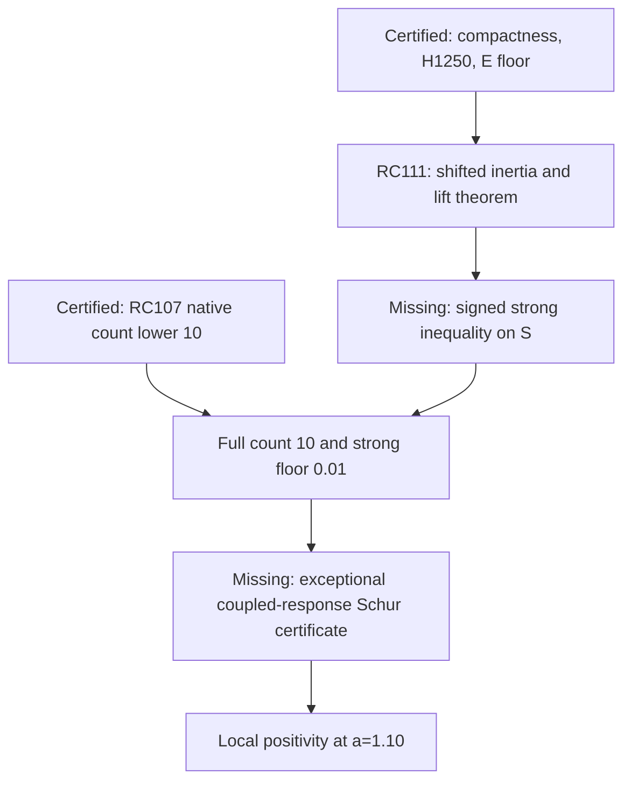

# RPB108 — RC111: Structural spectral coverage and strong-floor investigation

Aperture **a=1.10**. Starting checkpoint RC110, commit
`fa733de785d073c0e26a45bdd86987af64bcc8d0`.
Branch: `research/rpb108-route-consolidation`.

## Result and scope

RC111 proves a threshold-dependent coverage and completion theorem, gives exact rational controls, and quantifies an obstruction to the inherited absolute-norm architecture. It adds no native directions and evaluates no new arithmetic entries. **The arithmetic strong-floor hypothesis is not yet certified.** Thus this checkpoint does not determine the complete original exceptional spectrum, extend local positivity, settle Global/F4, or imply RH.

The strongest justified route is **shifted Feshbach/inertia reduction with correlated Galerkin lifts**, retaining the rank-1,250 head as an auxiliary proof cutoff. Its missing input is one signed coercivity estimate on the omitted strong head; a dense 1,250-by-1,250 evaluation is not a hypothesis of the theorem.

## Objects and inherited facts

All orthogonality, adjoints, projection norms, and operator inequalities below use the actual canonical metric. In coordinates with basis J, the metric is M=J*J; thresholds subtract tM, never a physical mass matrix or an unverified identity matrix.

Let A=A_Q=I+i*Ki on the canonical Hilbert space, H the original rank-1,250 Riesz head, E=H-perp, and

\[
 A=\begin{pmatrix}A_H&B\\B^*&D\end{pmatrix},\qquad
 \alpha I\preceq D\preceq bI,\quad \alpha=247/2500.
\]

RC77 gives compactness of i, hence of i*Ki. The spectrum below 1 consists of discrete finite-multiplicity eigenvalues with possible accumulation only at 1. RC95 supplies the tail norm on E. RC103 supplies b=4.135066 even and 3.239591 odd, an inverse polynomial, and the lifted-response identity. RC105 pays inexact actions; RC106 retains correlated lift forms and residual Grams.

N is the actual 22-feature native Riesz subspace, contained in H. RC107 proves positivity of the entire original N compression and exactly five compression eigenvalues below 0.01 per parity. Min-max therefore gives **at least ten original eigenvalues below 0.01**. The E floor gives the inherited upper bound 1,250 at this threshold. RC110 proves a twelve-dimensional native span, together with its complete coupling to E, uniformly positive; the original nonpositive index is at most 1,238. This does not improve the count below the much larger threshold 0.01: the certified positive floor is extremely small.

These objects must remain distinct:

| Object | Certified information | Coverage limitation |
|---|---|---|
| N compression of A | Positive; five eigenvalues below 0.01 per parity | Omits H minus N and E coupling |
| Full original A | Compact perturbation; E floor; original low-count lower bound | Additional low modes in omitted head remain possible |
| F=A_H-BD^-1B* | Exact zero-threshold Schur form | Its eigenvalues and eigenvectors are not those of A |
| Rational Ritz candidates | Actual canonical Gram and full-action residual enclosures | Residual inclusion does not exclude unseen modes; overlapping inclusions do not count distinct modes |
| RC110 positive span | Positive after E coupling | Not asserted invariant or a complete spectral subspace |

## Theorem 1: threshold Feshbach coverage

Fix 0<t<alpha. Set

\[
 F_t=A_H-tI_H-B(D-tI_E)^{-1}B^*.
\]

Then the number of original eigenvalues strictly below t, counting multiplicity, is

\[
 n_-(A-tI)=n_-(F_t).
\]

Indeed, with L=(D-tI)^-1 B*, the original shifted quadratic form equals

\[
 \langle h,F_th\rangle_c+
 \langle e+Lh,(D-tI)(e+Lh)\rangle_c.
\]

The bounded invertible triangular change (h,e) -> (h,e+Lh) preserves maximal negative-subspace dimension. The second block is strictly positive. This proves the identity in the infinite Hilbert space without asserting a similarity or equality of spectra. Compactness identifies the negative index with the discrete spectral count.

Choose any explicitly controlled W contained in H, let S=H orthogonally minus W, and let B_S=P_S B. If

\[
 \boxed{P_SF_tP_S\succeq0,}
\tag{C_t}
\]

then

\[
 \boxed{\langle x,Ax\rangle_c\ge t\|x\|_c^2\quad(x\perp W).}
\]

For x=s+e in S plus E, apply the displayed square completion with h=s. Thus all eigenvalues below t are accounted for by at most dim W exceptional dimensions; W need not be invariant. If dim W=10 and RC107's ten-mode lower count is used at t=0.01, the **full count is exactly ten**. The ten-dimensional spectral subspace range 1_{(-infinity,t)}(A) then exists and its canonical orthogonal complement has floor t. It is not automatically the rational candidate span W.

The theorem provides the requested stopping rule. Establishing C_t on the actual operator, including all errors, would end the search for further modes below t. It does not prove positivity of the exceptional block.

### Why the unshifted head cannot be substituted

For F=A_H-BD^-1B*, functional calculus gives

\[
 F-tI-\frac{t}{\alpha(\alpha-t)}BB^*
 \preceq F_t\preceq F-tI.
\tag{1}
\]

The difference is t B D^-1(D-tI)^-1 B*. In nonorthonormal coordinates replace I by the canonical Gram matrix. In particular n_-(F-tI) is only a lower bound on the original count. The validator exhibits a strict rational counterexample: D=1, B=1/10, A_H=201/10000, t=1/100. Here F-t is positive, whereas F_t is negative. The original operator has a mode below t. No equality of the original and effective exceptional subspaces is licensed.

An alternative sufficient estimate is P_S F P_S >= delta I with

\[
 \delta\ge t+\frac{t g_S}{\alpha(\alpha-t)},\qquad B_SB_S^*\preceq g_S I.
\]

It may be far less sharp than evaluating the correlated shifted form.

## Theorem 2: correlated threshold lifts and count enclosures

For any canonical head map J, R=B*J, and approximate lift Y with range E, define

\[
 r=R-(D-tI)Y,
\]
\[
 C_t=J^*(A_H-tI)J-R^*Y-Y^*R+Y^*(D-tI)Y.
\]

Exact square completion yields

\[
 J^*F_tJ=C_t-r^*(D-tI)^{-1}r.
\]

Therefore, if certified actual-metric enclosures satisfy C_lo <= C_t <= C_hi and 0 <= r*r <= G, then

\[
 C_{lo}-G/(\alpha-t)\preceq J^*F_tJ\preceq C_{hi}.
\tag{2}
\]

If a certified residual Gram lower bound G_lo is available, the upper endpoint improves to C_hi-G_lo/(b-t). Signed mixed entries in C_t are retained; an entrywise absolute replacement would lose the intended correlation.

With J spanning the entire H, endpoint inertias satisfy n_-(upper) <= n_-(F_t) <= n_-(lower). Matching finite negative counts, with nonsingular endpoint matrices, give a complete original count and exclude a threshold null. With J spanning only S, a positive semidefinite lower endpoint suffices for C_t and original coverage. An analytic operator inequality on S is equally acceptable: equation (2) does not demand dense finite matrices.

RC103's Chebyshev method applies to the positive interval [alpha-t,b-t]; RC105's recurrence and action-error propagation must be recalibrated to this shifted interval. Existing zero-threshold degree budgets cannot silently be reused. RC106 supplies the zero-threshold version of (2). RC111's validator checks the shifted identity, both inverse endpoints, inertia transfer, and threshold metric on noncommuting exact rational blocks with a nonidentity canonical Gram. These are algebraic controls, not arithmetic Weil lifts.

## Theorem 3: compact negative-part counting

Since bounded K is self-adjoint, let K=K_+-K_- be its positive/negative-part decomposition and T=K_-^(1/2)i. Then

\[
 A\succeq I-T^*T,\qquad
 n_-(A-tI)\le\#\{s_j(T)>\sqrt{1-t}\}.
\]

Proof: any negative subspace of A-t is negative for (1-t)I-T*T; compact singular-value min-max gives the bound. If a rank-r approximation T_r satisfies ||T-T_r|| <= eta and eta^2 <= 1-t, then A >= t on ker T_r, a subspace of codimension at most r. Its orthogonal complement is an explicit exceptional space if T_r is explicit.

A weaker version takes ||K|| <= kappa and a rank-r approximation i_r with tail tau: A >= 1-kappa tau^2 on ker i_r. The inherited canonical tail on E can be used by setting i_r=i P_H; it is not a bound for an arbitrary physical polynomial projection. Rank means actual operator rank, with canonical domain norm and physical codomain norm.

This negative-part theorem is a genuine dense-head-free reduction, but K_- has not been evaluated or bounded sharply enough in the inherited arithmetic. It does not identify a small count from compactness alone.

## Structural routes and actual input costs

| Route | Exact additional hypothesis | Arithmetic/operator input | Assessment and cost |
|---|---|---|---|
| Compact/approximation count | Rank-r negative-part weighted embedding approximation with squared tail <=1-t | Certified signed K_- or a dominating compact positive operator | Can avoid all head entries; current absolute K envelope fails even at 1,250 |
| Galerkin exclusion | Floor d>t on the entire omitted complement and signed residual Gram on retained modes | Full residuals plus complementary coercivity | Ritz residuals alone insufficient; small matrices after a structural floor |
| Shifted inertia reduction | C_t on explicit S, or matching full F_t endpoint inertias | Signed strong form and inverse/lift residual estimates | Selected route: inherited E floor and lift machinery already available; matrix-free structural estimate permitted |
| Source coercivity | Direct signed lower inequality on W-perp or S | Prime translations with exact support, archimedean multiplier and rank-two pole correlations | Potentially highest payoff, presently no complete signed inequality; can provide the missing C_t estimate |

For the direct Galerkin version let U be an isometric canonical basis of N, Q=U*AU, C=P_(N-perp)AU and D_N=P_(N-perp)A|_(N-perp). If D_N>=dI>t and C*C<=G, then

\[
 n_-(Q-tI)\le n_-(A-tI)\le n_-(Q-tI-G/(d-t)).
\]

Equal endpoints transfer the census. For a nonorthonormal basis replace tI by tM and use the corresponding coupling Gram. The missing d concerns **all** N-perp, not E alone. RC107's action residuals bound C, but do not supply d. An individual residual smallness condition cannot rule out an orthogonal mode invisible to every Ritz vector.

## Quantitative obstruction to current generic enclosures

Using exactly RC95's tail and RC66's parity norm enclosures, the absolute-K floor 1-kappa tau_1250^2 is:

| Parity | Generic floor lower | Generic ||B||^2 upper | Effective floor sufficient for t=0.01 via (1) |
|---|---:|---:|---:|
| Even | -2.1350652565 | 47.3543641331 | 53.9846828303 |
| Odd | -1.2395906912 | 24.1659652424 | 27.5544583224 |

All exact fractions are in the JSON. The last column is an overly conservative sufficient budget, not a required true strong floor. It uses g=rho tau^2 kappa^2, rho=252/257. This establishes that **these inherited absolute-norm enclosures cannot certify a positive complement floor by this architecture**. It does not establish negativity or excessive true coupling. RC107's small compression directions also make these sufficient budgets unrealistic for the intended small W. Signed correlations, tighter restricted coupling, or a different structural factorization are needed.

### Rigorous information obstruction

The validator constructs compact-perturbation diagonal controls with the same 22-coordinate native compression and full action on that native space, the same E floor, and the same twelve-coordinate positive native space plus E. Ten native compression eigenvalues lie below t; the remaining twelve are above t. The omitted 1,228 head coordinates can contain m additional negative modes, for m=0,1,12,1,228, without changing those observations. The full count becomes 10+m. Infinite tails are identity; compactness is preserved. These models are explicitly **not the original arithmetic Weil operator** and do not claim to reproduce its source identities or all norm enclosures.

More generally, for z in H orthogonal to N, replacing an operator by A-lambda(z tensor z) preserves AN, the complete N compression, D, and every quadratic form on N plus E, while creating a low-Rayleigh direction for large lambda. The alteration is finite rank, so compact perturbation structure is preserved. It need not preserve the fixed arithmetic K or its inherited norm bounds. This proves the logical gap in using the finite census, native action data, positive native spans and E floor alone as an exclusion theorem. A new inequality that tests omitted head directions is indispensable.

## Coverage to positivity: remaining coupled-response obligation

If C_t is certified for a ten-dimensional W, write the original operator on W plus V, V=W-perp, as

\[
 A=\begin{pmatrix}A_W&C\\C^*&D_V\end{pmatrix},\qquad D_V\succeq tI.
\]

A sufficient completion condition is A_W-C D_V^-1 C* >0; the simpler correlated matrix bound A_W-G_W/t >0, C C* <= G_W, also suffices. These are actual canonical forms, not just finite compression positivity.

Alternatively, for zero-threshold effective F on H=W plus S, establish F_S>=beta I>0 and an actual exceptional lift lower form L_W>0. With R_W=B*J_W and Y_W in E, set r_W=R_W-DY_W and

\[
 L_W\preceq C_W-r_W^*r_W/\alpha.
\]

The exact strong response is

\[
 P_SFJ_W=P_S A(J_W-Y_W)-P_SB D^{-1}r_W.
\]

Certify a Gram upper bound G_response for this full sum, retaining signed correlation where available, then verify

\[
 \boxed{L_W-G_{response}/\beta\succ0.}
\]

Schur completion proves F>0 and hence A>0. RC103–106 provide the analytic inverse and error framework, not the actual response Gram. Every projection, metric, source, arithmetic quadrature, truncation and inexact-action error must appear in these enclosures. A lower-endpoint failure alone indicates an enclosure failure; an actual low direction requires a certified Rayleigh upper bound, and an actual negative direction requires that upper bound to be negative.

If only a positive effective strong floor beta is proved, without the shifted t estimate, it still yields an original strong floor on W-perp. With g_S >= ||B_S||^2, square completion and
||s||^2+||e||^2 <= max(2,1+2g_S/alpha^2)(||s||^2+||e+D^-1B_S*s||^2)
give

\[
 A|_{W^\perp}\succeq
 \frac{\min(\beta,\alpha)}{\max(2,1+2g_S/\alpha^2)}I.
\]

This is a valid positive stopping threshold, possibly smaller than 0.01. It transfers coercivity, not spectral subspaces.

## Minimal next estimate and dependency graph

For the chosen ten rational RC107 candidates define W as their actual canonical span and S=H orthogonally minus W. The **single minimal operator estimate for this proposed coverage route** is

\[
 P_S\bigl[A_H-0.01I-B(D-0.01I)^{-1}B^*\bigr]P_S\succeq0.
\]

It directly certifies original strong floor 0.01 and, together with the inherited lower count, exact count ten. A sufficient concrete replacement is the lower endpoint C_lo-G/(alpha-0.01)>=0 from theorem 2 for S, proved structurally or by certified operator approximations. No new weak-mode integral alone supplies this estimate. If this target is too strong, a positive unshifted F_S floor still gives an explicit original strong floor by the previous formula; the resulting count need not be ten.



RC110's twelve-mode result remains certified and independent supporting data. Global/F4 continuation is a separate obligation beyond this local graph. RH is not claimed. If the proposed strong inequality has a negative lower enclosure, classify it as an enclosure obstruction until an actual direction or count is certified. Compactness alone, another finite census, or adding one more positive native direction is not a stopping rule.

## Reproduction and status labels

The script consumes certificates in this exact order: RC110, RC107, RC106, RC103, RC95, RC77, RC66. It checks inherited SHA-256 dependencies, exact rational envelope budgets, two-stage signed Schur positivity, nonidentity canonical metric threshold elimination, shifted lift endpoints, a strict counterexample to unshifted threshold counting, and the invisible-mode controls. `--replay --output CERT` uses independent determinant-ratio inertia and compares the complete JSON with the saved certificate.

```bash
python scripts/validate_rpb108_rc111_structural_spectral_coverage.py \
 --output certificates/rpb108_rc111_structural_spectral_coverage.json \
 certificates/rpb108_rc110_odd_exceptional_pair_closure.json \
 certificates/rpb108_rc107_original_compression_spectral_census.json \
 certificates/rpb108_rc106_correlated_effective_head_sandwich.json \
 certificates/rpb108_rc103_complement_inverse_lift.json \
 certificates/rpb108_rc95_jump_aware_even_source_tail.json \
 certificates/rpb108_rc77_canonical_adjoint_tail.json \
 certificates/rpb108_rc66_arch_multiplier_transport.json
```

Repeat with `--replay` and the same output and inputs. The script directory supplies inherited helper modules. No floating-point eigenvalue decision is used. Decimal values in the table are display approximations of the exact certificate fractions.

**Certified:** inherited results, the analytic theorems proved here, exact algebraic controls and inherited-envelope obstruction. **Conditional:** original strong floor, exact original count ten, and exceptional-block completion. **Exploratory:** choosing the ten rational candidates as W. **Unsupported:** exhaustiveness of those candidates, any true negative original direction inferred from a failed enclosure, or a new arithmetic factorization without a proof.
