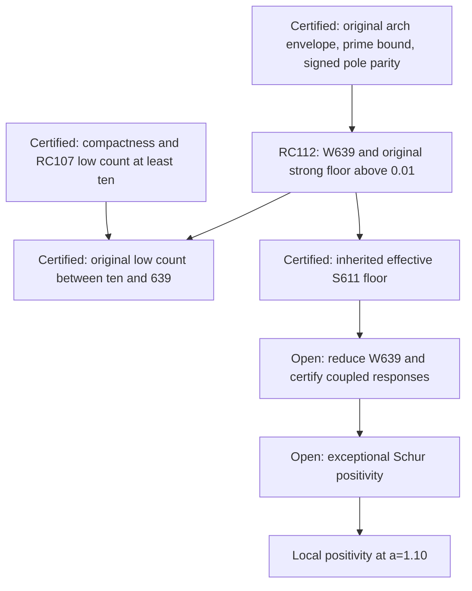

# RPB108 — RC112: parity spectral coverage and a certified strong floor

Aperture a=1.10. Parent RC111: `fe3bb886c48a64fac6356134fee83fc6415ac69d`.
Branch: `research/rpb108-route-consolidation`. No Lean or unrelated branch changes.

## Certified result

For the full original Weil operator A_Q, define W by actual canonical Riesz representatives of these native Chebyshev moments:

- Even degrees 0,2,...,494: 248 dimensions.
- Odd degrees 1,3,...,781: 391 dimensions.

Then dim W=639, and the entire canonical orthogonal complement satisfies

\[
 \boxed{\langle x,A_Qx\rangle_c\ge
 \frac{5001251}{500000000}\|x\|_c^2
 =0.010002502\|x\|_c^2\qquad(x\perp W).}
\tag{1}
\]

This is a **global lower bound outside an explicit finite subspace**, with no evaluation of the complete 1,250-feature head. It satisfies the coverage stopping criterion in the second sense requested for RC111: every dangerous direction is controlled by an exceptional subspace of bounded dimension. It does not identify 639 eigenvectors or claim that all 639 dimensions are genuinely exceptional.

RC107 supplies at least ten original eigenvalues below 0.01. Equation (1) gives

\[
 \boxed{10\le N_{A_Q}(0.01)\le639,}
\]

including multiplicities. Per parity: 5 <= N_even(0.01) <=248 and 5 <= N_odd(0.01) <=391. There are at most 629 additional low modes beyond the ten forced by the native census. The nonpositive index is at most 639, improving RC110's inherited 1,238 upper bound. The exact count and exceptional-block positivity remain open.

There is also a certified **611-dimensional strong subspace** of the inherited rank-1,250 effective head, with the same positive floor. This follows from the original inequality, not from an interchange of spectral subspaces.

## Why parity changes the budget

RC42 gives the exact physical pole remainder

\[
 K_{pole}=2|\cosh(x/2)\rangle\langle\cosh(x/2)|
          -2|\sinh(x/2)\rangle\langle\sinh(x/2)|.
\]

For an even physical vector the sinh pairing vanishes exactly. Its pole contribution is nonnegative and may be dropped in a lower bound. For an odd vector the cosh pairing vanishes; the entire negative contribution is bounded by 2||sinh(x/2)||_2^2 times the physical squared norm.

The paired prime translations commute with reflection. The archimedean multiplier and canonical Fourier weight are even. Thus the actual canonical even and odd subspaces are orthogonal, reduce A_Q, and their form cross term vanishes. This remains true for complex-valued vectors. Reflection commutes with the canonical Riesz map, so native even/odd moment representatives have the stated parity.

Using the exact outward RC43 prime operator bound and RC42 negative-pole bound, set

\[
 k_e=k_{prime}=4.10314831633822\ldots,
 \qquad k_o=k_{prime}+2\|\sinh(x/2)\|_2^2
       =4.57444325658822\ldots .
\]

These are **physical** negative allowances. They are not canonical norm bounds substituted into a physical Fourier integrand. The positive pole term is retained in the actual original operator; dropping it is solely a valid one-sided form estimate. No reference Weil operator replaces A_Q.

## Source-structured concentration theorem

Write B=11/10, w(xi)=log(e+|xi|), and J_T x=Fourier(i x) restricted to (-T,T). RC19's inherited actual archimedean lower envelopes, as used in RC44, are

\[
 a_{arch}(\xi)\ge-31/5,\qquad
 a_{arch}(\xi)\ge\log |\xi|-1/|\xi|
 \quad(\pi|\xi|\ge1/4).
\]

No new special-function claim is assumed. The original coefficients are pinned to the source blob inherited by RC44 and recorded in this certificate.

For parity p choose L>0, T=exp L, reference floor a_p>0, and physical negative allowance k_p. Let certified rational endpoints satisfy T_lo<T<T_hi, with T_lo>60. If

\[
 R_p=(1-a_p)L-k_p-(1+3a_p)/T_{lo}>0,
\]

then on |xi|>=T the physical multiplier minus k_p and minus a_p w is nonnegative. Indeed w(x)<=log x+3/x and the resulting lower function (1-a_p)log x-k_p-(1+3a_p)/x is increasing. On |xi|<=T, e+T<eT, so w<L+1. Consequently, with

\[
 p_p=31/5+k_p+a_p(L+1),
\]

the complete original form satisfies the operator inequality on that parity

\[
 A_Q\succeq a_p I-p_p J_T^*J_T.
\tag{2}
\]

The form inequality follows on the smooth supported core and extends by the inherited canonical form continuity to the complete carrier. It uses the original signed pole identity and an entire prime-operator norm estimate; it pays all prime contributions collectively. No prime, pole or archimedean source cross covariance is replaced by an unverified computed matrix.

RC22's radius-two Laurent-contour approximation X_n of the Fourier kernel gives

\[
 \|J_T-X_n\|\le8\sqrt{BT}
 \exp\left(\frac34(2\pi BT)-n\log2\right).
\]

This is the full operator from the canonical carrier into physical frequency L2, using ||i||<=1. Using the sharper inherited rho is unnecessary. X_n factors through the native moments of degrees 0,...,n-1. On the even subspace only its even moments occur, and on the odd subspace only its odd moments occur. Orthogonality to their **actual canonical Riesz representatives** annihilates these moments exactly; no polynomial approximation of a Riesz vector is substituted.

With log2>693/1000, pi<22/7, and

\[
 g_p=n_p(693/1000)-\tfrac34(44/7)BT_{hi}>0,
\]

we have

\[
 \|J_Tx\|_2^2\le\delta_p^2\|x\|_c^2,
 \qquad \delta_p^2\le64BT_{hi}/E_{100}(2g_p),
\]

where E_100(y)=sum_{j=0}^{100} y^j/j! <=exp y. Thus (2) proves the original parity floor a_p-p_p delta_p^2 outside its parity moment span. The ranks of these spans follow from independence of distinct polynomial moment functionals on the smooth supported core; this makes no conditioning assertion.

This proves the concentration theorem. It is a source-structured coercivity argument using actual arithmetic bounds, with an explicit Fourier approximation-number budget. Dense head entries, individual Ritz residuals, and full source response reconstruction are not hypotheses.

## Exact accepted budgets

| Quantity | Even | Odd |
|---|---:|---:|
| L | 4.161 | 4.632 |
| Reference floor a_p | 0.010042 | 0.010258 |
| Chebyshev truncation length n_p | 495 | 783 |
| Retained parity moments | 248 | 391 |
| Largest native degree | 494 | 781 |
| High multiplier reserve, approximately | 0.00000524012 | 0.00000682512 |
| Accepted original complement floor | 0.010002502 | 0.010078155 |

Every accepted value and outward approximation error is recorded as an exact fraction in the JSON. The common floor is the smaller of the two parity floors. The proof needs the strict positive reserves, not sampled multiplier values. The cutoff choices were proposed by exploratory numerical budgeting; **no claim of optimality or a minimal feature count is made**. Acceptance and the displayed count bounds are entirely exact rational decisions.

The error budget here has no numerical projection or head-metric error: orthogonality to actual Riesz representatives annihilates the defining moments by identity. The arithmetic prime/pole norm errors are inherited outward bounds; exponential cutoffs, contour tails, and acceptance floors are enclosed exactly. Approximate trial Riesz vectors are not used in this coverage proof.

The native parity head W is contained in the inherited H1250, because its largest degree is 781<1250. Its metric and head entries have not been constructed. This does not impair the proof of its rank or the complement operator inequality.

## Transfer to the inherited effective head: a genuine strong floor

Retain the original RC103 decomposition, without changing its complement:

\[
 A_Q=\begin{pmatrix}A_H&B\\B^*&D\end{pmatrix},
 \quad H=H_{1250},\quad E=H^\perp,
 \quad D\succeq\alpha I,\quad\alpha=247/2500.
\]

Set S=H canonically orthogonal minus W. Then

\[
 \dim S=1250-639=611
 \quad(377\text{ even},\;234\text{ odd}),
\]

and W-perp=S plus E. For s in S and e in E, (1) bounds the original quadratic form by beta(||s||_c^2+||e||_c^2), where beta=0.010002502. Taking the minimum over e, attained at e=-D^-1B*s, gives

\[
 \boxed{P_SFP_S\succeq\beta P_S,\qquad
 F=A_H-BD^{-1}B^*.}
\tag{3}
\]

Likewise, at t=0.01, minimizing the shifted original form over e gives

\[
 \boxed{P_SF_tP_S\succeq(\beta-t)P_S,
 \quad F_t=A_H-tI-B(D-tI)^{-1}B^*.}
\tag{4}
\]

The parity-specific floors may be retained instead of their common minimum. These are actual effective **compression** inequalities; no equality between original and effective eigenvalues or spectral subspaces is asserted. In particular, the new effective strong floor applies to S611, **not** to the complement of the ten RC107 candidates or to the complement of the twelve RC110 positive directions.

Equations (3) and (4) instantiate RC111's structural hypotheses for W639. Thus 1,250 is now an auxiliary cutoff for this route, with 611 strong dimensions controlled analytically. All previously certified rank-1,250 statements, including its much larger infinite-complement floor and RC110's coupled twelve-mode positivity, remain in force.

## Remaining coupled block and inverse choice

Writing F on W plus S, equation (3) gives the exact remaining Schur obligation

\[
 \boxed{F_W-F_{WS}F_S^{-1}F_{SW}\succ0.}
\tag{5}
\]

A sufficient certified matrix inequality is L_W-G_response/beta>0, where L_W <= J_W*FJ_W and G_response >= (P_SFJ_W)*(P_SFJ_W), in the actual canonical metric. It can be blockwise or operator-structured; a dense 639-by-639 matrix is not logically mandatory. RC103–106 give the exact original E inverse, approximate lifts, inexact-action recurrence, and correlated residual sandwich for constructing these bounds.

For R=B*J_W, any Y in E and r=R-DY,

\[
 J_W^*FJ_W=C_Y-r^*D^{-1}r,
 \quad P_SFJ_W=P_SA(J_W-Y)-P_SB D^{-1}r.
\]

All source, projection, metric, arithmetic quadrature, truncation and action errors must be paid before (5) is accepted. This checkpoint computes none of those exceptional responses. Positive finite compressions and a certified strong block do not by themselves prove coupled positivity.

One could instead replace the head by W639 and eliminate E639=W-perp directly. That gives a **different** exact effective operator and an infinite-complement floor only beta rather than alpha. For threshold 0.01 its certified shifted gap is merely beta-0.01=0.000002502. A safe complement upper bound comes from 1+rho||K|| and is recorded in the JSON. The old RC103 upper endpoints, Chebyshev degrees, and RC105 action budgets do not automatically transfer to this enlarged complement.

For that reason, retaining the original better-conditioned E1250 inverse while using the analytic S611 floor is the natural next response route. Nothing in RC112 requires discarding the old complement machinery.

## What remains for a smaller exceptional census

The ten rational native candidates lie in W639 but are not proved exhaustive. To transfer the exact count ten to the full operator, an additional signed exclusion estimate is required on the **629-dimensional remainder within W639**, after coupling to S611 and E1250. Equivalently, directly certify RC111's shifted inequality on H1250 orthogonal minus the ten-candidate span. RC112 has supplied its outer 611-dimensional strong part, not the remaining 629-dimensional block or the cross coupling between these parts.

This is a finite count upper bound and a stopping rule for directions outside W639. It is not a complete count of ten, nor an enlargement from twelve to thirteen individually certified positive native vectors. Lower-enclosure failure in the remaining block would still not establish an actual negative original direction.



Global/F4 continuation remains separate; RH is not claimed. No Lean front is changed.

## Reproduction and evidence boundary

Files:

- `scripts/validate_rpb108_rc112_parity_spectral_coverage.py`
- `certificates/rpb108_rc112_parity_spectral_coverage.json`
- This note.

Inputs in order: RC111, RC107, RC44, RC43, RC42, RC66. The validator checks the parent and arithmetic SHA-256 dependencies, parity budgets, strict high-frequency reserves, full Fourier residual budgets, exact dimensions, and inherited census lower counts. The analytic parity and concentration proofs are given above; the script does not formalize them in Lean.

```bash
python scripts/validate_rpb108_rc112_parity_spectral_coverage.py \
 --output certificates/rpb108_rc112_parity_spectral_coverage.json \
 certificates/rpb108_rc111_structural_spectral_coverage.json \
 certificates/rpb108_rc107_original_compression_spectral_census.json \
 certificates/rpb108_rc44_reduced_native_head.json \
 certificates/rpb108_rc43_native_prime_head.json \
 certificates/rpb108_rc42_native_signed_pole_head.json \
 certificates/rpb108_rc66_arch_multiplier_transport.json
```

Repeat with `--replay`. Replay replaces Taylor summation by Horner evaluation, verifies an independent convolution identity, and compares the complete certificate exactly. Taylor upper remainders use a rational geometric tail. No floating-point value is used in acceptance.

**Certified:** explicit W639, original complement floor, global low-count bounds, inherited effective S611 floors, preservation of earlier results. **Conditional:** exceptional response bounds and positivity via (5). **Exploratory:** cutoff selection and the hope of further signed compression within W639. **Unsupported:** exact count ten, minimum possible rank 639, identification of W with an invariant spectral subspace, or local/global positivity from this certificate alone.
