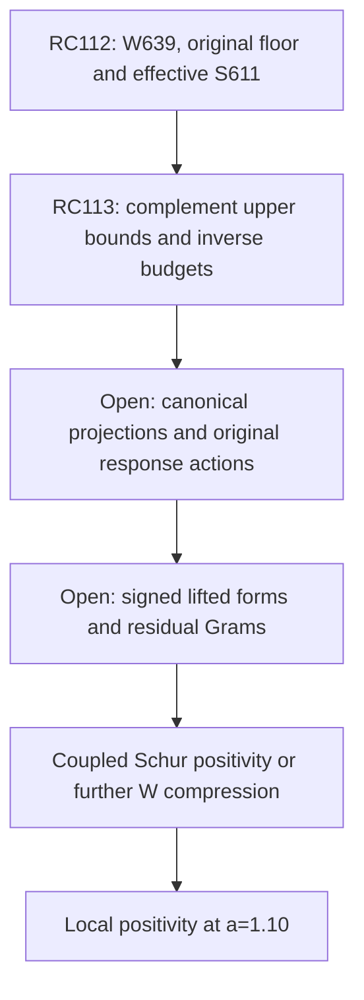

# RPB108 — RC113: covered-complement inverse and coupled Schur route

Aperture a=1.10. Parent RC112: `ed2e51cf176250e1f224caae3f1d7e89991ee124`.
Branch: `research/rpb108-route-consolidation`. Lean and unrelated branches unchanged.

## Outcome

RC113 establishes sharper actual canonical embedding and upper operator bounds on RC112's entire covered complement. Combined with the certified positive floors, these give an explicit polynomial inverse with paid inexact-action budgets for the original 639-head complement. It also proves the equivalence of direct and nested Schur reductions and the correlated nested residual identity.

This is a quantitative computational reduction. **No actual 639-head projection, arithmetic response, or coupled head matrix has been evaluated.** The original count below 0.01 remains 10–639. The exact count ten, coupled exceptional positivity, whole-aperture positivity, Global/F4 and RH remain open.

## Operators, metrics and retained certification

Let W=W639 be RC112's actual canonical moment span (248 even, 391 odd). Let V=W-perp, C=P_V A_Q|_V, and R=P_V A_Q J, where J maps head coordinates into W with actual canonical Gram M=J*J. Original block notation is

\[
 A_Q=\begin{pmatrix}Q&R^*\\R&C\end{pmatrix},
 \qquad Q=J^*A_QJ
\]

in head coordinates; all scalar multiples on that coordinate space mean multiples of M, not an unverified identity or physical mass matrix.

RC112 proves C>=a_p I in each parity, with a_e=0.010002502 and a_o=0.010078155. W is not asserted invariant. RC77 compactness and RC107's full-operator lower count remain inherited. The older decomposition H1250 plus E1250 remains available with D>=alpha I, alpha=247/2500. Its exact effective head F=A_H-BD^-1B* is distinct from the direct effective head on W constructed below. RC110's twelve-mode positivity remains certified for its **original** complement E1250.

## New theorem: canonical embedding on the covered complement

Fix one parity and its RC112 cutoff T=exp L, L>1. For x in V, RC112 gives

\[
 m_{lo}:=\int_{|\xi|<T}|\widehat{ix}(\xi)|^2d\xi
 \le\delta^2\|x\|_c^2.
\]

Let E_lo and E_hi be the low and high canonical weighted energies. The canonical weight w=log(e+|xi|) obeys w>=1 everywhere and w>=L in the high band. Consequently,

\[
 \|ix\|_2^2\le m_{lo}+E_{hi}/L
 \le \|x\|_c^2/L+(1-1/L)m_{lo}.
\]

It follows that

\[
 \boxed{\|i|_V\|^2\le\sigma_p^2
 :=1/L_p+(1-1/L_p)\delta_p^2.}
\tag{1}
\]

This is an inequality on the full actual canonical complement, not a finite trial embedding or physical polynomial projection. The proof uses exact moment annihilation and the entire Fourier tail. RC112's squared tail includes the complete contour approximation error; no numerical projection error occurs in (1).

Using A_Q=I+i*Ki and the inherited parity norms ||K||<=kappa_p gives

\[
 a_pI\preceq C_p\preceq b_pI,
 \qquad b_p\ge1+\kappa_p\sigma_p^2.
\tag{2}
\]

The identity part has zero W–V coupling. The global inclusion norm bound ||i||^2<=rho=252/257 therefore yields

\[
 \boxed{R^*R\preceq g_p M,
 \qquad g_p\ge\rho\sigma_p^2\kappa_p^2.}
\tag{3}
\]

These are genuine operator enclosures. The bound g_p is conservative and is **not** a measurement of the actual signed coupling covariance.

With S=H1250 canonically orthogonal minus W, the inherited effective compression F_S satisfies a_p I<=F_S<=b_p I as well: its lower bound is RC112, while F_S<=A_SS<=1+kappa_p sigma_p^2. This transfers inequalities only; no equality of original and effective spectra is claimed.

## Certified interval data

| Quantity | Even | Odd |
|---|---:|---:|
| Rounded embedding squared upper | about 0.240329742191 | about 0.215902482955 |
| Original complement lower a_p | 0.010002502 | 0.010078155 |
| Original complement upper b_p | 4.702146 | 3.375887 |
| Generic coupling squared upper g_p | about 55.919972811347 | about 25.636645913478 |
| b_p/a_p | about 470.097 | about 334.971 |
| (b_p-0.01)/(a_p-0.01) | about 1,875,358 | about 43,067 |

The certificate contains exact fractions and outward rounding. The last row explains a substantial difference in numerical targets: solving the complement at zero for positivity is far better conditioned than eliminating it at threshold 0.01 for an exact low-count census. Threshold counting still requires C-0.01I, not C, and not an unshifted effective head minus 0.01M. The tiny shifted gaps are certified lower endpoints, not measured spectral gaps.

## Uniform polynomial inverse and action contract

For either C_p or F_S,p on the interval [a_p,b_p], set c=(b+a)/(b-a)>1 and

\[
 p_n(x)=\frac{T_n((b+a-2x)/(b-a))}{T_n(c)},
 \qquad q_{n-1}(x)=\frac{1-p_n(x)}x.
\]

Then

\[
 \|I-Cq(C)\|\le\epsilon_n=1/T_n(c),
 \qquad\|C^{-1}-q(C)\|\le\epsilon_n/a.
\]

For Y=q(C)R, r=R-CY has r*r<=epsilon_n^2 R*R. RC105's scaled recurrence carries total local errors E_j with E_j*E_j<=eta^2 G, G>=R*R. Its lift error amplification obeys

\[
 H_n=\sum_{j=1}^n(n-j+1)T_j(c)/T_n(c)
 \le n(n+1)/2=:H.
\]

Choosing eta=epsilon/(bH), where epsilon is an outward upper bound on epsilon_n, gives the implemented residual contract

\[
 \widehat r^*\widehat r\preceq4\epsilon^2G.
\]

Each E_j includes the complete action, arithmetic, source, projection and recurrence error. This is a requirement for an implementation, not a verified action here. All lifts are mathematically projected into V. An approximate physical vector with unaccounted leakage into W cannot be substituted in the exact inverse identity; final range projection and its errors must be enclosed.

Using G=g_p M, the residual correction is bounded by

\[
 \widehat r^*C^{-1}\widehat r
 \preceq(4\epsilon^2g_p/a_p)M.
\tag{4}
\]

The exact accepted budgets are:

| Residual correction allowance relative to actual M | Even residual degree | Odd residual degree |
|---|---:|---:|
| 10^-6 | 137 | 112 |
| 10^-12 | 212 | 175 |
| 10^-24 | 362 | 302 |

The inverse polynomial has degree one less. A recurrence needs n-1 compressed operator actions plus an action to evaluate the final residual. These counts are **per response vector or response block**, under the action contract. They do not include the cost of constructing sources, applying certified canonical projections, or enclosing the lifted form. They are not total runtime predictions or proofs that the resulting head is positive.

The JSON records every per-step eta, conservative amplification H, outward epsilon and correction coefficient. Degree minimality is only for the specified conservative enclosure and outward epsilon grid; it is not a claim of an optimal inverse algorithm. A 10^-24 residual allowance is a numerical target; no actual exceptional-head margin at that scale has been proved. Matrix-valued actual R*R can replace generic gM and reduce these budgets, especially on weak directions.

## Direct coupled-head certificate with signed correlations

For any lift Y with range V, including an inexact one, set

\[
 r=R-CY,
 \qquad L_Y=Q-R^*Y-Y^*R+Y^*CY.
\]

The exact direct effective head is

\[
 \boxed{K_W=Q-R^*C^{-1}R=L_Y-r^*C^{-1}r.}
\tag{5}
\]

Thus certified actual-metric enclosures L_lo<=L_Y<=L_hi and G_lo<=r*r<=G_hi give

\[
 L_{lo}-G_{hi}/a\preceq K_W
 \preceq L_{hi}-G_{lo}/b.
\tag{6}
\]

With no residual lower bound, use G_lo=0. All mixed signs in L_Y and residual Grams must be retained or enclosed rigorously. The canonical form L_Y is evaluated on J-Y, including the original source contributions and their correlations. Projection and metric errors are separate from the residual correction in (4); they cannot be charged to it without proof.

A positive definite lower endpoint in (6) certifies K_W>0 and, by the C floor, whole-domain original positivity at a=1.10. A negative Rayleigh upper endpoint can certify an actual negative original direction after lifting. Failure of the lower endpoint alone certifies neither negativity nor a null.

This gives a concrete response target replacing a scalar global leakage budget. A dense 639-head matrix is one possible implementation, not a requirement: blockwise strong-floor exclusion inside W or a further signed operator decomposition could reduce it. Canonical projection feasibility remains an actual construction obligation; the count reduction does not supply a conditioned numerical basis for W.

## Exact nested equivalence and residual identity

Write the original compression on W plus S plus E1250 as

\[
 A_Q=\begin{pmatrix}
 A_{WW}&A_{WS}&A_{WE}\\
 A_{SW}&A_{SS}&A_{SE}\\
 A_{EW}&A_{ES}&D
 \end{pmatrix}.
\]

First eliminate D to obtain the inherited F on W plus S. Then eliminate the certified positive F_S. Bounded square completion yields

\[
 K_W=F_W-F_{WS}F_S^{-1}F_{SW}.
\tag{7}
\]

This is exactly the same K_W as (5), because the minimizing e for each s is e=-D^-1(A_EW w+A_ES s), and subsequent minimization in s agrees with joint minimization over V=S plus E. Its interpretation is an inertia/positivity identity, not a spectral similarity.

For an arbitrary complement residual z=(z_S,z_E), the exact inverse quadratic correction satisfies

\[
 \boxed{z^*C^{-1}z=
 z_E^*D^{-1}z_E+
 (z_S-A_{SE}D^{-1}z_E)^*
 F_S^{-1}(z_S-A_{SE}D^{-1}z_E).}
\tag{8}
\]

Proof: the block triangular factorization of C transforms the residual to (z_S-A_SE D^-1 z_E,z_E). Equation (8) preserves its signed cross correlation. Bounding z_S and z_E separately by norms before this transformation can lose cancellation. A nested implementation can keep the well-conditioned original D inverse and use the new [a,b] interval for F_S. However, applying F_S itself includes D^-1; a naive nested recurrence multiplies operator work and must pay inner solve errors as outer action errors. No cost advantage of either implementation is asserted here.

## Why RC110's twelve positive directions cannot simply be carried over

RC110 proves its selected native span coupled to E1250 positive. RC112 proves S plus E1250 positive. These two overlapping positivity statements do not prove positivity of their union: the previously unpaid selected–S coupling remains.

The exact control matrix

\[
 \begin{pmatrix}1&2&1/10\\2&1&1/10\\1/10&1/10&1\end{pmatrix}
\]

has positive W-plus-E and S-plus-E two-by-two compressions. Its vector (1,-1,0) has a negative Rayleigh quotient. Both direct and nested Schur elimination yield the same negative exceptional scalar. This is an abstract control, **not** a claimed negative original Weil direction. It proves why the earlier twelve-mode certificate cannot be relabelled as positivity after eliminating the new complement V.

The validator also checks (5)–(8), scalar-floor rejection versus a positive correlated lower, a nonidentity head metric, signed noncommuting blocks, and inexact recurrence errors. These small controls establish the algebraic contracts; none evaluates an arithmetic response of A_Q.

## Remaining work and stopping rule

The immediate concrete computational contract is:

1. Implement or enclose actual canonical projection onto V and the compressed action C, paying range and action errors.
2. For an explicitly chosen block of W, construct original R and projected lifts using the certified inverse interval.
3. Enclose L_Y and residual Grams with the actual canonical metric; use (6).
4. Exclude strong directions within W and certify the remaining coupled exceptional block, or directly prove its positive lower endpoint.

No further individually certified native direction is added here. An exact census of ten is optional if a structural positivity certificate closes K_W directly. Conversely, ten positive native compression directions cannot replace steps 1–4.



Global/F4 is a separate continuation obligation. RH is not implied by the current local partial result.

## Reproduction and evidence labels

Input order: RC112, RC111, RC106, RC103, RC105, RC66. The script checks SHA-256 dependencies, exact embedding and operator budgets, all degree/error contracts, and the rational signed controls.

```bash
python scripts/validate_rpb108_rc113_covered_complement_inverse.py \
 --output certificates/rpb108_rc113_covered_complement_inverse.json \
 certificates/rpb108_rc112_parity_spectral_coverage.json \
 certificates/rpb108_rc111_structural_spectral_coverage.json \
 certificates/rpb108_rc106_correlated_effective_head_sandwich.json \
 certificates/rpb108_rc103_complement_inverse_lift.json \
 certificates/rpb108_rc105_inexact_inverse_recurrence.json \
 certificates/rpb108_rc66_arch_multiplier_transport.json
```

Repeat with `--replay`. Replay uses the independent positive-binomial Chebyshev formula, independent polynomial-power evaluation and explicit two-by-two inversion, and compares the entire JSON. Inherited script helpers must be on the script path. No floating-point decision is used.

**Certified:** original covered-complement embedding and upper bounds, inverse polynomial theorem and numerical contracts, exact Schur identities, and rational controls. **Conditional:** all action and projection contracts and positivity after a response certificate. **Not performed:** actual projections, source actions, lifted forms or residual Grams for W639. **Unsupported:** improved original spectral counts beyond RC112, automatic twelve-mode transfer, a runtime guarantee from polynomial degrees, or local/global positivity from inverse budgets alone.
