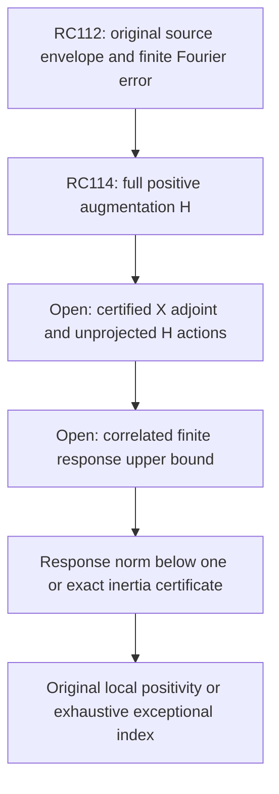

# RPB108 — RC114: projection-free positive augmentation and finite response

Aperture a=1.10. Parent RC113: `1ac07c3329f4a8df087f8f4792f2f3e44d9ded35`.
Only `research/rpb108-route-consolidation` is written. No Lean edits.

## Result and evidence boundary

RC114 constructs a **certified uniformly positive augmentation of the full original Weil operator**, using its actual signed source lower envelope and the inherited finite Fourier approximation. Original positivity becomes an exact finite-rank response criterion. The route requires neither the canonical W639 projection nor inversion of its canonical head Gram matrix.

This is a replacement computational architecture, not a new original positivity certificate. Actual source-adjoint actions and response matrices have not been evaluated. The original count below 0.01 remains 10–639; the exact count ten, local positivity at 1.10, Global/F4 continuation and RH remain open.

The new positive operator is explicitly an augmentation H of A_Q, **not A_Q itself**. Its positive floor cannot be transferred back without paying the full finite-rank correction. The criterion below pays that correction exactly and retains its correlations.

## The positive-augmentation theorem

Work separately on each actual canonical parity. RC112 supplies

\[
 A_Q\succeq aI-pJ_T^*J_T,
 \qquad \|J_T-X\|^2\le d^2,
\]

where J_T restricts the physical Fourier transform to (-T,T), X is the exact finite Chebyshev Fourier-kernel truncation, and its rank is at most 248 even or 391 odd. All norms and adjoints have the canonical domain metric and physical frequency-L2 codomain metric. These are full-operator inequalities, not inequalities of trial matrices.

For any u>0, Young's inequality gives

\[
 J_T^*J_T\preceq(1+u)X^*X+(1+1/u)d^2I.
\]

Set lambda=p(1+u), Q=sqrt(lambda)X and

\[
 \boxed{H=A_Q+Q^*Q=A_Q+\lambda X^*X.}
\]

Then

\[
 \boxed{H\succeq\eta I,
 \qquad \eta=a-p(1+1/u)d^2.}
\tag{1}
\]

Choosing u=1/4 for both parities gives strict positive eta from exact inherited budgets. No original positivity assumption is used. The original archimedean multiplier, prime translations and signed poles remain unchanged inside A_Q; the added finite-rank operator is fully accounted for by the response reduction.

The global embedding bound rho=252/257 gives ||J_T||<=sqrt(rho), so

\[
 \|X\|^2\le x^2:=(\sqrt\rho+\sqrt{d^2})^2.
\]

With the actual parity remainder norm ||K||<=kappa and A_Q=I+i*Ki,

\[
 \eta I\preceq H\preceq bI,
 \quad b\ge1+\rho\kappa+\lambda x^2,
 \quad \|Q\|^2\le v:=\lambda x^2.
\tag{2}
\]

Every square root and rounding allowance is outward and rational in the certificate. Implementations may use H=A_Q+lambda X*X and the response lambda X H^-1 X* directly, avoiding evaluation of sqrt(lambda).

## Exact finite response and inertia

On the physical auxiliary frequency space define

\[
 \boxed{\mathcal B=QH^{-1}Q^*.}
\tag{3}
\]

It is positive and has rank at most 639 in total. Its nonzero spectrum lives in range X, a finite-dimensional physical-frequency subspace. Let Z=QH^-1/2. Then

\[
 A_Q=H^{1/2}(I-Z^*Z)H^{1/2},
 \qquad \mathcal B=ZZ^*.
\]

Bounded invertible congruence preserves negative index. The nonzero eigenvalues of Z*Z and ZZ* agree with multiplicity, by their singular-value correspondence. Hence

\[
 \boxed{n_-(A_Q)=N_{\mathcal B}(1,\infty),
 \qquad \dim\ker A_Q=\dim\ker(I-\mathcal B).}
\tag{4}
\]

More strongly,

\[
 \boxed{A_Q\succ0\iff\|\mathcal B\|<1.}
\tag{5}
\]

If B<=theta I with theta<1, the original canonical floor is at least eta(1-theta). Conversely, if A_Q>=delta I and H<=bI, the transformed form is at least delta/b, giving ||B||<=1-delta/b. No equality between spectra of A_Q and B is claimed. Compactness inherited from RC77 identifies the finite negative index with original discrete eigenvalue multiplicity.

Null vectors correspond exactly: if A_Q x=0, then y=Qx is nonzero and B y=y. Conversely B y=y gives x=H^-1 Q*y and A_Q x=0, with Qx=y. This is a local algebraic correspondence, **not a first-contact exclusion or a Global/F4 theorem**.

For a threshold t<eta, use H_t=H-tI. Then

\[
 N_{A_Q}(-\infty,t)=N_{Q(H-tI)^{-1}Q^*}(1,\infty).
\tag{6}
\]

In canonical coordinates with metric M, the threshold form is H_form-tM, not H_form-tI. With a nonorthonormal auxiliary basis, use its actual physical Gram as well. The validator tests both metrics and signed noncommuting blocks. Equation (6) is another stopping criterion for the full count; a census of this exact response operator is exhaustive, whereas a finite native compression census is not.

## Accepted positive and threshold variants

| Purpose | Parity | u | Augmented floor eta | Augmented upper b |
|---|---|---:|---:|---:|
| Positivity response | Even | 1/4 | 0.009844510 | 28.846756 |
| Positivity response | Odd | 1/4 | 0.009358779 | 25.176680 |
| Count below 0.01 | Even | 32 | 0.010001267 | 352.493809 |
| Count below 0.01 | Odd | 4 | 0.010033194 | 65.335672 |

The inexpensive positivity variant has eta<0.01, so it cannot be used to count original modes below 0.01 through (6). The separate larger augmentations have eta>0.01 and permit that threshold identity, with poorer inverse conditioning. These choices are certified sufficient parameters, not optimized values.

The generic bound ||B||<=v/eta is far above one. It cannot certify original positivity through a scalar norm estimate. This is an enclosure obstruction, not evidence that the true B has an eigenvalue above one. The finite response needs actual signed, correlated control. A positive reference operator alone does not complete the original problem.

## Correlated response certificate: the residual has the opposite sign

For an arbitrary approximate response Y to Q*, let r=Q*-HY and

\[
 C_Y=QY+Y^*Q^*-Y^*HY.
\]

Exact expansion yields

\[
 \boxed{\mathcal B=C_Y+r^*H^{-1}r.}
\tag{7}
\]

The residual correction is **added**, unlike the subtracted correction in RC106's effective-head sandwich. Therefore actual enclosures C_lo<=C_Y<=C_hi and G_lo<=r*r<=G_hi give

\[
 C_{lo}+G_{lo}/b\preceq\mathcal B
 \preceq C_{hi}+G_{hi}/\eta.
\tag{8}
\]

Without a certified residual lower bound use G_lo=0. A sufficient positivity certificate is

\[
 \boxed{C_{hi}+G_{hi}/\eta\preceq(1-\zeta)I_{aux},
 \qquad\zeta>0.}
\tag{9}
\]

It gives original floor eta zeta. Matching inertias of I minus upper/lower response enclosures can certify the original nonpositive structure through (4). Threshold variants require H-tI throughout. Signed mixed entries in C_Y and residual covariance must be retained; separately bounding their component norms discards the intended correlations.

For the square-root-free implementation, solve HZ=X*, set r_X=X*-HZ and C_X=XZ+Z*X*-Z*HZ. Then B=lambda(C_X+r_X*H^-1r_X). All constants and residual bounds are correspondingly multiplied by lambda.

## Why this removes the canonical Gram inverse

The finite approximation factors as

\[
 Xx(\xi)=\sum_j\psi_j(\xi)\ell_j(x),
 \qquad \ell_j(x)=\langle r_j,x\rangle_c,
\]

with exact Chebyshev Fourier coefficients psi_j and actual canonical Riesz representatives r_j. If R_n maps native coefficients to sum_j c_j r_j, and O maps coefficients to sum_j c_j psi_j, then X=O R_n*. Thus

\[
 H=A_Q+\lambda R_n G_{freq}R_n^*,
 \quad G_{freq}=O^*O,
\]

and the response is lambda O L O*, with L=R_n*H^-1R_n. Its nonzero eigenvalues equal those of

\[
 \lambda G_{freq}^{1/2}L G_{freq}^{1/2}.
\tag{10}
\]

The frequency Gram is positive semidefinite. No inverse of R_n*R_n is present, and no canonical projection onto W is needed. A rank-deficient frequency Gram can still be handled without inversion. Positive matrix upper bounds on L and G_freq give a conservative operator-norm bound using positive square-root congruence; monotonicity of the positive product's maximal eigenvalue pays both enclosures. Signed correlations in L remain available.

This does **not** remove canonical Riesz/source-adjoint work. X*y is a finite combination of actual r_j, equivalently i* applied to the corresponding physical polynomial source. Applying A_Q still requires the original bounded canonical action. The frequency Gram or equivalent auxiliary metric, square-root/factor error and all source, approximation, form and action errors must be enclosed. Conditioning of a chosen auxiliary basis is not proved here. The benefit is removal of a particular canonical head inverse, not a universal claim of numerical ease.

A matrix-free norm proof or a smaller exceptional block inside the finite auxiliary response can replace dense evaluation of (10). Its full rank upper is 639, not a demand for 639 individually certified modes.

## Quantitative inverse-action budgets

Apply the RC103 Chebyshev inverse and RC105 scaled recurrence to H on [eta,b]. For ideal residual epsilon and total local error factor eps/(b n(n+1)/2), the inexact residual correction in (7) is bounded by

\[
 4\epsilon^2v/\eta\;I_{aux}.
\]

Exact accepted budgets for the positivity variant are:

| Auxiliary correction allowance | Even residual degree | Odd residual degree |
|---|---:|---:|
| 10^-6 | 322 | 310 |
| 10^-12 | 509 | 489 |
| 10^-24 | 883 | 847 |

The inverse polynomial degree is one less. These counts are per vector or response block and require every recorded local-action contract. They exclude the cost and error of evaluating C_Y. They are larger than RC113's direct projected inverse counts (137/112 at 10^-6); the tradeoff is avoiding the unknown canonical W projection and its Gram inverse. No total runtime advantage is proved. The smallest allowance is a target, not an established original positivity margin.

The JSON records exact outward epsilons, per-step errors and correction coefficients. No original arithmetic H actions, Y, C_Y or residual Grams are computed at this checkpoint.

## Controls and minimal next estimate

Exact rational controls include positive and negative original forms with uniformly positive H, nonidentity canonical metrics, the actual dual metric in residual norms, signed noncommuting source blocks, threshold inertia correspondence, residual sandwiches, and an exact null mapping. The negative example verifies that positive augmentation does not by itself imply original positivity. These are abstract controls, not claimed arithmetic Weil directions.

The decisive new estimate for this route is the single upper response inequality (9), or an exhaustive signed spectral/inertia certificate for its finite response operator. Before that can be tested on the original arithmetic, the minimal construction obligation is a certified implementation of the finite Fourier source adjoint X* and the unprojected H action. A small block can test this action contract, but adding one more positive native direction would not establish (9).



RC112–113's direct projected route remains valid in parallel as an alternative implementation; no previous certificate is replaced or weakened. Global/F4 is separate. No global continuation or RH conclusion follows from these local partial results.

## Reproduction

Input order: RC113, RC112, RC111, RC106, RC103, RC66. The validator checks dependency hashes, inherited arithmetic budgets, exact augmentation floors and upper bounds, residual degrees and local errors, plus the signed metric-aware controls.

```bash
python scripts/validate_rpb108_rc114_positive_augmentation.py \
 --output certificates/rpb108_rc114_positive_augmentation.json \
 certificates/rpb108_rc113_covered_complement_inverse.json \
 certificates/rpb108_rc112_parity_spectral_coverage.json \
 certificates/rpb108_rc111_structural_spectral_coverage.json \
 certificates/rpb108_rc106_correlated_effective_head_sandwich.json \
 certificates/rpb108_rc103_complement_inverse_lift.json \
 certificates/rpb108_rc66_arch_multiplier_transport.json
```

Repeat with `--replay`. Replay uses the independent positive-binomial Chebyshev formula, explicit inverse-form calculation and determinant-ratio inertia, comparing the entire JSON. No floating-point acceptance is used. The analytic finite-rank and parity proofs are supplied here, not formalized in Lean.

**Certified:** full positive augmentation, exact response/threshold/null identities and numerical inverse contracts. **Conditional:** original positivity or complete inertia after the response certificate. **Not performed:** actual original response actions, response operator, frequency Gram or auxiliary conditioning. **Unsupported:** original positivity from the augmented floor alone, scalar generic-norm completion, mandatory dense 639 computation, or any new Global/F4 or RH conclusion.
