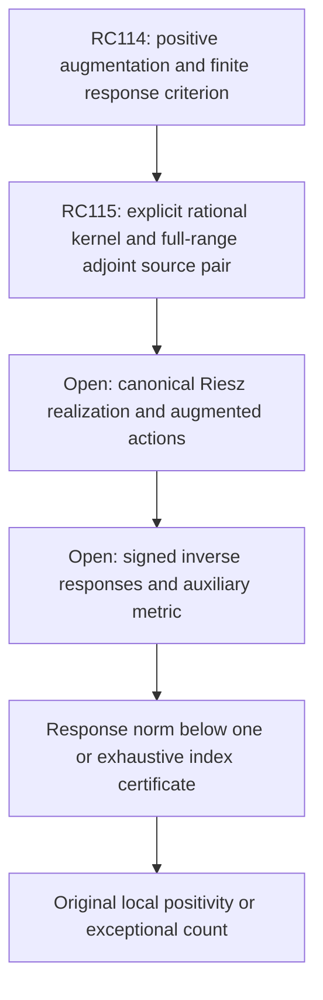

# RPB108 — RC115: rational Fourier-adjoint source construction

Aperture a=1.10. Parent RC114: `c27c2ec5fbd46b1743586758480f66b3cf96ce17`.
Only `research/rpb108-route-consolidation` is written. Lean is unchanged.

## Result and boundary

RC115 supplies an explicit rational finite Fourier-kernel recipe and evaluates two full native adjoint source polynomials:

- Constant even auxiliary frequency input: all 248 retained even coefficients.
- Linear odd auxiliary frequency input: all 391 retained odd coefficients.

All **639 physical-source coefficients** have exact rational interval enclosures in the JSON. The source polynomials represent the actual canonical adjoint through i*, with a rigorous canonical error bound. The canonical Riesz images themselves, original Weil actions on them, and augmented inverse responses remain uncomputed.

The global finite-kernel approximation error has norm below 10^-70. Each tested adjoint source has canonical error norm below 10^-65. These are source-construction certificates, not additional positive native directions or spectral modes.

The rational polynomial kernel also produces a certified positive augmentation of the full original operator, retaining floor 0.009844510 even and 0.009358779 odd. This augmentation is a **new exact operator**, distinct from RC114's exact-kernel augmentation. Original local positivity and the auxiliary response norm below one remain open. The original spectral count below 0.01 remains 10–639. Global/F4 and RH are not claimed.

## Rational band and explicit kernel

For each parity use RC112's outward rational half-bandwidth U=T_hi, instead of the irrational cutoff T=exp L. The original source lower inequality remains valid:

\[
 A_Q\succeq aI-pJ_U^*J_U,
\]

because J_T*J_T<=J_U*J_U. The Laurent-contour error used by RC112 already uses U in both its rectangle area and exponent gap; its same squared error d^2 bounds J_U-X_(n,U), where X_(n,U) is the exact degree-(n-1) Chebyshev kernel truncation on the rational band. This application follows directly from the inherited contour formula. It is not a claim that the original and rational-band kernels are identical.

Choose rational pi_0 by rounding the midpoint of RC30's directed pi enclosure downward to 80 decimal places. The certificate verifies the inherited Machin identity enclosure independently using exact alternating rational arctangent sums. The exact pi error e_pi is stored.

Let B=11/10, xi=U tau with -1<=tau<=1, t=x/B, Z=2 pi_0 B U and N=2400. Define the rational Taylor kernel

\[
 E_N(t,\tau)=\sum_{k=0}^N\frac{(-i Z\tau t)^k}{k!}.
\]

Rewrite it exactly in Chebyshev polynomials T_j(t), then retain only degrees j<n, with the requested parity. This defines the finite operator \widehat X on the actual canonical domain. Its rank is at most 248 even and 391 odd. All kernel coefficients are rational complex numbers; their exact formula is a reproducible lazy generator, not a stored dense array.

For j=0 the coefficient is

\[
 \widehat\psi_0(\tau)=\sum_{m=0}^{\lfloor N/2\rfloor}
 \frac{(-1)^m(Z\tau/2)^{2m}}{(m!)^2}.
\]

For j>0 it is

\[
 \widehat\psi_j(\tau)=2(-i)^j
 \sum_{m=0}^{\lfloor(N-j)/2\rfloor}
 \frac{(-1)^m(Z\tau/2)^{j+2m}}{m!(j+m)!}.
\tag{1}
\]

This is derived directly from

\[
 [T_j]t^k=2^{1-k}\binom{k}{(k-j)/2}\quad(j>0),
 \qquad [T_0]t^{2m}=2^{-2m}\binom{2m}{m}.
\]

No Bessel-library or external special-function identity is assumed. The script checks exact monomial-to-Chebyshev coefficients through degree 24 and independently verifies the adjoint duality against direct integration of a full degree-24 Taylor kernel.

## Global model and adjoint errors

For real z, the integral Taylor remainder on the imaginary axis has modulus at most |z|^(N+1)/(N+1)!, since |exp(-isz)|=1. The certificate uses an outward rational Z_max and encloses that remainder by 10^-120. The phase error from pi_0 is at most 2 B U e_pi. Thus, before Chebyshev truncation,

\[
 |e^{-2\pi i B\xi t}-E_N(t,\tau)|\le
 e_0:=2BUe_\pi+Z_{max}^{N+1}/(N+1)!.
\]

An error bounded by e_0 has constant Chebyshev coefficient error at most e_0 and each other coefficient error at most 2e_0, by its cosine integral formula. Retaining n terms gives a kernel error at most 2n e_0. The physical rectangle has area 4BU; using ||i||<=1 yields

\[
 \boxed{\|X_{n,U}-\widehat X\|^2
 \le16n^2BU e_0^2=:e_X^2<10^{-140}.}
\tag{2}
\]

The same bound holds for adjoint operator norm. This includes the Taylor, pi and kernel-truncation comparison errors. The contour error d controls J_U-X_(n,U); equation (2) separately controls X_(n,U)-Xhat.

No canonical moment projection or Gram inverse occurs. All moment representatives are actual Riesz representatives: ell_j(h)=<r_j,h>_c=integral T_j(x/B)i h(x)dx. Approximate polynomial images of r_j are not substituted into this identity.

## Actual physical adjoint sources for the two tests

Take y_e(xi)=1 and y_o(xi)=xi/U. Their physical frequency squared norms are 2U and 2U/3. The adjoint identity is

\[
 \widehat X^*y=i^*q_y,
 \qquad q_y(x)=\sum_{j<n}c_j(y)T_j(x/B),
 \quad c_j(y)=\int_{-U}^U\overline{\widehat\psi_j(\xi/U)}y(\xi)d\xi.
\tag{3}
\]

The even source is real; the odd source has global phase i. After extracting that phase, the real coefficients are

\[
 c_{e,j}=2U(-1)^{j/2}
 \sum_m\frac{(-1)^m d_j(Z/2)^{j+2m}}
 {m!(j+m)!(j+2m+1)},\qquad j\text{ even},
\]

\[
 c_{o,j}/i=2U(-1)^{(j-1)/2}
 \sum_m\frac{(-1)^m d_j(Z/2)^{j+2m}}
 {m!(j+m)!(j+2m+2)},\qquad j\text{ odd},
\]

where d_0=1, d_j=2 for j>0, and m<=floor((N-j)/2). These are exact integrals of the defined rational polynomial kernel. Other parity coefficients vanish identically.

The validator evaluates these large alternating sums at 700 digits with directed rounding, then encloses every final coefficient on a rational 10^-70 grid. Replay reverses the summation order and compares all 639 intervals and their hashes. The interval recurrence uses only positive term magnitudes, explicit signed accumulation, and precision-preserving negation. No floating-point eigenvalue decision is involved.

Let q_hat be the rational polynomial of interval centers and let R=sum_j coefficient radii. Since |T_j(t)|<=1 on the physical support,

\[
 \|i^*(q_y-q_{hat})\|_c^2\le2B\rho R^2,
 \qquad\rho=252/257.
\]

Combining this with (2) gives the certified error relative to the exact rational-band truncation:

\[
 \boxed{\|X_{n,U}^*y-i^*q_{hat}\|_c^2
 \le2 e_X^2\|y\|_2^2+4B\rho R^2<10^{-130}.}
\tag{4}
\]

The coefficient intervals enclose the **polynomial model source** in (3); equation (4) pays the difference from the exact kernel adjoint. The i* image is specified and controlled by identity and norm, not numerically constructed. There is no claim that a physical polynomial itself is the canonical adjoint image.

Accepted squared errors are approximately 6.634e-136 even and 1.649e-135 odd. Exact rational upper bounds are in the JSON. These test vectors exercise the full retained coefficient range; they are not Ritz vectors, low Weil modes or positivity tests.

## Positive augmentation with the explicit rational model

The combined operator error satisfies

\[
 \|J_U-\widehat X\|\le d+e_X.
\]

Define the exact rational-kernel augmentation

\[
 \widehat H=A_Q+\lambda\widehat X^*\widehat X,
 \qquad\lambda=\tfrac54p.
\]

Young's inequality with u=1/4 gives

\[
 \boxed{\widehat H\succeq
 [a-5p(d+e_X)^2]I.}
\tag{5}
\]

The exact interval budget, including outward square roots, preserves the accepted floors:

| Parity | Rational-model augmented floor |
|---|---:|
| Even | 0.009844510 |
| Odd | 0.009358779 |

This is a certificate for Hhat, not an assertion Hhat=H_RC114. Its finite correction is still of rank at most 639. Because the original A_Q is unchanged, the exact response criterion applies afresh:

\[
 \widehat{\mathcal B}=\lambda\widehat X\widehat H^{-1}\widehat X^*,
 \qquad A_Q\succ0\iff\|\widehat{\mathcal B}\|<1.
\]

No bound below one has been computed. Reusing RC114's numerical inverse budgets for Hhat requires validating its upper endpoint and action contracts; matching lower floors alone is not that validation. The old exact-kernel augmentation and this rational one have different response operators. Their original-operator conclusions must each pay their own exact correction.

## Frequency metric and remaining source-response obligations

Since each psi_hat is an explicit rational polynomial on a rational band, its frequency Gram is an exact rational integral:

\[
 G_{jk}=U\int_{-1}^1\overline{\widehat\psi_j(\tau)}
 \widehat\psi_k(\tau)d\tau.
\]

Every monomial term can be integrated using integral tau^(2l)=2/(2l+1) and vanishing odd moments. A full frequency Gram has **not** been evaluated, factored or conditioned. Severe cancellation in power coefficients remains an implementation issue; the operator error proof avoids treating large coefficient norms as the true kernel norm.

The minimal next construction is a certified canonical realization of i*q_hat and an augmented action Hhat on its response trials. The source-adjoint formula and its approximation budget are now explicit. A paired action/response test can use both parities without adding individually positive native directions. After those actions, the signed response upper enclosure must include:

- Canonical Riesz-source and action errors.
- Actual auxiliary metric/factor errors.
- Inverse residual covariance and correlated response form errors.
- All additional projection or trial approximation errors introduced by an implementation.

The source polynomial alone is not an inverse response, an original Weil action, or a completed response norm certificate. Positivity of the augmentation cannot replace the finite response bound.



The original RC112 coverage floor and RC110 twelve-mode statement remain valid with their original scopes. Global/F4 is separate; RH is not claimed. No Lean front is changed.

## Reproduction and status

Input order: RC114, RC112, RC66. The script checks SHA-256 links, independently encloses pi, verifies exact coefficient and adjoint-duality controls, evaluates all 639 source intervals, and pays global kernel, source and augmentation errors.

```bash
python scripts/validate_rpb108_rc115_rational_fourier_adjoint.py \
 --output certificates/rpb108_rc115_rational_fourier_adjoint.json \
 certificates/rpb108_rc114_positive_augmentation.json \
 certificates/rpb108_rc112_parity_spectral_coverage.json \
 certificates/rpb108_rc66_arch_multiplier_transport.json
```

Repeat with `--replay`. Replay uses reversed alternating summation for every source coefficient and compares the entire certificate. The inherited script directory provides interval and norm helpers. All reported error bounds are rational upper bounds; decimal approximations are display only.

**Certified:** rational kernel recipe, global kernel/adjoint error, two full-range physical adjoint source polynomials, and rational-model positive augmentation. **Conditional:** original positivity after the exact auxiliary response certificate. **Not performed:** canonical source images, original/augmented operator actions, inverse responses or full frequency Gram. **Unsupported:** identifying source-construction tests as low spectral modes, transferring inverse budgets solely from a matching lower floor, or inferring original positivity from the augmentation alone.
