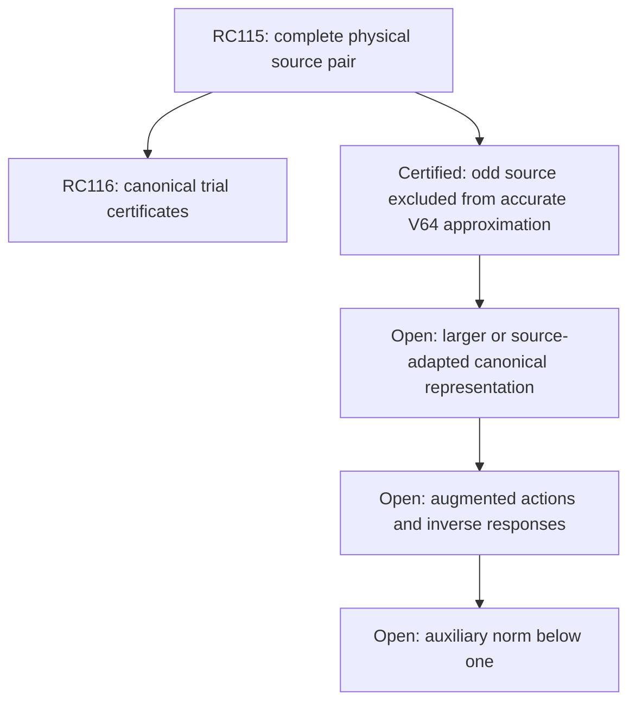

# RPB108 — RC116: canonical adjoint trials and a 64-mode obstruction

Aperture a=1.10. Parent RC115: `d715b5613ed3d83d5fdf2d5910795c3cc763ac5e`.
Only `research/rpb108-route-consolidation` is written. No Lean changes.

## Main result

RC116 constructs rational 64-mode canonical trials for both RC115 adjoint sources, with rigorous actual-metric error enclosures. It also proves a stronger obstruction:

\[
 \boxed{\inf_{v\in V_{64}}\|X_{n,U}^*y_o-v\|_c^2
 \ge\frac{2343009129213}{10^{12}}
 =2.343009129213,}
\tag{1}
\]

where y_o(xi)=xi/U and V64 is the entire space of supported physical Legendre polynomials of degree at most 63, regarded as actual canonical vectors. Thus **no canonical trial in this space** can realize this odd source with error norm below 1.53. This is an actual approximation obstruction, not merely failure of an upper enclosure.

At least **97.8336842007%** of this source's squared canonical energy lies outside V64. The conservative source error paid in RC115 also makes (1) valid for the rational polynomial model adjoint tested there.

This rules out reusing the inherited 64-mode physical trial space unchanged for accurate realization of the complete new odd adjoint test. It does not rule out larger polynomial spaces or a different, localized trial representation. No individual positive native direction is added.

The even source has a certified trial and upper error bound, but this method does not prove a positive canonical distance lower bound for it. A zero lower enclosure is not a claim of accuracy. No original Weil or augmented action, inverse response, auxiliary norm below one, or new positivity statement has been certified. The original count below 0.01 remains 10–639; Global/F4 and RH remain open.

## Source and metric objects

Let q0 be the rational physical Chebyshev polynomial of RC115's source coefficient centers, including global phase 1 even or i odd. Define u0=i*q0 in the actual canonical Hilbert space. RC115 gives

\[
 \|u_{ref}-u_0\|_c^2\le e_s^2<10^{-130},
 \quad u_{ref}=X_{n,U}^*y.
\]

The source rounding error alone is also enclosed by e_s; hence the same conservative transfer applies to the rational-model adjoint Xhat*y. Neither u0 nor u_ref is identified with the physical polynomial q0.

The trial basis is P_j(x/B), j=0,...,63, B=11/10. Its physical mass is m_j=2B/(2j+1). The **actual canonical** Gram G satisfies the RC67 certified mass-relative enclosure

\[
 G_0-d_gM_{phys}\preceq G\preceq G_0+d_gM_{phys},
 \quad d_g=1849/10^{30}.
\tag{2}
\]

RC67's d_g already includes actual constant, kernel tail, and numerical entry-enclosure errors. Its nominal center G0 is used only to propose a trial. Physical masses are not substituted for the canonical metric when accepting a trial.

## Exact signed physical moments

For same-parity Chebyshev indices,

\[
 \int_{-B}^B T_j(x/B)T_k(x/B)dx
 =B\left[\frac1{1-(j+k)^2}+\frac1{1-(j-k)^2}\right].
\tag{3}
\]

Opposite parity gives zero. Same parity avoids the apparent denominators at index 1. The identity follows from T_j T_k=(T_(j+k)+T_|j-k|)/2 and the elementary integral of T_(2l).

The script uses all 639 source coefficients. It calculates ||q0||_2^2 using exact integer Chebyshev convolution, retaining all signs. The common coefficient denominator divides 2*10^70, so the quadratic convolution is integer arithmetic followed by exact rational integration. It constructs Legendre-to-Chebyshev polynomials by their recurrence and evaluates

\[
 f_j=\langle P_j,q_0\rangle_{phys}
 =\langle P_j,u_0\rangle_c.
\]

Every f_j is outward-enclosed on a rational 10^-40 grid. The physical norm is enclosed on a 10^-20 grid. These small outward allowances are paid below. Global phase is separated without changing norm or energy decisions.

## Rigorous physical source-truncation test

The orthogonal physical projection onto degree <=63 has energy

\[
 E_{phys,64}=\sum_{j=0}^{63}|f_j|^2/m_j,
 \quad\|q_0-P_{phys,64}q_0\|_2^2
 =\|q_0\|_2^2-E_{phys,64}.
\]

Exact interval decisions give:

| Source | Physical norm squared, approximately | Squared physical energy outside degree 63, fraction lower |
|---|---:|---:|
| Even | 128.1790838141 | 0.856643188080 |
| Odd | 68.3874147263 | 0.999241368008 |

Thus physical source truncation to the inherited 64-mode space loses a large amount of actual energy. This alone would not prove a canonical image obstruction, because the adjoint i* smooths the source. The next theorem supplies that missing step.

## Universal polynomial canonical-energy bound

For a physical polynomial q of degree d supported on [-B,B], let Q=||q||_2. Expand q=sum a_j P_j(x/B). Physical orthogonality and endpoint Cauchy–Schwarz give

\[
 |q(B)|+|q(-B)|\le\frac{2(d+1)}{\sqrt{2B}}Q.
\]

The Legendre derivative expansion

\[
 P_j'=\sum_{l<j,\;j-l\text{ odd}}(2l+1)P_l
\]

gives integral_(−1)^1 |P_j'|^2=j(j+1). Applying Cauchy–Schwarz to the derivative basis and summing j(j+1)(2j+1) yields

\[
 \|q'\|_2\le\frac{(d+1)^2}{2B}Q.
\]

The validator independently checks the derivative-norm identity for degrees 1–24 with exact power-polynomial integration. The general identity follows from the displayed derivative expansion and orthogonality.

Include the endpoint jumps of the zero extension. Its total variation allowance is

\[
 V_q:=|q(B)|+|q(-B)|+\int_{-B}^B|q'|
 \le\frac{(d+1)(d+3)}{\sqrt{2B}}Q.
\]

Integration by parts with the actual Fourier convention exp(-2pi i xi x) therefore gives

\[
 |\widehat q(\xi)|\le V_q/(2\pi|\xi|)\quad(\xi\ne0).
\]

This also proves that the zero-extended polynomial has finite canonical logarithmic energy; no unproved physical operator-domain regularity is used.

Set S_d=(d+1)^2(d+3)^2/(2B). For w(x)=log(e+x), split the canonical energy at S_d. Low frequencies contribute at most w(S_d)Q^2. Since

\[
 \int_{S_d}^\infty w(x)/x^2dx
 \le[w(S_d)+1]/S_d,
\]

the tail contributes at most [w(S_d)+1]Q^2/18, using pi>3. Choose an integer K with (8/3)^K>S_d+3. The inherited inequalities 8/3<e<3 imply w(S_d)<K. Therefore

\[
 \boxed{\|q\|_c^2\le C_d\|q\|_2^2,
 \qquad C_d=(19K+1)/18.}
\tag{4}
\]

The boundary terms are explicitly included. For RC115's even degree-494 source C_d=238/9; for its odd degree-781 source C_d=257/9.

Taking q itself as a canonical test vector and using <i*q,q>_c=||q||_2^2 gives

\[
 \boxed{\|i^*q\|_c^2\ge\|q\|_2^2/C_d.}
\tag{5}
\]

This is a quantitative lower bound on the actual Riesz image, with no canonical Riesz inverse computed.

## Canonical exclusion of the entire 64-mode trial space

Canonical energy dominates physical energy because w>=1. Thus G>=M_phys on V64 and G^-1<=M_phys^-1. For u0=i*q0, the energy of its **canonical** projection satisfies

\[
 \|P_{c,64}u_0\|_c^2=f^*G^{-1}f
 \le f^*M_{phys}^{-1}f=E_{phys,64}.
\]

Combining with (5),

\[
 \boxed{\operatorname{dist}_c(u_0,V_{64})^2
 \ge\|q_0\|_2^2/C_d-E_{phys,64}.}
\tag{6}
\]

All norm lower endpoints and projection upper endpoints are outward in the validator. For the odd source this is strictly positive. Transfer to u_ref uses

\[
 \operatorname{dist}_c(u_{ref},V_{64})
 \ge\operatorname{dist}_c(u_0,V_{64})-e_s,
\]

with downward/upper rational square-root endpoints. This yields (1).

The relative energy statement uses ||u0||_c^2>=||q0||_2^2/C_d, the projection bound, and the same source-transfer error. Its accepted lower fraction is 978336842007/10^12. It concerns the exact adjoint source, not an eigenmode of A_Q.

For the even source, (6)'s current lower enclosure is nonpositive. The validator records zero as its distance lower bound and makes no failure or success inference about even canonical approximation. The odd result is a genuine low-accuracy obstruction for this representation; the even unresolved bound is an estimate limitation.

## Canonical trial construction and upper errors

For each parity, a 100-digit Decimal solve of the nominal 32-by-32 parity block G0 v=f proposes a vector. Round its physical Legendre coefficients to a rational 10^-35 grid. Trial selection is numerical; **all acceptance decisions are exact rational inequalities** using (2), source pairing intervals, and actual norm bounds. Replay freezes the saved rational trial and repeats the proof without a numerical solve.

For a rational trial v let E_hi=v*G0 v+d_g||v||_phys^2 and let F_lo be a signed lower enclosure of <q0,v>_phys. Then

\[
 \|u_0-v\|_c^2\le U-2F_{lo}+E_{hi},
\tag{7}
\]

where U is a certified upper bound for ||u0||_c^2. We use the smaller of rho||q0||_phys^2 and a sharper ambient weighted-dual bound.

For the full-band adjoint J_U*y,

\[
 \|J_U^*y\|_c^2\le\int_{-U}^U|y(\xi)|^2/w(\xi)d\xi.
\]

The script encloses this integral by 128 rational frequency cells, using monotonicity of w and exact cell integrals of |y|^2. Lower logarithm bounds use e>8/3, log2>693/1000, and a positive atanh series after reduction to [1,2). No sampled quadrature error is ignored. The contour and RC115 source errors then bound u0 by the triangle inequality.

Accepted trial information is:

| Source | Canonical image norm squared lower | Canonical image norm squared upper | Trial error squared upper |
|---|---:|---:|---:|
| Even | about 10.1178 | 42.206644056170 | 32.088820981180 |
| Odd | at least ||q0||_phys^2/(257/9) | 16.187354661025 | 16.164369368267 |

The large upper errors do not certify accurate realization. For the odd case the distance lower bound independently proves that no trial in V64 can be accurate. For the even case an upper-enclosure failure alone does not establish an actual error lower bound. No original Weil form on these trials is evaluated.

## Consequence for the next action attempt

The inherited 64-mode canonical machinery remains valid for its original native targets. It cannot be reused unchanged to realize the new odd full-band source to the accuracies required by RC114's response construction. This is an obstruction to a specific representation, not to the projection-free augmentation theorem or to original positivity.

The next implementation should use a larger polynomial trial space or a nonpolynomial representation adapted to this oscillatory source. Its concrete gate is a canonical source/action error bound that beats the present positive distance lower bound; then the augmented operator action and inverse response can be tested. Enlarging the count of individually positive native directions does not meet this gate.

No exact original low-mode count beyond RC112 is established. The source-space approximation obstruction is distinct from an additional exceptional eigenmode, a negative Weil direction, or failure of the signed Schur criterion.



RC77–115 retain their original certified scopes. Local a=1.10 positivity, separate Global/F4 continuation, and RH remain unclaimed.

## Reproduction

Input order: RC115, RC114, RC112, RC107, RC67. The validator checks all dependency hashes, exact signed source norms and moments, the canonical metric, polynomial-energy bounds and derivative controls, physical and canonical truncation obstructions, and trial error transport.

```bash
python scripts/validate_rpb108_rc116_canonical_adjoint_trials.py \
 --output certificates/rpb108_rc116_canonical_adjoint_trials.json \
 certificates/rpb108_rc115_rational_fourier_adjoint.json \
 certificates/rpb108_rc114_positive_augmentation.json \
 certificates/rpb108_rc112_parity_spectral_coverage.json \
 certificates/rpb108_rc107_original_compression_spectral_census.json \
 certificates/rpb108_rc67_sixty_four_riesz_enrichment.json
```

Repeat with `--replay`. Replay uses the saved rational candidates, reversed exact physical moment and quadratic sums, and the complete metric/error checks. Trial proposal needs only Python's standard Decimal library; inherited helpers must be on the script path. No numerical eigenvalue acceptance or new source quadrature is used.

**Certified:** canonical rational trial pair with actual-metric errors, exact physical source tails, and a positive canonical distance lower bound for the entire odd V64 trial space. **Conditional:** action/response certification after a suitable new representation. **Not performed:** original or augmented operator actions and inverse responses. **Unsupported:** even approximation failure from its upper bound, treating the odd approximation obstruction as a negative original Weil direction, or deriving local/global positivity from canonical norm certificates.
