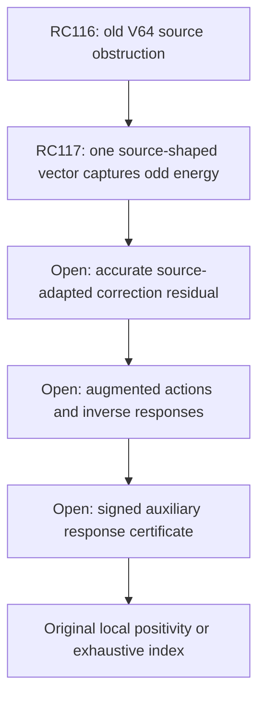

# RPB108 — RC117: source-adapted canonical trial and energy capture

Aperture a=1.10. Parent RC116: `737f4bfae48e157018bf66c915a3bdb24733381a`.
Only `research/rpb108-route-consolidation` is written. No Lean changes.

## Certified advance

A **one-dimensional source-adapted trial space** captures at least 88.4809106363% of the odd adjoint's squared canonical energy. Its explicitly chosen rational trial has squared canonical error at most

\[
 \boxed{1.864635849010.}
\]

The same scalar calculation strengthens the lower bound for every old degree-63 polynomial trial:

\[
 \boxed{\inf_{v\in V_{64}}\|u_{odd}-v\|_c^2
 \ge14.270837931357.}
\]

Thus the new trial provably beats **the entire inherited 64-mode space**, not merely RC116's particular trial vector. That old space captures at most 0.3622278797% of this source's squared canonical energy under the improved certified bounds.

This is a change of representation: the one vector preserves the full degree-781 source shape. It is not a newly positive native Weil direction, a Ritz eigenmode, or an invariant spectral subspace. No dense high-degree canonical metric is evaluated. The remaining canonical error is still far above the inverse-action requirements; high-accuracy realization and actual augmented responses remain open.

The original spectral count below 0.01 remains 10–639. No local a=1.10 positivity, separate Global/F4 continuation, or RH conclusion is claimed.

## Representation theorem

Let q be a supported physical source polynomial, regarded also as a canonical vector, and let u0=i*q be its actual canonical Riesz image. The physical polynomial and its Riesz image are distinct. Define

\[
 Q=\|q\|_2^2,\qquad E=\|q\|_c^2.
\]

The exact dual pairing is <u0,q>_c=Q. The canonical projection onto span{q} therefore has squared energy Q^2/E. If Q>=Q_lo>0 and E<=E_hi, then

\[
 \boxed{\|P_{\operatorname{span}\{q\}}u_0\|_c^2
 \ge Q_{lo}^2/E_{hi}.}
\tag{1}
\]

For an explicit positive rational alpha and a source norm upper U0,

\[
 \boxed{\|u_0-\alpha q\|_c^2
 \le U_0-2\alpha Q_{lo}+\alpha^2E_{hi}.}
\tag{2}
\]

Choose alpha near Q_lo/E_hi, then pay source/model error by the triangle inequality. RC115 gives ||u_ref-u0||_c<=e_s, where u_ref is its exact rational-band Fourier adjoint. It also encloses the rational-model adjoint by the same conservative e_s. Consequently

\[
 \|P_{\operatorname{span}\{q\}}u_{ref}\|_c
 \ge Q_{lo}/\sqrt{E_{hi}}-e_s.
\]

The projection energy divided by an actual source norm upper gives a canonical energy-capture fraction. This theorem replaces a fixed low-degree trial space by a vector selected from the source itself. Its computational obligation is a scalar canonical energy bound for q, not a large new Gram inverse.

Here q is the exact rational center polynomial from RC115, including global phase i in odd parity. The stored trial is alpha times that complete polynomial; its 391 odd coefficients are not discarded. A physical polynomial of degree 781 defines one vector, hence one trial dimension.

## Scalar canonical energy: preserve the signed principal part

Use the actual canonical weight w(xi)=log(e+|xi|). Split it exactly as

\[
 w(\xi)=\log|\xi|+m(\xi),
 \qquad m(\xi)=\log(1+e/|\xi|)>0.
\]

The log singularity at zero is integrable for these supported sources. The principal Fourier form is not assumed positive. With q(x)=sum_j a_j P_j(x/B), B=11/10 and R=2B, the inherited singular canonical kernel underlying RC67 gives

\[
 E_{principal}=
 \sum_j H_j\frac{2B}{2j+1}|a_j|^2
 +c_R Q
 +\int_{-B}^{B}\!\left[-\log\frac{x+B}{2B}\right]|q(x)|^2dx,
\tag{3}
\]

for a fixed parity source, whose squared modulus is even. Here c_R=-gamma-log(2pi R), with its actual RC56 enclosure. The endpoint term represents the two symmetric half-log terms; it does not omit endpoint effects.

For clarity, the inherited singular operator has local part

\[
 c_R q(x)-\tfrac12\log[t(1-t)]q(x),
 \quad t=(x+B)/(2B),
\]

and polynomial finite-difference part

\[
 \tfrac12\int_{-B}^B\frac{q(x)-q(y)}{|x-y|}dy.
\]

The latter acts as H_j P_j on the Legendre basis. This yields (3) by physical orthogonality. No bounded physical operator is substituted for the full logarithmic canonical form; only its exact principal identity and the positive remainder multiplier are used. RC56–67's canonical kernel and constant are applied to a new polynomial vector, rather than extrapolating the old 64-by-64 numerical metric.

### Connection and endpoint computations

The Chebyshev-to-Legendre connection is computed from T_(n+1)=2xT_n-T_(n-1) and

\[
 xP_j=\frac{j+1}{2j+1}P_{j+1}+\frac{j}{2j+1}P_{j-1}.
\]

The script propagates directed 700-digit intervals, then encloses the source's Legendre coefficients on a 10^-80 grid. Two independent checks constrain the entire conversion:

- All 64 old Legendre source pairings agree with RC116's exact physical moments.
- The full-degree Legendre physical norm interval is contained in RC116's independently computed integer-convolution norm interval.

The source connection interval hash is recorded. The complete conversion is reproducible from RC115's source coefficients, without storing or inverting a connection matrix.

For the endpoint integral, form q squared by exact integer Chebyshev convolution. Let

\[
 D_n=\int_{-1}^1\frac{T_n(x)-(-1)^n}{x+1}dx.
\]

Then D0=0, D1=2 and D_n=2 integral T_(n-1)-2D_(n-1)-D_(n-2). Integration by parts gives

\[
 L_0=2,\quad L_1=-1,\quad
 L_n=\tfrac12[D_{n+1}/(n+1)-D_{n-1}/(n-1)],
\]

where L_n=integral T_n(x)[-log((x+1)/2)]dx. These rational moments integrate the endpoint form exactly. The script independently checks degrees 0–24 against shifted-power log moments. It also checks the finite-difference Legendre eigenidentity through degree 24; the general identity follows from the same polynomial recurrence.

Constant uncertainty, connection intervals, physical norm endpoints and final rounding are all paid in (3). The constant term is negative: its upper enclosure uses c_R upper times Q lower, preserving the signed cancellation with harmonic and endpoint energies.

## Positive regular remainder bound using the already measured source leakage

The positive remainder is

\[
 E_{reg}=\int_{\mathbb R}m(\xi)|\widehat q(\xi)|^2d\xi.
\]

Choose T0=6 and split q=p+r by **physical** orthogonal projection onto degree <=63. RC116 supplies ||p||_2^2 and ||r||_2^2 upper bounds from exact source pairings. This projection is used only in this physical Fourier estimate; it is not a canonical head projection or a representation of u0.

The residual r annihilates all polynomial moments below degree 64. RC22's pointwise Fourier-kernel truncation therefore gives, on |xi|<=T0,

\[
 |\widehat r(\xi)|\le\sqrt{2B}\,\varepsilon_{64}\|r\|_2,
 \quad\varepsilon_{64}\le4\exp(-g),
\]

\[
 g=64(693/1000)-\tfrac34(44/7)BT0>0.
\]

A positive rational exponential sum bounds exp(-g). Together with |Fourier p|<=sqrt(2B)||p||_2,

\[
 E_{reg,lo}\le4B
 (\|p\|_2+\varepsilon_{64}\|r\|_2)^2 I(T0),
\]

\[
 I(T0)=\int_0^{T0}\log(1+e/x)dx.
\]

The bound e<11/4 gives the explicit upper

\[
 I(T0)\le T0\log(1+(11/4)/T0)
 +(11/4)\log(1+T0/(11/4)).
\]

The script encloses both logs with rational atanh series and log2 upper 694/1000, separately proving the latter by a positive exponential sum. There is no sampled quadrature.

For |xi|>T0, m(xi)<=e/|xi|, so

\[
 E_{reg,hi}\le(11/4)Q_{hi}/T0.
\]

All source tails remain paid. Large physical residual energy is not discarded: moment annihilation controls its low-frequency leakage, while its entire norm pays the high-frequency remainder. This is why the odd source's small physical low-mode component makes a strong scalar bound possible.

Combining the signed principal energy and positive remainder bounds gives actual canonical E_hi without a dense high-degree metric.

## Accepted quantitative results

| Quantity | Even | Odd |
|---|---:|---:|
| Physical source degree | 494 | 781 |
| Canonical source-shape energy upper | 904.413109107982 | 326.532870912023 |
| Principal log-frequency energy upper | 405.080536127968 | 293.944096064549 |
| Positive regular energy upper | 499.332572980014 | 32.588774847474 |
| Rational trial scalar, approximately | 0.1417262560 | 0.2094350089 |
| Exact-adjoint trial squared-error upper | 24.040302412120 | 1.864635849010 |
| Energy fraction captured by source line, lower | 0.430414264158 | 0.884809106363 |

The even source improves its previous certified upper error but is not proved better than every old degree-63 trial. Its regular-energy bound is much more conservative because its measured low-mode component is larger.

For the odd adjoint, (1) supplies a stronger canonical norm lower bound:

\[
 \|u_{odd}\|_c^2\ge14.322718812016.
\]

The old canonical projection onto V64 has energy bounded by its small physical source projection, as in RC116. Paying the source transfer error yields

\[
 \operatorname{dist}_c(u_{odd},V64)^2\ge14.270837931357,
\]

and outside-energy fraction at least 0.996377721203. These strengthen RC116 additively; its earlier lower bounds remain certified. This sharpening makes the representation comparison decisive: one adapted vector gives a squared-error upper of 1.8647, while no vector in the old 64-mode space can attain squared error below 14.2708.

These are canonical approximation facts. They neither identify original low spectral modes nor prove original Weil positivity.

## Remaining accuracy and response obligation

The error norm is still of order one. It cannot be inserted as an accurate RHS or operator action in RC114's high-precision inverse recurrence. The source-adapted trial supplies a useful starting representation, not a completed Riesz solve or augmented response.

The next decisive estimate is a canonical residual enclosure for a correction to this source-shaped trial, such as a supported realization of the Riesz equation with all endpoint and multiplier errors paid. A small collection of source-adapted correction vectors may be tested; increasing the count of individually positive native directions does not address this accuracy gate.

The trial alpha q is a canonical supported polynomial vector. It is not asserted to lie in the native Riesz head W639, and it is not silently interchanged with i*q. Its physical degree does not impose a mandatory 782-dimensional canonical computation.

After accurate source realization, the remaining original obligations are unchanged: certify augmented operator actions, inverse responses, the actual auxiliary metric, and the signed response upper below one or an exhaustive finite inertia certificate. No augmented or original Weil action has been evaluated in RC117.



Local aperture positivity, separate Global/F4 continuation, and RH remain distinct and open beyond their inherited certified scopes.

## Reproduction and status labels

Input order: RC116, RC115, RC112, RC67, RC56. The validator checks input hashes, the actual constant enclosure, exact log/Legendre controls, every old pairing, the full source norm, signed canonical energy, positive multiplier tail budgets, and all trial/source transfer errors.

```bash
python scripts/validate_rpb108_rc117_source_adapted_trial.py \
 --output certificates/rpb108_rc117_source_adapted_trial.json \
 certificates/rpb108_rc116_canonical_adjoint_trials.json \
 certificates/rpb108_rc115_rational_fourier_adjoint.json \
 certificates/rpb108_rc112_parity_spectral_coverage.json \
 certificates/rpb108_rc67_sixty_four_riesz_enrichment.json \
 certificates/rpb108_rc56_precision_attached_head.json
```

Repeat with `--replay`. Replay reverses connection contributions and exact endpoint accumulation, checking the complete certificate and connection interval hash. Directed interval arithmetic proposes no eigenvalue acceptance. All displayed decimals are outward bounds or labeled approximations of exact certificate fractions.

**Certified:** source-shape scalar canonical energies, rational trial pair, odd canonical energy capture, and stronger old-space obstruction. **Conditional:** high-accuracy correction and response work. **Not performed:** original/augmented actions, inverse responses or auxiliary norm evaluation. **Unsupported:** original positivity from energy capture, native spectral invariance of the trial, or transferring order-one source errors into a high-accuracy recurrence without payment.
