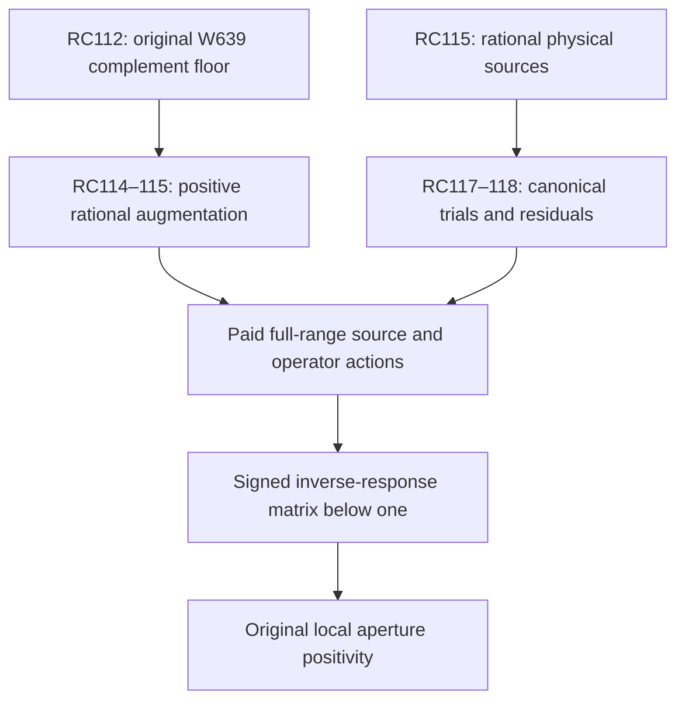

# RPB108 — RC118: canonical metric residual sources

Date: 2026-10-12 UTC. Aperture: a=11/10. Branch: research/rpb108-route-consolidation. Starting commit: b3dbd0af0e8bb6d355f65cda31416e7d3fefa38f (RC117).

## Result and scope

RC118 proves an actual canonical Riesz residual identity for the two source-shaped trials introduced at RC117, and bounds every physical residual term. It improves both certified source-realization errors without constructing a dense canonical metric. This is a source-action theorem, not an original Weil action or an inverse-response certificate.

| Quantity | Even | Odd |
|---|---:|---:|
| Physical source degree | 494 | 781 |
| Selected exact trial scalar | 11/40 | 231/1000 |
| Polynomial residual squared upper, rounded outward | 11.854679 | 0.408533 |
| Nonconstant endpoint-log source norm squared upper | 0.428050 | 0.437142 |
| Positive regular-multiplier source norm squared upper | 20.467459 | 0.543949 |
| Full physical residual norm squared upper | 23.688754 | 0.925953 |
| Canonical trial error squared upper, exact model adjoint | 23.227884 | 0.907939 |
| Previous RC117 canonical error squared upper | 24.040303 | 1.864636 |

All acceptance uses the exact rational certificate fractions; the displayed values are outward rounded. The sums of the squared component bounds are not used as a squared residual bound: the script adds their norm bounds first, paying all cross terms conservatively. The principal harmonic and central endpoint terms are kept together before this triangle estimate.

The certified original spectral count below 1/100 remains between 10 and 639. RC112's original complement floor at W_639 remains at least 5001251/500000000, and its effective-head strong floor on H_1250 orthogonal to W_639 remains valid. No new native positive direction, exhaustive small spectral census, local positivity, Global/F4 result or RH claim is made.

## Actual canonical residual theorem

Let B=11/10, let i be the canonical embedding into physical L2[-B,B], and use the Fourier convention exp(-2 pi i x xi). The actual canonical metric is

\[
 \langle v,z\rangle_c=\int_{\mathbb R}\log(e+|\xi|)\widehat v(\xi)\overline{\widehat z(\xi)}\,d\xi.
\]

All functions are extended by zero before Fourier transformation. Let q be either exact rational center polynomial from RC115, including its recorded global phase; set u_0=i^*q and v=alpha q as a supported canonical vector. Define the physical metric-action source Lq by

\[
 Lq=\sum_j(H_j+c_R+\log2)a_jP_j(x/B)+h(x)q(x)+\mathcal Rq(x),
 \quad h(x)=-\tfrac12\log(1-(x/B)^2),
\tag{1}
\]

where q=sum a_j P_j(x/B), H_j=sum_(k=1)^j 1/k, c_R=-gamma-log(2 pi(2B)), and

\[
 \mathcal Rq=\chi_{[-B,B]}\mathcal F^{-1}\{m\widehat q\},
 \qquad m(\xi)=\log(1+e/|\xi|).
\]

**Theorem.** For every supported polynomial q, Lq is in physical L2, i^*Lq=q, and

\[
 u_0-v=i^*(q-\alpha Lq),\qquad
 \|u_0-v\|_c^2\le\rho\|q-\alpha Lq\|_2^2,
 \quad\rho=252/257.
\tag{2}
\]

Proof. The inherited RC56–67 singular canonical kernel has finite-difference part (1/2) integral (q(x)-q(y))/|x-y| dy, acting as H_j on P_j, and local term c_R q-(1/2)log[t(1-t)]q, t=(x+B)/(2B). Since -(1/2)log[t(1-t)]=log2+h, this gives (1). Its endpoint logarithms multiplied by a polynomial are in L2. The positive remainder satisfies the supported-input Hilbert–Schmidt bound below, so is also in L2. The kernel identity therefore gives <q,z>_c=<Lq,iz>_2, first on the inherited dense test core and then by continuity on the canonical space. This establishes i^*Lq=q without assuming a bounded physical logarithmic multiplier. Equation (2) follows from ||i||^2<=rho. Physical endpoint jumps have not been discarded.

The canonical metric action L is distinct from the bounded physical Weil remainder K in A_Q=I+i^*Ki. Equation (2) supplies a source-realization error; it neither evaluates A_Qq nor constructs an augmented inverse response.

## Regular multiplier: supported-source control

Although m is unbounded at frequency zero, m is square integrable. Direct integration by parts gives

\[
 I_2=\int_0^\infty\log(1+e/t)^2dt=e\pi^2/3.
\]

For completeness, scale t=e s, integrate by parts, and substitute z=1/(1+s). The remaining integral is 2 integral_0^1 [-log(1-z)]/z dz=2 sum_(n>=1)1/n^2=pi^2/3; the positive series justifies integration. This is the elementary Basel identity, with pi bounded above by 22/7. The script uses e<11/4, certified by the inherited rational exponential enclosure, and I_2<= (11/4)(22/7)^2/3. For any supported physical error e_s,

\[
 \|\mathcal F^{-1}(m\widehat e_s)\|_2^2
 \le4B I_2\|e_s\|_2^2,
\tag{3}
\]

because |widehat e_s|<=sqrt(2B)||e_s||_2 and integral_R m^2=2I_2. This is a supported-input bound, not a globally bounded L2 Fourier multiplier claim.

Let U be RC115's rational band half-width, y=1 in even parity and y=xi/U in odd parity on [-U,U], and q_J=chi_[-B,B] F^-1 y. Set k=2 pi B. Its Fourier transform is W in even parity, and (xi/U)W minus [cos(k(xi-U))-cos(k(xi+U))]/(2 pi^2 B U) in odd parity, where

\[
 W(\xi)=[\operatorname{Si}(k(\xi+U))-\operatorname{Si}(k(\xi-U))]/\pi.
\]

Integration by parts in the sine-integral tail gives |Si(t)-pi/2|<=2/t for t>0. On |xi|<=U/2 this implies |W|<=A=1+1/(3BU), using pi>3. In odd parity |widehat q_J|<=A|xi|/U+d/U with d=1/(9B). With the fixed rational Young parameter t=1/16, the low-band contribution to ||m widehat q_J||^2 is at most

\[
 J_{lo}=\begin{cases}
 2A^2I_2&\text{even},\\
 (1+t)A^2(11/4)^2/U+2(1+1/t)d^2I_2/U^2&\text{odd}.
 \end{cases}
\]

The odd first term uses xi^2 m(xi)^2<=e^2. Outside this band, m^2<=4(11/4)^2/U^2 and ||q_J||^2<=||y||^2, giving J_hi=4(11/4)^2||y||^2/U^2.

RC112's contour kernel estimate and RC115's finite-model estimate are physical Hilbert–Schmidt bounds as well as canonical-domain bounds. Thus, with their squared errors d_n^2 and e_X^2 and the coefficient-radius sum R_c,

\[
 \|q-q_J\|_2\le\epsilon_2=
 d_n\|y\|+e_X\|y\|+\sqrt{2B}R_c.
\]

No canonical error bound is inverted to obtain a physical error. Combining (3) with the band profile yields

\[
 \|\mathcal Rq\|_2\le\sqrt{J_{lo}+J_{hi}}+\sqrt{4BI_2}\epsilon_2.
\tag{4}
\]

## Endpoint-log source control

The inherited pointwise contour kernel error is at most 4/exp(g_n). The rational-model kernel error is at most 2n e_0, where e_0 is the paid pi-phase error plus Taylor remainder. Consequently

\[
 |q-q_J|\le\epsilon_{pt}=(4/\exp(g_n)+2ne_0)\|y\|_1+R_c.
\]

Here ||y||_1=2U even and U odd. The exact physical band profiles imply |q_J(x)|<=1/(3|x|) even and <=1/(3|x|)+1/(18Ux^2) odd. On |x|<=B/2, h(x)<=2x^2/(3B^2). Therefore h|q| is bounded by the nonnegative polynomial

\[
 p(x)=C+\frac{2|x|}{9B^2}+\frac{2\epsilon_{pt}x^2}{3B^2},
 \quad C=0\text{ even},\quad C=1/(27UB^2)\text{ odd}.
\]

On |x|>=B/2, |q|<=M=2/(3B)+epsilon_pt, plus 2/(9UB^2) in odd parity. Finally integral_[-B,B] h^2<=B: on 0<=s<1, -log(1-s^2)<=-log(1-s), and integral_0^1 log(1-s)^2 ds=2. Hence

\[
 \|hq\|_2^2\le2\int_0^{B/2}p(x)^2dx+BM^2.
\tag{5}
\]

The second term deliberately bounds the whole interval, so double counting only increases this upper bound. No sampled endpoint quadrature is used.

## Signed polynomial cancellation and exact acceptance

Write s_j=H_j+c_mid+log2_mid, with the RC56 constant interval and a rational 80-term atanh enclosure for log2. The constant uncertainty is delta=(width(c_R)+width(log2))/2. Directed 700-digit Chebyshev-to-Legendre connection intervals from RC117 produce sign-aware bounds A_1_lower for sum m_j s_j |a_j|^2 and A_2_upper for sum m_j s_j^2 |a_j|^2, m_j=2B/(2j+1). With physical Q_upper from RC116,

\[
 \|q-\alpha\sum s_j a_jP_j\|_2^2
 \le Q_{upper}-2\alpha A_{1,lower}+\alpha^2 A_{2,upper}=P_\alpha.
\]

For each alpha in {100/1000,...,400/1000}, all positive, the residual satisfies

\[
 \|q-\alpha Lq\|_2
 \le\sqrt{P_\alpha}+\alpha(\|hq\|_{upper}+\|\mathcal Rq\|_{upper}+\delta\sqrt{Q_{upper}}).
\tag{6}
\]

The minimum certified bound selects alpha, with exact deterministic tie breaking. This is an optimization of upper enclosures, not proof of optimal trial error. Square roots are rational upward bounds. The exact rational-model adjoint differs from i^*q by RC115's certified canonical source error e_s; the final error is (sqrt(error_center)+sqrt(e_s))^2 rounded upward. Both improvements over RC117 are certified. Neither enclosure is asserted sharp.

## Coverage, completion and the minimal next estimate

RC112 already supplies a stopping rule outside an explicit W_639, without asserting that W_639 is invariant or exactly the exceptional spectral space. The 1,250-feature head is therefore an auxiliary proof cutoff, not a mandatory dense response matrix. Reducing the count below 639 or proving positivity of the remaining structure still requires an original-operator exclusion or response certificate.

The viable selected route remains RC114–115's positive augmentation Hhat=A_Q+T^*T, with its certified eta>0. For the exact finite auxiliary response B_aux=T Hhat^-1 T^*, original uniform positivity follows if B_aux<=theta I with theta<1, yielding A_Q>=eta(1-theta)I. This is an original-operator criterion; it is not a certificate for the different effective head F. For approximate responses Y and residual r=T^*-Hhat Y, the correlation-preserving identity is

\[
 B_{aux}=TY+Y^*T^*-Y^*\widehat H Y+r^*\widehat H^{-1}r.
\]

The residual correction is added here. A sufficient upper certificate is C_Y_upper+G_r_upper/eta< I, in the actual auxiliary physical metric. Scalar action bounds alone do not certify all correlated directions.

RC118 supplies a rigorous way to test supported source-shaped canonical trials. **The next minimal new operator estimate is a materially tighter canonical Riesz residual enclosure for the required auxiliary source family**, with signed hq and regular-source correlations retained or represented, followed by paid original/augmented actions. The current two-vector errors are too coarse and do not cover the entire auxiliary range. They cannot be reused as a full operator residual norm. The endpoint and positive-regular bounds are enclosure costs, not evidence of actual low or negative Weil directions.

| Route | Exact requirement still missing | RC118 contribution |
|---|---|---|
| Compact counting | Quantitative negative-part singular values below a selected threshold | No new count; inherits 10–639 |
| Galerkin exclusion | Full residuals and complementary original inequality for a smaller space | Canonical metric residual identity only |
| Inertia / positive augmentation | Full signed auxiliary inverse-response upper bound below one | Two source-realization tests improved |
| Source coercivity | Signed original prime/archimedean correlation inequality | Endpoint-aware metric source control only |



Global/F4's first-contact exclusion remains a separate obligation. Local positivity would not itself establish that theorem or RH.

## Reproduction and evidence classification

Inputs in order: RC117, RC116, RC115, RC112, RC56. The script checks milestone identities and the inherited SHA-256 links, uses exact rational norm budgets, and evaluates all source connection coefficients with directed arithmetic. Run from the repository root:

```bash
python scripts/validate_rpb108_rc118_canonical_source_residual.py \
 --output certificates/rpb108_rc118_canonical_source_residual.json \
 certificates/rpb108_rc117_source_adapted_trial.json \
 certificates/rpb108_rc116_canonical_adjoint_trials.json \
 certificates/rpb108_rc115_rational_fourier_adjoint.json \
 certificates/rpb108_rc112_parity_spectral_coverage.json \
 certificates/rpb108_rc56_precision_attached_head.json
```

Repeat with --replay. Replay reverses connection accumulation and candidate order and compares the entire exact certificate. The inherited helper scripts must be alongside the validator. No third-party quadrature or special-function package is used.

**Certified:** supported polynomial metric-action source identity, endpoint and regular source norm bounds, two improved canonical Riesz trial errors, input-linked rational certificate. **Conditional:** full original positivity from the augmented response matrix bound below one. **Exploratory:** choosing source-shaped trials as a solver basis. **Not performed:** numerical regular-source evaluation, original Weil or augmented actions, full-range source realization, inverse responses or auxiliary matrix certification. **Unsupported:** inferring an actual negative direction from these residual enclosures, equating source trial vectors with invariant low modes, or claiming count ten from the native census.
