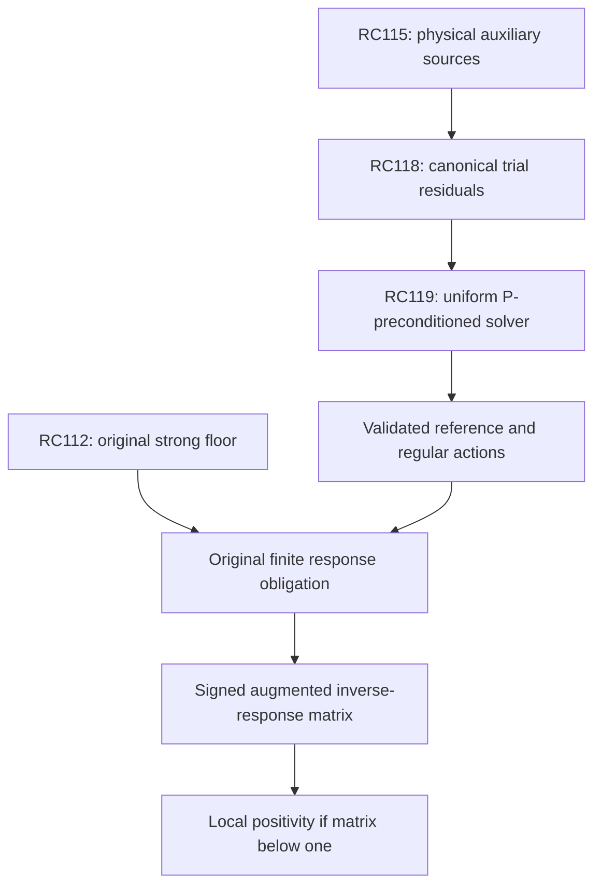

# RPB108 — RC119: uniform reference source solver and correlated stopping

Date: 2026-10-12 UTC. Aperture: a=11/10. Branch: research/rpb108-route-consolidation. Starting checkpoint: RC118, commit 867b267163659865c236530afba7a013f9aae9b5.

## Result and evidence boundary

RC119 proves a full-space preconditioning theorem for the canonical Riesz source problem. The positive reference retains the exact singular harmonic and endpoint-log structure and removes only a bounded positive regular multiplier. Its certified condition number is at most 230953/32125 = 7.189198443579767, independent of source degree, parity, or the 1,250-feature cutoff.

This supplies a convergent source-correction route and a correlated posterior stopping rule. It does not execute the reference inverse, the regular multiplier action, an original Weil action, or an augmented inverse response. Computational efficiency of the reference inverse has not been proved. No smaller exceptional spectral count is claimed.

| Certified quantity | Value |
|---|---:|
| Positive reference shift r | 789/125 = 6.312 |
| Reference physical form floor, lower | >3.801597088884796 |
| Preconditioned spectral lower a | 32125/230953 |
| Preconditioned spectral upper b | 1 |
| Uniform condition number upper | 230953/32125 < 7.2 |
| Original count below 0.01 | 10–639, inherited |

The stated decimal lower bound is rounded downward. Exact acceptance uses certificate fractions.

## Why repeating the scalar physical correction is not a stopping theorem

Write L for the positive selfadjoint physical operator associated with the actual canonical form. It is not the original Weil operator A_Q. RC118 proves Lq is a physical L2 source for every supported polynomial q, and i^*Lq=q. However L is unbounded. For a physically normalized Legendre polynomial of degree j,

\[
 \langle q_j,Lq_j\rangle_2
 \ge H_j+c_R+\log2,
 \qquad H_j\longrightarrow\infty,
\tag{1}
\]

because the remaining endpoint and regular forms are nonnegative. For every scalar alpha>0,

\[
 \|(I-\alpha L)q_j\|_2
 \ge\alpha(H_j+c_R+\log2)-1\longrightarrow\infty.
\]

Thus a fixed physical Richardson correction cannot be a bounded uniform contraction on the full source space. This is an actual metric obstruction, not a failure of an upper enclosure. It does not show that any of the specific RC118 tests diverge, and does not exhibit a negative original Weil direction.

The certificate includes exact finite noncontraction examples for the two RC118 scalars. Each dyadic harmonic block contributes at least 1/2, so H_(2^k)>=k/2. Even alpha=11/40 admits degree 2^20, with physical residual ratio >1.059639; odd alpha=231/1000 admits degree 2^23+1, with ratio >1.076596. These degrees are analytic witnesses, not matrices evaluated by the script. More generally the unbounded spectrum of L also precludes a uniform fixed-scalar contraction in its own energy norm wherever that update is defined; no preservation of all operator domains under repeated explicit correction is assumed.

## The positive principal reference

Use physical L2[-B,B], B=11/10, zero extension and Fourier convention exp(-2 pi i x xi). The canonical form has weight log(e+|xi|). Let

\[
 \mathcal R=\chi_{[-B,B]}\mathcal F^{-1}
 \log(1+e/|\xi|)\mathcal F\chi_{[-B,B]}.
\]

This notation denotes its bounded supported-input extension, not a bounded multiplier on all ambient physical L2. RC118 gives

\[
 0\preceq\mathcal R,\qquad
 \|\mathcal R\|^2\le4B I_2,
 \quad I_2=e\pi^2/3.
\]

The exact certificate uses e<11/4, pi<22/7, the same staged upward rounding as RC118, and verifies

\[
 \|\mathcal R\|^2\le
 248996598639455782313/6250000000000000000
 <(789/125)^2.
\tag{2}
\]

Positivity follows from the Fourier quadratic form and density; boundedness follows from the supported-source Hilbert–Schmidt estimate. Define

\[
 P=L+rI-\mathcal R,
 \qquad r=789/125.
\tag{3}
\]

P is the operator of the closed form obtained by adding the bounded nonnegative form rI-R to the closed canonical form. It has exactly the same form domain as L. This construction avoids assuming a separately closed indefinite log-frequency operator. On supported polynomials, RC118's identity gives the explicit reference action

\[
 Pq=\sum_j(H_j+c_R+\log2+r)a_jP_j(x/B)
       -\tfrac12\log(1-(x/B)^2)q(x).
\tag{4}
\]

Thus this is the shifted singular principal reference, with the actual constant c_R and both endpoints retained. No prime, pole or archimedean Weil source enters P. In particular P is not an approximation to A_Q and is not the effective head F.

The rational RC56 constant enclosure and the positive 80-term atanh enclosure for log2 certify

\[
 s=c_R+\log2+r\ge s_{lower}>3.801597088884796.
\]

The singular finite-difference form is (1/4) integral integral |q(x)-q(y)|^2/|x-y| dx dy, and the endpoint multiplier is nonnegative. Their closed-form representation, obtained from the inherited singular kernel on the dense test core and positive truncation, gives P>=s_lower I on the whole form domain. The Legendre harmonic diagonal is its polynomial realization; the global inequality is not inferred from a finite polynomial compression. The physical inverse P^-1 therefore exists and has norm at most 1/s_lower.

## Uniform preconditioning theorem

**Theorem.** On the common form domain,

\[
 \boxed{aP\preceq L\preceq P,
 \quad a=(1+r\rho)^{-1}=32125/230953,
 \quad\rho=252/257.}
\tag{5}
\]

Proof. By (2), P-L=rI-R>=0. Also P<=L+rI. The inherited actual embedding bound gives L>=rho^-1 I as a physical form. Therefore P<= (1+r rho)L. All constants in (5) apply to the full supported physical source problem; no finite compression is used.

Let the reference energy space have inner product <x,y>_P. The bounded form operator

\[
 M=P^{-1}L=I-P^{-1}(rI-\mathcal R)
\tag{6}
\]

means the Riesz operator of the L form in that energy space. It is selfadjoint in the P metric, with spectrum in [a,1]. It need not be selfadjoint in an arbitrary Euclidean coefficient metric. The equivalent physical conjugate is P^-1/2 L P^-1/2 in its form sense. Equation (6) only requires a bounded regular source and a reference inverse; it does not require direct application of an unbounded L to every iterate.

For physical q, the exact supported solution u=L^-1q represents the canonical source i^*q: <u,z>_c=<q,iz>_2. If v_0 is a canonical trial with a physical residual r_0=q-Lv_0, define g=P^-1r_0. Then M(u-v_0)=g. For the inverse polynomial p_n below,

\[
 v_n=v_0+p_n(M)g,
 \qquad\|u-v_n\|_c\le\epsilon_n\|u-v_0\|_c.
\tag{7}
\]

This follows because the residual polynomial commutes with M and the L energy is <Mx,x>_P. The same construction starts with v_0=0, for which ||u||_c<=sqrt(rho)||q||_2. It is valid for an entire source map as well as a single vector, with operator/Gram error contracts in the source metric.

## Exact Chebyshev and inexact-action budgets

Set b=1, c=(b+a)/(b-a), Z=(b+a-2M)/(b-a). The exact normalized residual and inverse polynomials are

\[
 R_n(M)=T_n(Z)/T_n(c),\quad
 p_n(M)=[I-R_n(M)]/M,\quad
 \epsilon_n=1/T_n(c).
\]

The quotient is a polynomial of degree n-1. Rather than large monomial coefficients, use the normalized recurrence x_k=p_k(M)g:

\[
 x_0=0,\quad x_1=2g/(a+b),
\]

\[
 x_{k+1}=
 \frac{2T_k(c)}{T_{k+1}(c)}Zx_k
 -\frac{T_{k-1}(c)}{T_{k+1}(c)}x_{k-1}
 +\frac{4T_k(c)}{(b-a)T_{k+1}(c)}g.
\tag{8}
\]

A local normalized fault f_j propagates to step n as

\[
 E_n=\sum_{j=1}^n\frac{T_j(c)}{T_n(c)}U_{n-j}(Z)f_j.
\]

Since spectrum(Z) is in [-1,1], ||U_l(Z)||_P<=l+1, and T_j(c)/T_n(c)<=1. If every local fault has P norm at most eta, total P error is at most H_n eta with H_n=n(n+1)/2. This also holds in operator norm for a source map, provided the fault Gram contracts are verified in its actual metric. Errors in applying Z, reference inverse actions, regular multiplier actions, coefficient rounding and recurrence arithmetic must all be included in f_j; a residual polynomial degree alone is not an action certificate.

If the source solve gives g_tilde with P error at most delta_g, then

\[
 \|u-v_n^{computed}\|_c
 \le\epsilon_n E_0+(1+\epsilon_n)\delta_g/a+H_n\eta,
 \quad E_0\ge\|u-v_0\|_c.
\tag{9}
\]

The P-to-canonical conversion costs no additional factor because L<=P. The certificate allocates one third of target tau E_0 to each term: epsilon_n<=tau/3, delta_g/E_0<=a tau/[3(1+epsilon_n)], eta/E_0<=tau/(3H_n).

| Relative canonical error norm target tau | Residual degree n | Inverse degree | Fault amplification H_n |
|---|---:|---:|---:|
| 10^-6 | 20 | 19 | 210 |
| 10^-12 | 38 | 37 | 741 |
| 10^-24 | 73 | 72 | 2701 |

Each degree is the least satisfying the exact one-third residual allocation, not a lower bound on the best possible solver degree. RC118's two center-source trial error bounds can be used for E_0. The certificate records conditional final exact rational-model adjoint errors, adding RC115's source approximation error afterward by the norm triangle inequality. These are achievable budgets under (9), not computed corrections or new measured errors.

## Correlated posterior stopping and reference-inverse certification

For any trial source family V with full physical residual columns R_0=Q-LV, put

\[
 G_P=R_0^*P^{-1}R_0,\qquad
 G_c=R_0^*L^{-1}R_0.
\]

The exact canonical source error Gram is G_c. Inverse monotonicity of (5) gives the stopping rule

\[
 \boxed{G_P\preceq G_c\preceq a^{-1}G_P.}
\tag{10}
\]

A certified upper for the full matrix G_P therefore controls all linear combinations and preserves correlations. Separate diagonal upper bounds do not supply the same matrix inequality. For an auxiliary reference solve with approximate columns W, set T_0=R_0-PW. The exact identity is

\[
 G_P=C_W+T_0^*P^{-1}T_0,
 \quad C_W=R_0^*W+W^*R_0-W^*PW.
\]

Consequently

\[
 C_W\preceq G_P\preceq C_W+s_{lower}^{-1}\operatorname{Gram}_{physical}(T_0).
\tag{11}
\]

The correction is added. Full projection, arithmetic, constant and action errors must be paid in the signed C_W enclosure and full residual Gram. A source approximation is handled by its inherited canonical error or an appropriate full-map norm contract, not by inverting a canonical-to-physical embedding bound.

Equation (11) is a concrete reference-inverse validation target. On polynomial W, PW has the explicit harmonic plus endpoint source (4); the only nonrational constant has the actual RC56 enclosure. Polynomial reference-form entries use the inherited harmonic diagonal, physical mass and exact endpoint-log moments from RC117. Thus no regular-multiplier quadrature is needed to build those entries. This does not prove a cheap reference inverse: adaptive Galerkin conditioning and a full physical residual Gram, including endpoint logarithms, still need certification. A finite compressed residual alone is insufficient.

## Connection to exceptional-spectrum completion

RC112 already proves a positive original floor on W_639 orthogonal complement, and a corresponding floor on the specified strong compression of the effective head. That does not identify W_639 as an invariant spectral space. The original threshold count remains 10–639. RC119 changes the source solver obligation, not that count.

The selected original-operator completion route remains the rational augmentation Hhat=A_Q+T^*T from RC115. Given Hhat>=eta I, completing the full signed response B_aux=T Hhat^-1T^*<=theta I with theta<1 gives A_Q>=eta(1-theta)I. Approximate augmented responses must use the RC114 signed identity plus their inverse-residual correction; the new P inverse is not Hhat^-1 and cannot replace it in that identity. The original/effective spectral subspaces are not interchanged.

| Stage | Status after RC119 | Minimal new estimate |
|---|---|---|
| Original strong floor / finite coverage | Certified, W_639; count 10–639 | Smaller original exclusion theorem if count reduction is pursued |
| Full physical model sources | Certified rational kernel recipe, two evaluated tests | Full source-map realization/metric contracts |
| Canonical source correction | Uniform bounded-condition theorem and Gram stopping rule certified | Reference P inverse actions and bounded regular R actions with full-map errors |
| Original/augmented actions | Not performed for the required response family | Paid original arithmetic source actions |
| Auxiliary inverse-response matrix | Not evaluated | Signed matrix upper below one |
| Global/F4 and RH | Separate; not concluded | Original global first-contact exclusion and remaining target chain |

The next focused experiment is a **validated P inverse action**, using (4) and (11), together with a numerical representation and certified physical error for R. This is more specific than trying additional scalar trial adjustments. It may use an adaptive polynomial cutoff, but neither the stopping theorem nor its condition number mandates a dense 1,250-feature metric. The theorem does not yet demonstrate that the implementation is cheaper than other reference solvers.



## Validation and reproduction

Input order: RC118, RC115, RC56. Hash linkage is checked against RC118. Exact rational checks certify the shift, reference floor, spectral interval, minimal degree budgets and scalar noncontraction witnesses. Replay uses the independent positive-binomial formula for T_n(c), reversed log-series accumulation and power-series matrix evaluation instead of Horner evaluation.

The two-dimensional rational control uses a nonidentity physical metric and noncommuting reference/canonical forms. It verifies the normalized quotient recurrence, the exact local-fault propagation identity, full fault and final error Gram bounds, the posterior canonical sandwich, and the signed reference response plus residual identity. It is explicitly an abstract control, not an arithmetic source action. Analytic infinite-dimensional hypotheses are proved above; these matrix controls do not substitute for those proofs.

```bash
python scripts/validate_rpb108_rc119_reference_preconditioned_source_solver.py \
 --output certificates/rpb108_rc119_reference_preconditioned_source_solver.json \
 certificates/rpb108_rc118_canonical_source_residual.json \
 certificates/rpb108_rc115_rational_fourier_adjoint.json \
 certificates/rpb108_rc56_precision_attached_head.json
```

Repeat with --replay to compare the complete certificate. Inherited helper scripts, including RC103 polynomial routines and exact matrix arithmetic, must be alongside the validator.

**Certified facts:** full-space reference positivity and form equivalence, bounded preconditioned spectrum, fixed-scalar obstruction, correlated stopping identities, exact rational budgets and replay controls. **Conditional reductions:** convergence and warm-start targets assuming validated action contracts; original positivity assuming the separate auxiliary matrix criterion. **Exploratory implementation choice:** adaptive polynomial P inverse. **Not performed:** reference inverse, regular multiplier evaluation, full-range source realization, original Weil/augmented actions or inverse responses. **Unsupported possibilities:** cheap implementation, exhaustive count ten, or local/global positivity from source conditioning alone. No Lean formalization or unrelated branch was modified.
