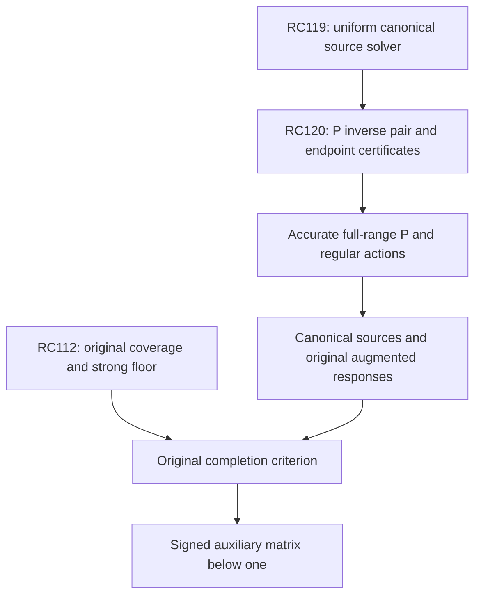

# RPB108 — RC120: implemented reference inverse trials and full endpoint residual

Date: 2026-10-12 UTC. Aperture: a=11/10. Branch: research/rpb108-route-consolidation. Starting checkpoint: RC119, commit 880b02c0f948eb17edaac4452ec806ebb584c509.

## Result

RC120 implements two polynomial approximate actions of RC119's positive principal-reference inverse P^-1, using the existing full source polynomials from RC115. Their errors are certified by the **full physical residual**, including its logarithmic endpoint part. No dense canonical metric is evaluated. The script stores all trial coefficients and an exact/interval certificate, with independent replay.

| Outward display bound | Even source | Odd source |
|---|---:|---:|
| Polynomial degree | 494 | 781 |
| Endpoint-log residual squared upper | 0.000913695 | 0.000344609 |
| Reference inverse P-energy error squared upper | 0.000240345 | 0.000090649 |
| Exact reference response lower | 13.739170978635 | 6.452226434365 |
| Exact reference response upper | 13.739411323520 | 6.452317082621 |
| Relative squared P-energy error upper | 0.000017493406 | 0.000014049144 |
| Response-energy fraction accounted for, lower | 0.999982506900 | 0.999985951053 |

The table applies after paying RC115's physical coefficient uncertainties for the exact rational-model sources. Exact acceptance uses rational certificate values. The squared errors are absolute P-energy errors for P^-1q; they are not errors of a computed canonical source i^*q or of an augmented Weil inverse response.

These tests account for over 99.998% of each tested reference response's energy. They do not yet meet RC119's high-accuracy action contracts, nor certify P^-1 on the full auxiliary range. The positive regular multiplier R has not been numerically applied. The original spectral count remains 10–639 below 0.01, with RC112's strong floor preserved. No new positive native direction, local positivity, Global/F4 conclusion, RH claim, or Lean change is made.

## Operators and sources

The actual canonical form defines the positive physical selfadjoint metric operator L, distinct from the original Weil operator A_Q. RC119 defines the positive reference

\[
 P=L+rI-\mathcal R,
 \quad r=789/125,
 \quad s=c_R+\log2+r,
\]

where R is the bounded supported regular metric multiplier with Fourier symbol log(1+e/|xi|). Its full-space inequalities remain

\[
 P\succeq s_{lower}I,\quad s_{lower}>3.801597088884796,
 \qquad aP\preceq L\preceq P,
 \quad a=32125/230953.
\]

On supported polynomial w=sum w_j P_j(x/B), B=11/10,

\[
 Pw=\sum_j(H_j+s)w_jP_j(x/B)+h(x)w(x),
 \quad h(x)=-\tfrac12\log(1-(x/B)^2).
\tag{1}
\]

The physical center sources q are the degree-494 even and degree-781 odd polynomials already constructed at RC115, for auxiliary vectors y=1 and y=xi/U. They have global phases 1 and i respectively. RC120 extracts that fixed phase for real arithmetic and reinstates it conceptually; all physical pairings retain it on both source and trial. The reference preserves parity.

Define z=P^-1q in physical coordinates. Its reference energy ||z||_P^2=<q,P^-1q> is not ||i^*q||_c^2=<q,L^-1q>. The latter source solve is still governed by RC119's preconditioned iteration and requires validated regular-source actions. Nor is P^-1 the inverse of the augmented original Weil operator Hhat.

## Harmonic-diagonal trial and paid projection errors

RC117's directed 700-digit Chebyshev-to-Legendre connection gives actual center-source coefficients a_j in rational intervals [a_j_lower,a_j_upper]. Let s_mid be the midpoint of the paid RC56 constant and RC119 log2 enclosures, plus r. Propose

\[
 v_j=\operatorname{rounddown}_{10^{-70}}
 \frac{(a_{j,lower}+a_{j,upper})/2}{H_j+s_{mid}}.
\]

All denominators are positive. This diagonal action retains every source degree and isolates the nonconstant endpoint multiplier as the remaining source term. It is not a Galerkin inverse of P, and is not asserted to be an optimal polynomial trial.

The script converts v_j P_j to a physical Chebyshev polynomial with directed 700-digit arithmetic, then rounds centers to a 10^-70 grid. The stored trial w is this exact rational center polynomial. Its discrepancy e from the proposed Legendre polynomial obeys

\[
 \|e\|_2\le\sqrt{2B}\sum_j\operatorname{radius}_j=\epsilon_{conv}.
\]

Since the harmonic operator is physically diagonal on Legendre polynomials of degree at most N, its norm on this polynomial space is H_N. The polynomial part of the full reference residual t=q-Pw has norm at most

\[
 \epsilon_{poly}=
 \sqrt{\sum_j\frac{2B}{2j+1}
  \max_{a\in[a_{j,lower},a_{j,upper}]}
       |a-(H_j+s_{mid})v_j|^2}
 +(H_N+s_{mid})\epsilon_{conv}
 +\delta_s\|w\|_2.
\tag{2}
\]

Here delta_s is the paid half-width of c_R+log2. Each squared term is rounded upward, and physical norm and root rounding are paid. No canonical error is inverted to infer a physical source error. Thus

\[
 \|q-Pw\|_2\le\epsilon_{poly}+\|hw\|_2.
\tag{3}
\]

The endpoint term is an actual L2 source, despite its pointwise logarithmic divergence at the physical boundary. Its complete squared norm is certified below, rather than measured only through finite moments. Nothing is assumed about annihilation outside the polynomial trial space.

## Exact squared endpoint-log moments

For x in [-1,1], define

\[
 h(x)=-\tfrac12\log(1-x^2),\quad
 K_n=\int_{-1}^1 T_n(x)h(x)^2dx,
 \quad I_n=\int_{-1}^1T_n(x)dx.
\]

I_n=2/(1-n^2) for even n and zero for odd n. Let L_n=integral T_n(x)[-log((x+1)/2)]dx be the exact rational endpoint moments from RC117. For even n, the first h moment is L_n-log2 I_n; all odd moments vanish. The base squared moment is

\[
 K_0=4-4\log2+2(\log2)^2-\pi^2/6.
\tag{4}
\]

It follows by expanding log(1-x^2)=log(1-x)+log(1+x). The squared single-log integrals are elementary, and the mixed integral is obtained from the positive logarithmic series or the beta derivative. No sampled quadrature is involved.

For even n>=2, take the boundary-vanishing primitive

\[
 F_n(x)=\frac{T_{n+1}(x)}{2(n+1)}
       -\frac{T_{n-1}(x)}{2(n-1)}+\frac{x}{n^2-1}.
\]

Its derivative is T_n+1/(n^2-1), and the exact polynomial identity is

\[
 \frac{F_n(x)}{1-x^2}
 =-\frac{2}{n^2-1}\sum_{\substack{1\le j<n\\j\ odd}}jT_j(x).
\]

Since F_n h^2 tends to zero at both endpoints, integration by parts is valid. Using (h^2)'=2xh/(1-x^2) gives

\[
 \boxed{K_n=-\frac{K_0}{n^2-1}
 +\frac{2}{n^2-1}\sum_{\substack{1\le j<n\\j\ odd}}
 j\{L_{j+1}+L_{j-1}-(\log2)(I_{j+1}+I_{j-1})\}.}
\tag{5}
\]

Every moment is therefore an exact rational linear combination of 1, log2, (log2)^2 and pi^2. Prefix sums compute all moments in a single recurrence. This avoids unstable high-degree power expansion and arbitrary endpoint truncation.

The validator independently checks (4)–(5) through degree 24 by expanding T_n into monomials and using

\[
 \int_{-1}^1 x^{2k}h(x)^2dx
 =\frac{4(O_k^2+O_k^{(2)})-8O_k\log2
       +4(\log2)^2-\pi^2/3}{4k+2},
\]

where O_k=sum_(j=1)^(k+1) 1/(2j-1) and O_k^(2)=sum 1/(2j-1)^2. This identity is the second beta derivative at parameters k+1/2 and 1; the half-integer harmonic reductions give the displayed finite sums. The verification is symbolic rational equality of all four coefficients, not comparison of floating-point samples.

For the stored w, integer Chebyshev product convolution constructs w^2 exactly from T_jT_k=(T_(j+k)+T_|j-k|)/2. Combining its coefficients with (5) yields the full integral B integral_-1^1 h^2 |w|^2 as one four-symbol expression. Rational log2 bounds and an independently checked Machin enclosure for pi enclose the expression with its signed coefficients preserved. Constant and source connection errors are separately paid in (2). These exact squared-log moments are a reusable tool for future polynomial reference residuals, not merely this source pair.

## Actual reference-inverse certificate

The full residual squared upper R_t from (3) implies

\[
 \boxed{\|P^{-1}q-w\|_P^2
 =\langle t,P^{-1}t\rangle_2\le R_t/s_{lower}.}
\tag{6}
\]

Reference trial energies are independently bounded using the Legendre harmonic proposal and its connection error, the actual physical mass, and RC117's exact endpoint-log moments. In fixed parity,

\[
 \|w\|_P^2=
 \sum_jH_j\frac{2B}{2j+1}|w_j|^2
 +(c_R+r)\|w\|_2^2
 +\int_{-B}^B[-\log((x+B)/(2B))]|w|^2dx.
\]

Both upper and lower harmonic sums are rounded in the proper direction; the connection discrepancy is paid in the harmonic square-root norm. Physical source-trial pairings are exact rational Chebyshev convolutions. Define

\[
 C_w=2\Re\langle q,w\rangle_2-\|w\|_P^2.
\]

The exact signed identity is

\[
 \langle q,P^{-1}q\rangle_2
 =C_w+\langle t,P^{-1}t\rangle_2.
\tag{7}
\]

Hence the certificate's positive C_lower and C_upper+R_t/s_lower bound the reference response. The relative squared inverse error is at most (R_t/s_lower)/C_lower. The response-energy fraction accounted for is at least C_lower/(C_upper+R_t/s_lower); it expresses 1 minus the relative approximation error, not an assertion that w is an invariant spectral mode.

The exact rational-kernel model source differs from its center q by a physical error at most sqrt(2B) times the sum of RC115 coefficient radii. This increases the physical residual norm in (3), and changes the source-trial pairing by at most that error times ||w||_2. Those changes are paid in the exact-model fields and in the display table. This target is the exact rational-model physical source, not the exact-band Fourier source; no unrecorded contour transfer is assumed.

For the tested two-column source map, opposite parity makes the physical/reference response and error Grams diagonal. Thus the individual enclosures combine into a complete two-source matrix enclosure. This does not certify all 248 even and 391 odd auxiliary source directions, which share parity and require their cross correlations.

## What this resolves and what remains

RC119's reference inverse had only an analytic existence and condition bound. RC120 now supplies two explicit approximate actions with full residual certificates and a reusable endpoint-log-squared integration method. It does not complete the high-accuracy reference actions needed by the Chebyshev solver. The next minimal estimate is a tighter P inverse action—e.g. a correction retaining the endpoint source—and a certified numerical regular multiplier action on the resulting source family. Repeatedly applying an unbounded physical L with a fixed scalar remains excluded by RC119.

| Obligation | Standing after RC120 |
|---|---|
| Positive original floor outside W_639 | Certified at >=5001251/500000000 |
| Original threshold census | 10–639 below 0.01; not exhaustive at ten |
| P inverse actions | Two full-degree tests implemented and certified |
| High-accuracy/full-range P inverse | Open; finite-column tests are insufficient |
| Bounded regular source action R | Norm certified; numerical action open |
| Full canonical source solver | Conditional RC119 stopping theorem; iteration not executed |
| Original/augmented source responses | Not performed for the required full family |
| Signed auxiliary response matrix below one | Open; remains the original positivity criterion |

For the exact rational augmentation Hhat=A_Q+T^*T, its inherited eta>0 and a certified T Hhat^-1T^*<=theta I, theta<1, would give A_Q>=eta(1-theta)I. P^-1 cannot be substituted for Hhat^-1, and its response bounds are not bounds on the effective head F. The source preconditioner only supports the numerical realization needed before that separate matrix criterion. Signed residual corrections and actual source/metric errors remain mandatory.



A dense 1,250-feature calculation is not required by the stopping theorem. Whether adaptive reference actions are computationally cheaper remains an implementation question. Local positivity, Global/F4's separate first-contact obligation, and RH remain distinct and unproved by this checkpoint.

## Reproduction and classification

Inputs: RC119, RC115, RC56, in that order. The validator checks SHA-256 linkage, reconstructs every retained source coefficient, records all rational trial Chebyshev coefficients, independently encloses pi, verifies 25 symbolic endpoint controls, and pays all full physical residual and constant errors.

```bash
python scripts/validate_rpb108_rc120_reference_inverse_action.py \
 --output certificates/rpb108_rc120_reference_inverse_action.json \
 certificates/rpb108_rc119_reference_preconditioned_source_solver.json \
 certificates/rpb108_rc115_rational_fourier_adjoint.json \
 certificates/rpb108_rc56_precision_attached_head.json
```

Repeat with --replay. Replay reverses both directed connection accumulation orders, physical moment accumulation and squared-log symbolic summation and compares the complete exact certificate. The inherited helper scripts must be alongside the validator.

**Certified facts:** two stored rational reference inverse trials, full endpoint residual norms, signed reference-response intervals, physical source coefficient errors, exact squared-log recurrence and symbolic controls. **Conditional reductions:** high-accuracy canonical iteration after action contracts; original positivity after the distinct auxiliary response matrix bound. **Exploratory:** endpoint-aware correction as a next solver basis. **Not performed:** accurate/full-range reference solve, numerical regular action, canonical iteration, original Weil action or augmented inverse response. **Unsupported:** extrapolating two trials to a full operator norm or equating their energy capture with exceptional spectral coverage. Work is additive on the RC branch; no Lean or unrelated branches are changed.
