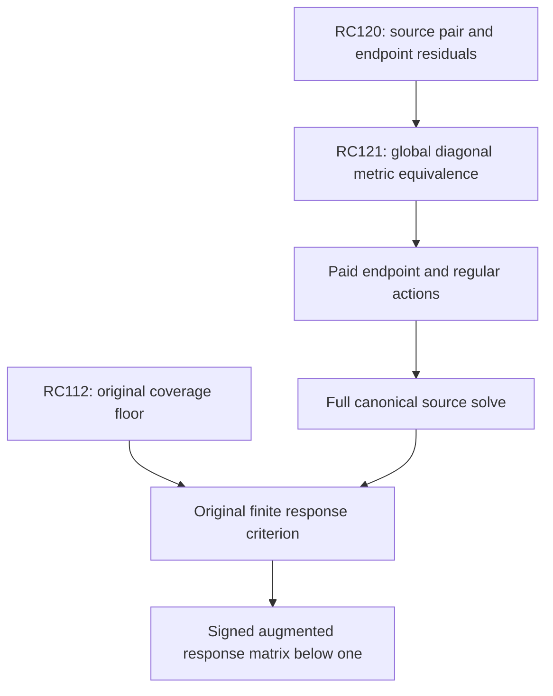

# RPB108 — RC121: global diagonal metric equivalence and endpoint action coverage

Date: 2026-10-12 UTC. Aperture: a=11/10. Branch: research/rpb108-route-consolidation. Starting checkpoint: RC120, commit 72e1c4cb7a89dd12a48371fcc32634a626baf171.

## Result and operator boundary

RC121 proves the full-space endpoint form inequality

\[
 \boxed{0\preceq h\preceq J+2\log2\,I,}
 \qquad h(x)=-\tfrac12\log(1-(x/B)^2),
 \quad JP_n=H_nP_n.
\tag{1}
\]

This gives an explicit diagonal preconditioner D for the positive principal reference P and the actual canonical metric operator L:

\[
 \boxed{D\preceq P\preceq2D,\qquad aD\preceq L\preceq2D,}
 \quad D=J+sI,\quad s=c_R+\log2+789/125,
 \quad a=32125/230953.
\tag{2}
\]

All statements use the actual constant c_R and the actual supported canonical form, not a Euclidean coefficient metric or a surrogate finite compression. This is a **global source-conditioning theorem**, not an original Weil strong-floor theorem. L defines the canonical norm; it is not A_Q. P is RC119's positive singular reference; it is not the effective head F or the augmented Weil operator Hhat.

| Full-space solver | Certified preconditioned spectrum | Condition upper |
|---|---|---:|
| Reference P with diagonal D | [1,2] | 2 |
| Actual canonical L with diagonal D | [32125/230953,2] | 14.378396887159534 |

The reference inverse no longer needs to be treated as an unknown black-box preconditioner. Diagonal inversion is explicit, while endpoint actions have an exact coefficient formula and an omitted-output error bound. The direct canonical route can avoid nesting an approximate P inverse inside every metric action. No iterative endpoint or regular action has yet been executed.

RC120's two stored trials are also certified here as very accurate **D inverse source actions**, with squared D-energy errors below 9.908e-62 even and 4.009e-62 odd, including the physical source coefficient error. This is distinct from their approximate P inverse role at RC120 and is not a computed canonical Riesz image.

The original threshold count remains 10–639 below 0.01. RC112's original strong floor outside W_639 and its specifically identified effective-head strong compression remain preserved. No new native positive direction is added; no local positivity, Global/F4 or RH conclusion is made.

## Exact endpoint matrix

Use B=11/10, physical mass m_n=2B/(2n+1), and normalized physical Legendre basis e_n=P_n(x/B)/sqrt(m_n). Reflection makes the endpoint matrix block diagonal by parity. Its diagonal is

\[
 d_n=\langle e_n,he_n\rangle_2
 =2H_{2n}-2H_n+\frac1{2n+1}-\log2,
\tag{3}
\]

and, for n!=m of the same parity,

\[
 h_{nm}=\frac{\sqrt{(2n+1)(2m+1)}}{|n-m|(n+m+1)}.
\tag{4}
\]

Opposite-parity entries vanish. Thus all within-parity matrix entries are nonnegative. The polynomial kernel expression is exact; it is not a sampled quadrature enclosure.

For completeness, these formulas follow from the single-endpoint logarithmic integral. For n>m, the Legendre Sturm–Liouville equation, integrated against the other polynomial times log(1-x), gives

\[
 \int_{-1}^1P_nP_m\log(1-x)dx
 =-\frac2{(n-m)(n+m+1)}.
\]

The boundary flux vanishes since (1-x^2)log(1-x) tends to zero. The derivative identity and physical orthogonality give integral (1+x)(P_n'P_m-P_m'P_n)=2, which determines the numerator. Combining the two endpoints cancels opposite parity and yields (4).

For the diagonal, Rodrigues integration gives the Jacobi norm at parameter alpha and second parameter zero,

\[
 N_n(\alpha)=\frac{2^{\alpha+1}}{2n+\alpha+1},\quad
 k_n(\alpha)=2^{-n}\frac{\Gamma(2n+\alpha+1)}{n!\Gamma(n+\alpha+1)}
\]

for its leading coefficient. Differentiating the norm at alpha=0 and subtracting twice the leading-coefficient derivative gives

\[
 \frac{\int P_n^2\log(1-x)dx}{2/(2n+1)}
 =\log2-\frac1{2n+1}-2(H_{2n}-H_n),
\]

which proves (3). These beta/Rodrigues identities are used as elementary analytic identities, not as numerical special-function evaluations. The validator independently integrates every same-parity product through degree 24 by its exact shifted power expansion against -log((1+x)/2), verifying both formulas. The log2 term is treated symbolically on diagonal entries.

## Infinite weighted Schur theorem

Take positive Schur weights omega_n=(2n+1)^(-1/2). They need not be square summable: the inequality is applied first to finitely supported vectors, with finite individual row sums. From (4), the weighted off-diagonal row terms are

\[
 h_{nm}\omega_m/\omega_n
 =\frac{2n+1}{|n-m|(n+m+1)}.
\]

For m=n-2k<n, this equals 1/(2k)+1/(2n-2k+1). For m=n+2k>n it equals 1/(2k)-1/(2n+2k+1). Exact harmonic summation gives

\[
 \sum_{\substack{m\ne n\\m\equiv n\ (2)}}
 h_{nm}\omega_m/\omega_n
 =d_n+H_{\lfloor n/2\rfloor}.
\tag{5}
\]

The upper infinite sum is H_(2n)-(1/2)H_n+1/(2n+1)-log2; the lower finite sum is H_(2n)-(3/2)H_n+H_floor(n/2). They combine into (5), including n=0. The infinite row sum is evaluated analytically; it is not extrapolated from finite rows.

We also have 0<=d_n<=log2. Positivity follows from h>=0. For the upper bound, convexity of 1/x on each midpoint interval gives

\[
 H_{2n}-H_n\le\log\frac{4n+1}{2n+1}
 =\log2-\log\frac{4n+2}{4n+1}.
\]

The inequality log(1+t)>=t/(1+t) then yields
H_(2n)-H_n+1/(4n+2)<=log2. The empty-sum case n=0 satisfies the same statement. Applying (3) proves d_n<=log2.

Including the diagonal, the exact weighted row sum is

\[
 2d_n+H_{\lfloor n/2\rfloor}\le H_n+2\log2.
\]

The weighted inequality 2|x_nx_m|<=|x_n|^2 omega_m/omega_n+|x_m|^2 omega_n/omega_m, summed over the nonnegative entries, proves (1) for every polynomial. This is a signed-structure argument: the parity and positive endpoint coefficients are retained, rather than bounding the logarithm by a pointwise supremum, which is infinite.

## Full-domain transfer and actual canonical metric

The endpoint form is the closed nonnegative physical multiplication form. The Legendre harmonic form J is the closed diagonal form with weights H_n. Inequality (1) extends by the polynomial core of J and closedness of the endpoint form; it supplies form-domain inclusion and form continuity. In particular every J-form vector has finite endpoint energy.

To avoid assuming coverage from a finite basis, one can identify the canonical closure directly. Smooth functions supported strictly inside [-B,B] have rapidly decaying Legendre coefficients, by repeated use of the Legendre differential operator and orthogonality. Their Legendre partial sums converge in the J form, hence also in endpoint energy by (1). On polynomial sums the inherited singular kernel identity and the positive bounded regular form imply the upper canonical bound in (2). Thus those sums converge in the closed Fourier canonical form to the original smooth physical vector.

Conversely, smooth interior tests are dense in the supported canonical form: shrink the support by a dilation tending to the identity, then convolve with a compact smooth approximate identity inside the remaining margin. Weighted Fourier dilation and the bounded approximate-identity multipliers converge in log(e+|xi|) weighted L2. This proves polynomial form-core density without treating physical L2 density alone as energy density. The lower canonical bound from RC119 then gives convergence in D energy for every canonical Cauchy sequence. The closures coincide. Consequently (1)–(2) cover the whole supported canonical form domain, not merely the polynomial compression.

Since the exact s satisfies s>=s_lower>3.801597088884796>2log2, (1) gives h<=D and hence D<=P=D+h<=2D. Combining with RC119's aP<=L<=P proves the second inequality in (2). Numerical uses of D pay the actual constant enclosure. No finite Weil inertia or spectral subspace is inferred from this metric equivalence.

## Explicit endpoint action and omitted output

The bounded reference-energy action C=D^-1h is selfadjoint in D energy, with spectrum in [0,1]. For a polynomial w=sum_(n<=N) a_n P_n, its coefficients are explicit. The diagonal coefficient uses d_m a_m/(H_m+s). For unequal indices of the same parity,

\[
 (Cw)_m=\frac{2m+1}{H_m+s}
 \sum_{\substack{n\le N\\n\equiv m\ (2)}}
 \frac{a_n}{|m-n|(m+n+1)},
\tag{6}
\]

with the diagonal term added separately when m<=N. No inverse Gram or dense canonical metric is required to define this action. For m>N the displayed denominator is m(m+1)-n(n+1), so signed endpoint moments can be preserved for tighter tails in later work.

Let M>N be an output cutoff, and let A=sum_(n<=N)|a_n|. The full omitted D-energy satisfies

\[
 \|(I-\Pi_M)Cw\|_D^2
 \le\frac{2BA^2}{s_{lower}(M-N)^2}.
\tag{7}
\]

Indeed for m>M the sum in (6) has magnitude at most A/[(m-N)(m+1)], and the D-weighted squared coefficient is at most 4BA^2/[s_lower(m-N)^2(m+1)]. Since m+1>=m-N, the cubic series is bounded by its integral, 1/[2(M-N)^2]. Parity can improve this estimate but is not needed for certification.

Cauchy–Schwarz in the actual D metric gives

\[
 A^2\le C_N\|w\|_D^2,\qquad
 C_N=\sum_{\substack{n\le N\\n\text{ in input parity}}}
 \frac{2n+1}{2B(H_n+s_{lower})}.
\]

Thus (7) becomes a uniform full-input action contract, not just a bound on the two tested sources:

\[
 \boxed{\|(I-\Pi_M)Cw\|_D^2
 \le T_{N,M}\|w\|_D^2,\quad
 T_{N,M}=2BC_N/[s_{lower}(M-N)^2].}
\tag{8}
\]

For any polynomial source map W of that degree, the omitted-output Gram obeys R_tail^*D R_tail<=T_(N,M) W^*D W. All linear combinations are controlled with their actual correlations. No omitted-output residual is silently assumed zero.

| Parity | Input degree N | Output cutoff M | Uniform squared D-energy tail factor, upper |
|---|---:|---:|---:|
| Even | 494 | 989 | 0.013104960748 |
| Even | 494 | 1977 | 0.001460036861 |
| Even | 494 | 7905 | 0.000058464535 |
| Odd | 781 | 1563 | 0.012524461309 |
| Odd | 781 | 3125 | 0.001393982581 |
| Odd | 781 | 12497 | 0.000055797384 |

These are cutoff bounds, not executed endpoint actions. They are deliberately coarse. Their algebraic decay alone would demand impractically large cutoffs for very high accuracy. That is an enclosure limitation, not an obstruction to the bounded solver. Retaining signed endpoint moments in the exact denominator, using endpoint-enriched trial functions, or deriving a better form tail remains a concrete next estimate. No cheap high-accuracy implementation is asserted.

Input coefficient errors cost at most their D norm because ||C||_D<=1. Finite-output arithmetic error and the orthogonal omitted tail can be combined in squared D norm; additional input or constant uncertainty is then paid by the norm triangle inequality. Equation (8) applies only to finite-degree inputs; a general input tail must first be enclosed in D energy. This is an auxiliary numerical proof cutoff, not an exceptional spectral count or a mandate to evaluate the 1,250 original feature interactions.

## Solver and diagonal source obligations

Reference iteration uses M_P=D^-1P=I+C, spectrum in [1,2]. The direct canonical iteration uses

\[
 M_L=D^{-1}L=I+C+D^{-1}(\mathcal R-rI),
\]

spectrum in [a,2]. Both operators are form-Riesz operators in D energy. In particular endpoint iterates need not be assumed to have a physical L2 logarithmic action; the bounded form action suffices if its D-energy approximation errors are certified.

RC119's normalized Chebyshev recurrence and fault propagation apply with the new spectral intervals. For any initial canonical error bound E_0, an inverse-polynomial correction with exact residual epsilon_n and D-energy source/action errors delta_g and eta has canonical error at most

\[
 \epsilon_n E_0+\sqrt2\{(1+\epsilon_n)\delta_g/a+H_n\eta\},
 \quad H_n=n(n+1)/2,
\]

for the direct L route. The reference P route replaces a by 1 and E_0 by its reference energy error. The certificate allocates one third of a requested target to each term and uses an upward rational square-root bound.

| Relative energy error norm target | Reference P residual degree | Direct canonical L residual degree |
|---|---:|---:|
| 10^-6 | 9 | 29 |
| 10^-12 | 17 | 55 |
| 10^-24 | 33 | 106 |

These are exact conditional degree budgets, not completed iterations. The direct route has a larger condition number than RC119's P-preconditioned L route, but avoids a nested P inverse. A total computational cost advantage is not yet measured.

The initial source action g=D^-1q is diagonal. RC120's stored rational trials already implement it for the tested pair. Its polynomial-residual bound is precisely an upper for ||q-Dw||_2, before adding the endpoint term. Therefore, with the physical rational-model coefficient error epsilon_source paid,

\[
 \|D^{-1}q_{model}-w\|_D^2
 \le(\epsilon_{poly}+\epsilon_{source})^2/s_{lower}.
\]

The displayed errors below 10^-61 are limited mainly by the inherited approximately 10^-30 constant enclosure, rather than by the 700-digit connection arithmetic. They are diagonal source-action errors; they do not reduce the original canonical source error without subsequent actual iteration. Across the full modeled Fourier source family, the physical Hilbert–Schmidt model error from RC115 transfers to squared D-energy source-map error by division by s_lower. The certificate records this global kernel transfer separately from the two evaluated coefficient realizations.

## Coverage and completion dependencies

| Obligation | Standing after RC121 | Next minimum estimate |
|---|---|---|
| Original exceptional coverage / strong floor | W_639 complement floor and count 10–639 inherited | Smaller original spectral exclusion if count reduction is pursued |
| Canonical metric conditioning | Full actual diagonal equivalence proved | No additional conditioning theorem needed |
| Diagonal inverse source construction | Two full-degree actions certified; full-map kernel transfer proved | Interval realization of the required whole source family |
| Endpoint form actions | Exact formula and uniform omitted-output Gram bound proved | Execute actions with adequate tails and arithmetic contracts |
| Regular metric source action R | Bounded norm known; action not evaluated | Certified numerical regular action in D energy |
| Canonical source solve | Direct and nested stopping routes available | Paid iteration with correlated full-family errors |
| Original augmented responses | Not evaluated | Original arithmetic source actions and signed inverse responses |
| Original positivity | Not established | Auxiliary response matrix below one, or replacement original coercivity theorem |

For RC115's exact rational augmentation Hhat=A_Q+T^*T>=eta I, the unchanged original completion criterion is T Hhat^-1T^*<=theta I with theta<1, giving A_Q>=eta(1-theta)I. Neither D nor P can be substituted for Hhat in that inverse response identity. The effective head F and its spectral subspaces remain separately identified. Global/F4's original first-contact exclusion and RH remain independent obligations.



The next focused implementation is the direct diagonal-preconditioned endpoint action, with its omitted output enclosed. If the coarse tail prevents a useful action budget, the next theorem should retain signed endpoint correlations or an enriched endpoint representation, rather than certify another native positive direction.

## Reproduction and evidence classification

Inputs in order: RC120, RC119, RC115, RC56. Their hash linkage is checked. The validator performs 270 exact endpoint-matrix/row controls, independently replays Chebyshev values by a positive-binomial formula, verifies minimal conditional degrees and all action allocations, and checks the full-input cutoff and initial diagonal-source budgets.

```bash
python scripts/validate_rpb108_rc121_diagonal_metric_equivalence.py \
 --output certificates/rpb108_rc121_diagonal_metric_equivalence.json \
 certificates/rpb108_rc120_reference_inverse_action.json \
 certificates/rpb108_rc119_reference_preconditioned_source_solver.json \
 certificates/rpb108_rc115_rational_fourier_adjoint.json \
 certificates/rpb108_rc56_precision_attached_head.json
```

Repeat with --replay. Exact replay compares the complete certificate. Analytic infinite-dimensional coverage is proved by the Schur argument and closure transfer above; the finite controls verify formulas and arithmetic but do not substitute for that argument.

**Certified facts:** global endpoint domination, actual diagonal metric equivalence, full-input endpoint tail contract, initial diagonal source pair, exact conditional budgets. **Conditional reductions:** reference/direct canonical convergence after action contracts; original positivity after its separate response criterion. **Exploratory:** implementation cost and signed-tail improvements. **Not performed:** endpoint or regular iteration, full-range coefficient realization, original/augmented responses. **Unsupported:** transferring canonical conditioning to Weil positivity, counting ten exceptional modes, or treating a finite action box as a complete operator without its tail. Only additive RC files are committed; Lean and unrelated branches remain untouched.
