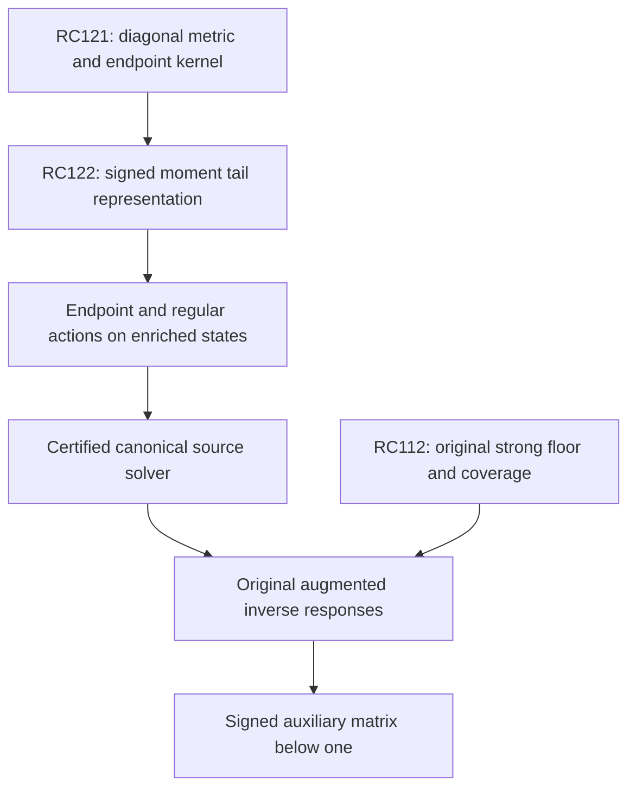

# RPB108 — RC122: signed endpoint-tail compression with correlated Gram bounds

Date: 2026-10-12 UTC. Aperture: a=11/10. Branch: research/rpb108-route-consolidation. Starting checkpoint: RC121, commit da50cb99b032c3fbf277d6496b4797a8d4ddca8d.

## Result and scope

RC122 replaces a large omitted endpoint output by a finite set of explicitly defined infinite tail columns. For the entire retained polynomial input spaces, the existing output cutoffs suffice with ranks 9, 19 and 39 for omitted-action D-norm errors 10^-6, 10^-12 and 10^-24. These are **uniform source-action approximation bounds**, not just certificates for selected directions.

| Input parity | Input degree N | Retained output degree M | Rank for 10^-6 | Rank for 10^-12 | Rank for 10^-24 |
|---|---:|---:|---:|---:|---:|
| Even | 494 | 989 | 9 | 19 | 39 |
| Odd | 781 | 1563 | 9 | 19 | 39 |

The input dimensions remain 248 even and 391 odd. Rank 39 is the dimension of a represented **output tail**, not a new exceptional spectral count or a rank-39 positivity head.

The tested RC120 trial pair also exhibits substantial signed cancellation. With the full analytic-tail Gram upper and all moment enclosures paid, the squared D-energy omitted-action bounds improve as follows:

| Trial | Inherited unsigned ceiling, outward upper | Signed full-tail ceiling, outward upper | Ratio of certified upper enclosures, lower |
|---|---:|---:|---:|
| Even | 0.180087936299 | 1.970787637744e-10 | 9.13e8 |
| Odd | 0.080825474665 | 3.610552620840e-10 | 2.23e8 |

The improvement is a ratio of upper enclosures for the same endpoint action. It does not measure a change in the actual operator, certify the original Weil source leakage, or identify weak spectral modes.

No retained endpoint output was numerically evaluated, no full endpoint iteration was performed, and the regular multiplier action remains unevaluated. The tail representation is not yet proved closed under the next endpoint action. The original spectral count remains 10–639 below 0.01; local positivity, Global/F4 and RH are not concluded.

## Metric, input and exact omitted kernel

Keep RC121's actual diagonal reference D=J+sI, with JP_n=H_nP_n, s=c_R+log2+789/125. Its constant is the actual RC56 enclosure, not a substituted nominal metric. RC121 proves D<=P<=2D and aD<=L<=2D, a=32125/230953, for the full canonical form. L is the canonical metric operator, P the positive principal reference, and neither is the original Weil operator A_Q or its effective head F.

Define C=D^-1h, the bounded endpoint form-Riesz action in D energy, h=-1/2 log(1-(x/B)^2), B=11/10. For a polynomial w=sum_(n<=N) a_nP_n of one parity, its omitted coefficients at m>N of that parity are exactly

\[
 (Cw)_m=\frac{2m+1}{H_m+s}
 \sum_{n\le N}\frac{a_n}{m(m+1)-n(n+1)}.
\tag{1}
\]

Other-parity coefficients vanish. This is the inherited exact endpoint matrix, not a generic operator-norm model. Put lambda=N(N+1)>0 and z_m=m(m+1). Use normalized signed endpoint moments

\[
 c_k(w)=\sum_{n\le N}a_n\left(\frac{n(n+1)}{\lambda}\right)^k.
\tag{2}
\]

Equivalently, c_k=((Lambda/lambda)^k w)(1), where Lambda=-d/dx[(1-x^2)d/dx] is the Legendre differential operator in the normalized coordinate x in [-1,1]. Lambda has eigenvalues n(n+1); it is distinct from the harmonic metric operator J. In particular c_0=w(1), and higher moments encode signed endpoint jets. No absolute-value sum replaces these moments in the represented tail.

## Uniform finite-rank replacement theorem

For m>M>N, the geometric identity gives

\[
 \sum_n\frac{a_n}{z_m-n(n+1)}
 =\frac1{z_m}\sum_{k=0}^{K-1}c_k(w)
           \left(\frac\lambda{z_m}\right)^k
 +\sum_n\frac{a_n[n(n+1)/z_m]^K}{z_m-n(n+1)}.
\tag{3}
\]

Define actual D-energy tail columns psi_k, supported only on m>M of the input parity, by Legendre coefficients

\[
 (\psi_k)_m=\frac{2m+1}{(H_m+s)z_m}
                \left(\frac\lambda{z_m}\right)^k.
\tag{4}
\]

These infinite columns belong to D energy: their Gram sums below converge. RC121's form equivalence also places them in the actual canonical energy space. They are explicitly represented infinite vectors, not truncated vectors with an assumed zero tail.

Let Psi_K c(w)=sum_(k<K) c_k(w) psi_k. If T_(N,M) is the certified RC121 unsigned squared tail factor and

\[
 q=\lambda/[(M+1)(M+2)]<1,
\]

then (3) and the same positive envelope used at RC121 prove

\[
 \boxed{\|(I-\Pi_M)Cw-\Psi_Kc(w)\|_D^2
       \le q^{2K}T_{N,M}\|w\|_D^2.}
\tag{5}
\]

Proof. Write A=sum|a_n|. The geometric remainder in (3) is at most A(lambda/z_m)^K/(z_m-lambda), hence at most q^K times the unsigned denominator envelope. RC121 bounds its D-weighted squared sum by 2BA^2/[s_lower(M-N)^2], and its D-metric Cauchy–Schwarz estimate gives A^2<=C_N||w||_D^2. The product is q^(2K)T_(N,M). This holds for every polynomial input, not only the evaluated moments.

At the chosen cutoffs q=N/[2(2N+3)]<1/4. The script chooses the least K satisfying the inherited enclosure q^(2K)T<=tau^2. Thus it proves the table's ranks without evaluating a large source matrix.

For any polynomial source map W with actual D input Gram, let J_K W be its signed moment map. The residual map E=(I-Pi_M)CW-Psi_K J_KW obeys the correlated matrix contract

\[
 \boxed{E^*DE\preceq q^{2K}T_{N,M}\,W^*DW.}
\tag{6}
\]

This transfers the bound to every linear combination of source columns. It does not combine independently bounded diagonal errors and assume the off-diagonal errors vanish.

The retained block plus the analytic columns gives a rank-at-most K replacement for the entire omitted action. That rank says nothing about the exceptional spectrum of A_Q. It only compresses the output representation needed in an operator-action certificate.

## Actual analytic-tail Gram and paid infinite remainder

The exact Gram in D energy is the positive Hankel matrix

\[
 G_{kl}=\langle\psi_k,\psi_l\rangle_D
 =2B\sum_{\substack{m>M\\m\text{ in parity}}}
 \frac{2m+1}{(H_m+s)z_m^2}
           \left(\frac\lambda{z_m}\right)^{k+l}.
\tag{7}
\]

No inverse of this Gram is needed. Its columns can be nearly dependent; an inverse or eigenvalue-floor claim is neither used nor made. Source response bounds use J_KW* G J_KW with the signed moment correlations retained.

RC122 evaluates the first 128 output-degree positions (64 parity terms) after M, with actual s lower and upper from the RC56 constant and log2 enclosures. Each scalar Hankel moment is rounded outward. If G_0 is the midpoint Hankel matrix, and epsilon_G is K times the largest half-width of these entries, the evaluated prefix lies between G_0-epsilon_G I and G_0+epsilon_G I. The constant uncertainty is paid before rounding. This is a Loewner enclosure, not an entrywise-upper matrix asserted to be a PSD upper.

For the remaining rows after R=M+128, set q_R=lambda/[(R+1)(R+2)]. Their positive squared weight mass is bounded by

\[
 \zeta_R\le\frac{2B}{s_{Gram,lower}(R+1)^2}.
\tag{8}
\]

This follows from the exact telescoping identity
(2m+1)/[m^2(m+1)^2]=1/m^2-1/(m+1)^2, summing over all integers to dominate the parity subset.

For 0<=t<=q_R, weighted Cauchy–Schwarz gives

\[
 v(t)v(t)^*\preceq
 (1-q_R)^{-1}\operatorname{diag}(1,q_R,\ldots,q_R^{K-1}),
 \quad v(t)=(1,t,\ldots,t^{K-1}).
\]

Hence the entire exact Gram satisfies

\[
 G_0-\epsilon_G I\preceq G\preceq
 G_0+\epsilon_G I+
 \frac{\zeta_R}{1-q_R}\operatorname{diag}(q_R^k).
\tag{9}
\]

The represented prefix retains its correlations; the unknown infinite Gram remainder is paid by this explicit positive diagonal bound. This remaining enclosure can be conservative and is not an exact signed evaluation of all infinite rows. A negative lower enclosure would not prove a negative Gram or a negative Weil direction. The prefix/constant enclosure and the diagonal infinite remainder are distinct from the rank-replacement error in (5).

For a source map, (9) yields signed moment-response Gram bounds by congruence. To transfer them to the exact omitted action, one may use a fully paid cross-error bound. For 0<t<1, with G_lower and G_upper from (9),

\[
 (1-t)(J_KW)^*G_{lower}(J_KW)
 -(t^{-1}-1)\epsilon^2W^*DW
 \preceq [(I-\Pi_M)CW]^*D[(I-\Pi_M)CW]
\]

\[
 \preceq(1+t)(J_KW)^*G_{upper}(J_KW)
 +(1+t^{-1})\epsilon^2W^*DW,
 \quad\epsilon^2=q^{2K}T_{N,M}.
\tag{10}
\]

The error is paid in the actual input Gram. For an individual tested trial, the script uses the sharper norm triangle bound rather than choosing a Young parameter. Finite-output action rounding and source coefficient errors remain separate action obligations.

## Tested signed moments and enclosure gains

The script reconstructs the Legendre coefficients of both stored RC120 rational trials using the directed 700-digit connection and evaluates all 39 normalized signed moments with exact rational acceptance. It independently checks c_0 against the exact sum of the stored Chebyshev center coefficients, giving

- Even w(1) approximately 0.018171824730801322.
- Odd phase-extracted w(1) approximately -0.03708880772641491; the actual trial retains its global phase i.

Opposite parity makes their tested two-column tail Gram diagonal. Within a general parity source family, (6), (9) and (10) preserve the moment matrix and its cross correlations; it is not justified to extrapolate this two-column diagonal structure to all 639 inputs.

For each trial, interval evaluation of its signed quadratic form in G_0, plus epsilon_G times its moment norm squared and the paid infinite Gram diagonal, gives an upper for the analytic tail energy. Adding the replacement-error norm sqrt(q^(2K)T E_w), with RC120's P-energy upper E_w>=||w||_D^2, encloses the true omitted action. All moment intervals and constant errors are included. The gains in the table compare this enclosure to T E_w, the inherited unsigned ceiling for the same trial.

The true omitted tail is still much larger than the **replacement error**. For example, a true tail ceiling around 10^-10 in squared energy cannot be dropped during a 10^-24 norm-accuracy iteration just because its represented approximation error is below 10^-48. The represented tail must be retained and acted on. This is the principal distinction between analytic tail compression and tail truncation.

## Iterative closure gap and minimal next estimate

A first action on a polynomial input now has a rigorous small-rank output-tail representation. A subsequent input includes the psi_k columns, whose coefficients extend to infinity. Equations (1)–(6) have not been extended to prove a closed accurate action on that enriched state. RC121's global ||C||_D<=1 gives continuity and coarse error transport, but does not supply a sufficiently small error for discarding the whole analytic tail.

The minimal next endpoint estimate is a certified action of C on the finite analytic-tail basis, or an enriched residual representation that closes those columns under the recurrence with paid D-energy errors. An adaptive truncation is also valid if its full basis-column tail is enclosed, but the generic algebraic cutoff may again become expensive. No claim of solver completion follows from rank compression alone.

The bounded regular metric multiplier R must likewise act on the enriched representation with certified error. The RC56 constant precision and the current Gram remainder enclosures may limit high-accuracy numerical response certification even though the geometric replacement theorem allows rank 39. The rank budgets are not a certificate that every arithmetic Gram error already meets the final iteration budget.

## Connection to original exceptional coverage

| Obligation | Standing after RC122 | Remaining new estimate |
|---|---|---|
| Original strong floor outside W_639 | Inherited certified floor >=5001251/500000000 | Smaller original spectral exclusion if sought |
| Original count below 0.01 | 10–639; no change | Original count/completion response certificate |
| Canonical diagonal conditioning | Full-space RC121 equivalence | No additional conditioning theorem needed |
| Polynomial endpoint output | Uniform rank-39 analytic tail replacement at existing cutoffs | Evaluate retained action with interval arithmetic |
| Endpoint action on enriched states | Not closed | Paid C psi_k action or closed enriched residual representation |
| Regular metric action | Norm known; numerical action open | Paid R action on required representations |
| Canonical source solver | Conditional recurrence/stopping rules available | Full coupled action contracts and iteration |
| Original augmented inverse response | Not evaluated | Original arithmetic actions and signed response matrix below one |

The original positivity criterion remains RC115's T Hhat^-1T^*<=theta I with theta<1, for Hhat=A_Q+T^*T>=eta I. D, P, L and their tail-response Grams are not substitutes for Hhat^-1 or the effective head F. Source-action compression supports that later calculation without proving it.



The 1,250-feature head remains an auxiliary original proof cutoff, not a mandatory dense metric action. RC122's small tail rank does not reduce its original exceptional bound to 39. Local aperture positivity, the separate Global/F4 original first-contact problem and RH remain distinct.

## Reproduction and evidence classification

Inputs in order: RC121, RC120, RC56. Hash linkage is checked. The validator performs 356 exact geometric-kernel, telescoping and weighted-Gram controls; computes minimal uniform ranks; encloses actual-constant Hankel moments; reconstructs all trial moments; and pays the full analytic and replacement error. Replay reverses interval connection, moment and Gram-prefix accumulation and compares the entire certificate.

```bash
python scripts/validate_rpb108_rc122_signed_endpoint_tail_compression.py \
 --output certificates/rpb108_rc122_signed_endpoint_tail_compression.json \
 certificates/rpb108_rc121_diagonal_metric_equivalence.json \
 certificates/rpb108_rc120_reference_inverse_action.json \
 certificates/rpb108_rc56_precision_attached_head.json
```

Repeat with --replay. The inherited helper scripts must be alongside the validator. Finite controls verify formulas; the uniform infinite-output theorem is proved analytically above.

**Certified facts:** uniform polynomial-input tail replacement, correlated source-map residual contract, exact-constant Gram upper/lower construction, signed trial moments and full omitted-action upper bounds. **Conditional reductions:** using this representation in a solver after enriched action contracts; original positivity after its separate response criterion. **Exploratory:** iterative closure and computational savings. **Not performed:** retained endpoint action, enriched endpoint iteration, regular action or original Weil/augmented response. **Unsupported:** discarding represented tails, treating rank 39 as an exceptional spectral census, or inferring original positivity from a canonical metric action bound. Work is additive on the RC branch and does not modify Lean or unrelated branches.
