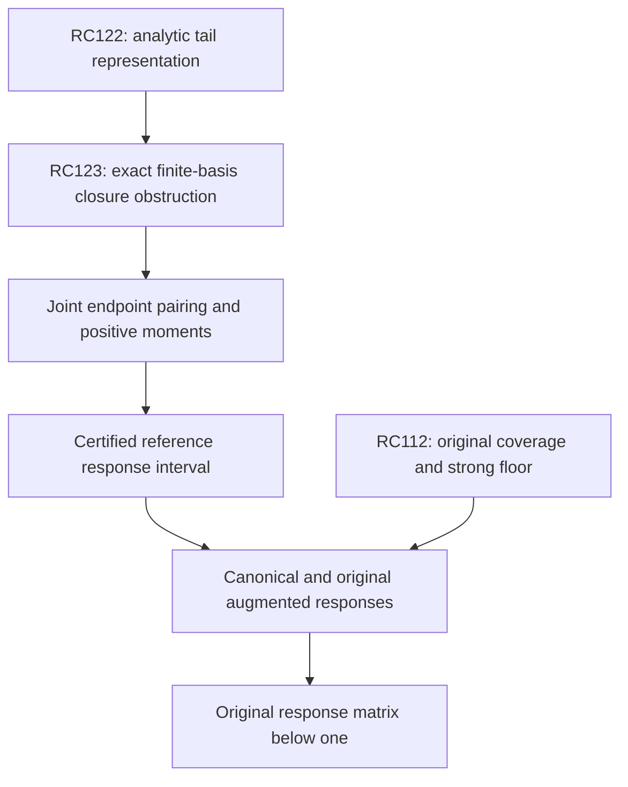

# RPB108 — RC123: endpoint nonclosure and positive moment stopping

Date: 2026-10-12 UTC. Aperture: a=11/10. Branch: research/rpb108-route-consolidation. Starting checkpoint: RC122, commit d22d048f6ab24896961e45799bfb0dbb6c2f6e5a.

## Result

RC123 proves an actual obstruction to exact closure of RC122's finite analytic-tail representation: applying the endpoint action to its leading tail column leaves every fixed span of the existing tail columns, even after adding finitely many polynomial directions. This is not an enclosure failure. It rules out a proposed exact finite function class, not accurate approximations, enriched representations, or positivity of the original Weil operator.

It also proves a finite positive-moment stopping rule for the reference inverse response. The rule preserves the complete correlated response matrix and does not require constructing every successive response vector in a fixed closed basis. The moments themselves remain an arithmetic/operator obligation; they have not been evaluated for the actual infinite endpoint columns.

| Relative reference-response matrix width target | Highest positive moment degree, sufficient | Required moment count |
|---|---:|---:|
| 10^-6 | 21 | 22 |
| 10^-12 | 41 | 42 |
| 10^-24 | 81 | 82 |

These budgets include an allocation for certified moment enclosures. They are sufficient degrees for a positive series, not optimal polynomial degrees or completed computations. RC121's shorter Chebyshev vector budgets remain valid under their own action contracts.

The minimal next correlation is explicit: the full matrix V^*hV for a joint family V of required finite vectors and analytic tails. It determines the first positive moment Gamma_1=Gamma_0-V^*hV. Existing Gram information alone does not determine the endpoint inverse response. All original spectral coverage and strong-floor statements are preserved; the original count below 0.01 remains 10–639. No local positivity, Global/F4 or RH conclusion is made.

## Operators and representation

Use the actual D energy from RC121:

\[
 D=J+sI,\quad JP_n=H_nP_n,
 \quad s=c_R+\log2+789/125.
\]

The endpoint action C=D^-1h is positive and selfadjoint in D energy, with 0<=C<=I. The positive principal reference is P=D+h, so its form-Riesz operator is I+C. These are canonical-metric/reference operators. None is the original Weil operator A_Q, its effective head F, or its augmentation Hhat.

Fix one parity and RC122's tail cutoff M, with input parameter lambda=N(N+1). The analytic columns have coefficients

\[
 (\psi_k)_m=\frac{2m+1}{(H_m+s)m(m+1)}
 \left(\frac\lambda{m(m+1)}\right)^k,
 \qquad m>M\text{ in that parity},
\]

and vanish elsewhere. Their actual D-energy norms are finite, as established by RC122's convergent Gram. In particular all coefficients of psi_0 are positive. RC122 approximates a polynomial-input omitted action by finitely many such columns with a geometric error. It does not assert that C maps their finite span to itself.

## Actual nonclosure theorem

**Theorem.** For the actual endpoint operator C and any fixed finite K,

\[
 C\psi_0\notin
 \{\text{finite-degree polynomials}\}+\operatorname{span}\{\psi_0,\ldots,\psi_{K-1}\}.
\tag{1}
\]

Proof. Put z_m=m(m+1) and D_m=H_m+s. By the exact endpoint matrix, for m>M of the chosen parity,

\[
 \frac{(C\psi_0)_m}{(\psi_0)_m}
 =\frac{d_m}{D_m}
 +z_m\sum_{\substack{n>M\\n\ne m\\n\text{ in parity}}}
 \frac{2n+1}{D_n z_n |z_m-z_n|}.
\tag{2}
\]

The diagonal d_m and every term are nonnegative. For fixed m the series converges: its far terms decay at least cubically. It equals the actual coefficient of C psi_0 by continuity of bounded C on D energy and convergence of the input's finite partial sums. This argument does not assume a pointwise physical logarithmic action on arbitrary energy vectors.

For M<n<=m/2, the factor z_m/(z_m-z_n) is greater than one. Therefore

\[
 \frac{(C\psi_0)_m}{(\psi_0)_m}
 \ge\sum_{\substack{M<n\le m/2\\n\text{ in parity}}}
 \frac{2n+1}{(H_n+s)n(n+1)}.
\tag{3}
\]

The lower sum diverges as m tends to infinity. An exact dyadic proof is sufficient. On a block 2^j<=n<2^(j+1), j>=1, there are 2^(j-1) indices of either parity; H_n<=1+log n<=1+(j+1)log2; and

\[
 \frac{2n+1}{n(n+1)}=\frac1n+\frac1{n+1}\ge2^{-j}.
\]

Thus a complete block above M contributes at least

\[
 b_j=\frac1{2[s_{upper}+1+(j+1)(\log2)_{upper}]}.
\tag{4}
\]

The sum of these positive reciprocal-linear terms diverges. Hence the ratio in (2) is unbounded.

In contrast, past the degree of any added polynomial, a vector in the proposed finite span has coefficient ratio

\[
 \frac{\sum_{k<K}a_k(\psi_k)_m}{(\psi_0)_m}
 =\sum_{k<K}a_k(\lambda/z_m)^k,
\]

which is bounded and tends to a_0. This contradicts (3), proving (1).

This proof also exhibits the structural cause: cumulative positive endpoint contributions from remote input modes grow across successive dyadic scales. A tail family containing only inverse powers of z_m cannot absorb that accumulation exactly. Refining the original rank-39 approximation error does not by itself prove closure under C.

## Quantitative witnesses and their limits

The certificate encloses the actual s upper using RC56 and a rational log2 series. It sums downward-rounded positive dyadic contributions until they exceed a selected threshold. If the final block index is J, choose a matching-parity output degree m>=2^(J+2); all selected input blocks lie below m/2.

| Parity / tail cutoff | First dyadic block | Last block for ratio >1 | Last block for ratio >2 | Last block for ratio >3 |
|---|---:|---:|---:|---:|
| Even / M=989 | 10 | 62 | 271 | 1108 |
| Odd / M=1563 | 11 | 66 | 287 | 1172 |

These are conservative analytic witnesses. The huge output degrees are recorded by their power-of-two exponents, not numerically evaluated as vectors or matrices. The growth proof supplies a witness for any finite coefficient bound, and does not claim that these are first crossings of the ratio.

Unbounded coefficient ratios do not contradict ||C||_D<=1. The denominator column's remote coefficients have very small D weight, so their ratios can grow while the full energy remains finite. Nor does (1) give a useful positive lower bound on the best finite-span approximation at a prescribed accuracy. In particular it does not show that adding suitable logarithmic or cumulative-tail columns cannot yield an efficient approximate action.

## Positive inverse-response moments

There is another route for the reference **quadratic response**, which avoids requiring an exactly closed finite vector basis. Let V be any specified finite family of D-energy vectors, including finite polynomial sources and analytic tail columns when their mixed responses are needed. Define

\[
 T=I-C,\qquad
 \Gamma_j=V^*D T^jV,\qquad
 \Sigma=V^*D(I+C)^{-1}V.
\tag{5}
\]

All matrices use the actual D metric and complex adjoints. T is a positive contraction. Gamma_0 is the initial family Gram; each Gamma_j is PSD, decreases in Loewner order, and its second differences are PSD. These statements follow from positivity of T^j, T^j C and T^j C^2; no componentwise positivity or simultaneous diagonalization of coefficient matrices is assumed.

Since I+C=2I-T,

\[
 (I+C)^{-1}=\frac12\sum_{j=0}^{\infty}2^{-j}T^j.
\]

The series converges in operator norm, independently of whether C has spectrum reaching one. Its positive matrix partial sum

\[
 S_n=\frac12\sum_{j=0}^n2^{-j}\Gamma_j
\]

has the exact remainder

\[
 \Sigma-S_n=2^{-n-1}V^*D T^{n+1}(I+C)^{-1}V.
\]

Commutativity of the functions of C, with 1/2 <= (I+C)^-1 <=1, proves

\[
 \boxed{2^{-n-2}\Gamma_{n+1}
 \preceq\Sigma-S_n\preceq2^{-n-1}\Gamma_{n+1}
 \preceq2^{-n-1}\Gamma_0.}
\tag{6}
\]

This is a correlated stopping theorem for the reference inverse response. Directional decay of Gamma_(n+1) can improve the stopping time beyond the uniform Gamma_0 budget. The entire matrix is retained; the dangerous response directions are not bounded independently and then combined without cross terms.

If the sources are specified as physical q with g=D^-1q, taking V=g gives Sigma=<q,P^-1q> in source-matrix form. If V contains analytic tails, the formal source D V is interpreted in the appropriate form dual unless physical L2 membership is separately established. No unproved source operator-domain regularity is needed for (5)–(6). For mixed finite and analytic families, Gamma_0 may be block diagonal by their coefficient supports while Gamma_1 contains the nonzero endpoint couplings.

This only certifies a reference response when its actual moments are paid. It does not realize a canonical vector, evaluate the regular metric action, or replace the original augmented inverse Hhat^-1.

## Inexact moment acceptance and stopping budgets

Suppose actual correlated moment enclosures satisfy

\[
 \widehat\Gamma_j-\delta\Gamma_0
 \preceq\Gamma_j\preceq
 \widehat\Gamma_j+\delta\Gamma_0,
 \qquad 0\le j\le n.
\]

The positive weights imply that the midpoint partial sum error is at most delta(1-2^-n-1) Gamma_0. Paying the final remainder in (6) gives a total lower-to-upper width at most

\[
 [2\delta(1-2^{-n-1})+2^{-n-1}]\Gamma_0.
\tag{7}
\]

Choose delta=eta/3 and the least n with 2^-n-1<=eta/3. The full width is at most eta Gamma_0, giving degrees 21, 41 and 81 for eta=10^-6, 10^-12 and 10^-24. Each moment's actual projection, source, metric, infinite-sum, constant and arithmetic errors must meet the stated Loewner contract. If Gamma_0 itself is only enclosed, one must pay its source-metric enclosure and use an appropriate certified upper in error allocations; the certificate does not assume it numerically exact for the actual tail family.

This positive series avoids alternating large polynomial coefficients in the response acceptance. It is not claimed cheaper or stronger than RC121's Chebyshev vector method: it needs more moment degrees, and the cost of computing full correlated moments remains unknown. It supplies a distinct finite stopping obligation.

## Why the existing Gram is insufficient

Gamma_0 and the global contraction bound alone yield only

\[
 \tfrac12\Gamma_0\preceq\Sigma\preceq\Gamma_0.
\]

They do not determine Sigma. The validator uses the same abstract family and nonidentity D metric with C=0 and C=I to obtain responses Gamma_0 and Gamma_0/2 respectively. This demonstrates insufficiency of **Gram-plus-contraction information**. It is not a counterexample to the fixed arithmetic endpoint operator, whose full kernel is known.

The first new actual endpoint datum is

\[
 \boxed{H_V=V^*hV,\qquad\Gamma_1=\Gamma_0-H_V.}
\tag{8}
\]

It must include mixed finite-vector/analytic-tail pairings and all same-parity correlations. Evaluating only tail norms or adding more independently certified directions does not pay (8). A certified H_V immediately supplies the sharper n=0 response bounds Gamma_0/2+Gamma_1/4 <= Sigma <= Gamma_0/2+Gamma_1/2. Further moments or a replacement resolvent correlation theorem may then close the desired response interval.

The minimal next research target is therefore an actual signed endpoint pairing matrix for the relevant joint family, followed by higher positive moments if the first enclosure is insufficient. A new enriched-vector action representation remains a viable alternative. RC123 does not presume either one succeeds.

## Original coverage and completion dependencies

| Obligation | Standing after RC123 | Next arithmetic/operator datum |
|---|---|---|
| Original strong floor / spectral coverage | RC112 W_639 complement floor; count 10–639 below 0.01 | Smaller original exclusion or original exceptional response completion |
| Canonical diagonal conditioning | RC121 global equivalence proved | None for conditioning itself |
| Polynomial endpoint tail | RC122 uniform rank-39 replacement | Retained finite action arithmetic |
| Fixed existing tail-basis exact closure | Rigorously impossible | Different/enriched approximation or response moments |
| Reference correlated inverse response | Positive finite-moment stopping theorem proved | Actual V^*hV, then required Gamma_j enclosures |
| Regular metric action | Numerical action not performed | Paid regular-source/enriched response estimate |
| Original augmented response | Not evaluated | Full signed T Hhat^-1T^* upper below one |

The unchanged original criterion is Hhat=A_Q+T_Weil^*T_Weil>=eta I and T_Weil Hhat^-1T_Weil^*<=theta I with theta<1, implying A_Q>=eta(1-theta)I. T_Weil here is the augmentation source map; it is distinct from the contraction T=I-C in (5). The reference response Sigma is not this original response matrix and not the effective head F. The original 1,250 head remains an auxiliary proof cutoff, not a mandatory dense canonical metric calculation.



Local positivity, Global/F4's separate original first-contact exclusion, and RH are distinct. Neither the obstruction nor the reference moment theorem concludes any of them.

## Reproduction and classification

Inputs: RC122, RC121, RC56. The validator checks hash linkage and records exact dyadic growth witnesses and minimal positive-series budgets. A noncommuting rational two-dimensional example with a nonidentity metric verifies 17 positive response remainder sandwiches, their sharper moment remainders, monotonicity/second differences and independent reverse summation. These are abstract controls, not evaluated arithmetic endpoint moments.

```bash
python scripts/validate_rpb108_rc123_endpoint_closure_obstruction.py \
 --output certificates/rpb108_rc123_endpoint_closure_obstruction.json \
 certificates/rpb108_rc122_signed_endpoint_tail_compression.json \
 certificates/rpb108_rc121_diagonal_metric_equivalence.json \
 certificates/rpb108_rc56_precision_attached_head.json
```

Repeat with --replay to compare the complete certificate. Infinite-dimensional nonclosure and the response stopping theorem are proved analytically above; finite controls check the exact quantitative constructions.

**Certified facts:** actual fixed finite tail-basis nonclosure, conservative quantitative growth witnesses, positive correlated moment stopping theorem, exact conditional error budgets. **Conditional:** actual reference response bounds after moment contracts; original positivity after its independent response criterion. **Exploratory:** computational cost of moment evaluation or enriched columns. **Not performed:** infinite-tail endpoint action, actual H_V or Gamma_j evaluation, regular metric action, canonical iteration or original responses. **Unsupported:** interpreting nonclosure as approximation impossibility, inferring actual arithmetic ambiguity from abstract Gram controls, or concluding positivity from reference conditioning. Only additive RC files are committed; Lean and unrelated branches are untouched.
