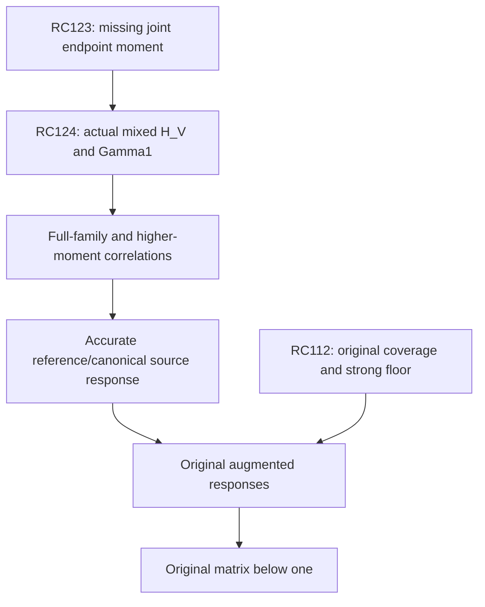

# RPB108 — RC124: actual joint endpoint matrix and first response moment

Date: 2026-10-12 UTC. Aperture: a=11/10. Branch: research/rpb108-route-consolidation. Starting checkpoint: RC123, commit 6c9315fe7941f38e9c89447345241b005e159d3c.

## Result and coverage boundary

RC124 evaluates and certifies the first missing endpoint correlation from RC123 on two concrete joint families. Each family combines a finite physical Legendre vector with an actual infinite analytic tail; the mixed terms and all omitted contributions are paid. It produces full Loewner enclosures of H_V=V^*hV, Gamma_0, Gamma_1 and the reference inverse response.

The families are V_even=[P_0,psi_0] at cutoff M=989 and V_odd=[P_1,psi_0] at cutoff M=1563, with psi_0 the corresponding RC122 infinite column. These are tests of the joint moment route. They are not additional positive original Weil native directions, invariant spectral spaces, or coverage of all 39 tail columns.

| Actual tail quantity, outward display | Even | Odd |
|---|---:|---:|
| D-energy lower | 9.525877217163e-8 | 3.648729552081e-8 |
| D-energy upper | 9.590604299325e-8 | 3.713424341859e-8 |
| Endpoint energy lower | 4.996779189889e-8 | 1.747039415114e-8 |
| Endpoint energy upper | 7.635041154564e-8 | 2.995694083811e-8 |
| Reference tail response / actual D-energy, lower | 0.545914167381 | 0.535253350257 |
| Reference tail response / actual D-energy, upper | 0.744521083956 | 0.778327426073 |

The reference-response intervals strictly improve the Gram-plus-contraction interval [1/2,1]. All acceptance uses exact rational certificate endpoints. The first-moment bounds remain broad; no high-accuracy reference response or canonical source solve is completed.

The original spectral count remains 10–639 below 0.01. RC112's original W_639 complement floor, its specified effective-head strong floor, and the older 1,250-head complement certificate remain preserved. Whole-aperture positivity, Global/F4 and RH are not established.

## Actual operators and tested family

Keep the actual diagonal energy D=J+sI, with H_n eigenvalues for J and s=c_R+log2+789/125. RC56's c_R enclosure and the rational log2 enclosure are paid throughout. The endpoint multiplication form is h=-1/2 log(1-(x/B)^2), B=11/10. RC121 proves 0<=h<=J+2log2 I<=D. Thus C=D^-1h is a positive contraction in D energy, and P=D+h is the positive principal reference.

For one parity, psi_0 has actual Legendre coefficients

\[
 (\psi_0)_n=\frac{2n+1}{(H_n+s)n(n+1)}
 \quad(n>M\text{ in parity}),
\]

and zero coefficients elsewhere. All retained coefficients are positive. The leading tail is independent of RC122's normalization lambda because its moment order is zero.

The finite vector P_p has p=0 even or p=1 odd. The joint D Gram is exactly block diagonal by coefficient support:

\[
 \Gamma_0=\begin{pmatrix}
 \frac{2B}{2p+1}(H_p+s)&0\\0&G
 \end{pmatrix},\quad
 G=2B\sum_{\substack{n>M\\n\text{ in parity}}}
 \frac{2n+1}{(H_n+s)[n(n+1)]^2}.
\tag{1}
\]

The endpoint Gram has nonzero mixed terms. A block-diagonal Gamma_0 therefore cannot justify separate response certification without endpoint correlations.

L is the actual canonical metric operator, P the reference, and D its diagonal preconditioner. None is the original Weil operator A_Q, the exact effective head F, or the augmented original operator Hhat. The finite P_p vectors here are physical polynomials, not silently identified with the canonical Riesz moment vectors of the original head.

## Exact mixed pairing

Put z_n=n(n+1). The inherited exact endpoint matrix gives

\[
 b_p=\langle P_p,h\psi_0\rangle_2
 =2B\sum_{\substack{n>M\\n\text{ in parity}}}
 \frac{2n+1}{(H_n+s)z_n(z_n-p(p+1))}.
\tag{2}
\]

For p=0, equation (2) is exactly G, including every omitted term. For p=1, it is a positive series slightly larger than G, with the factor z_n/(z_n-2). The certificate evaluates its finite prefix and pays its full infinite remainder with that factor.

The actual mixed enclosures are:

| Pairing | Lower, outward display | Upper, outward display |
|---|---:|---:|
| Even <P_0,h psi_0> | 9.525877217163e-8 | 9.590604299325e-8 |
| Odd <P_1,h psi_0> | 3.648731054629e-8 | 3.713425907773e-8 |

The finite diagonal is exact up to the log2 enclosure:

\[
 \langle P_0,hP_0\rangle_2=2B(1-\log2),
 \qquad
 \langle P_1,hP_1\rangle_2=\frac{2B}{3}(4/3-\log2).
\]

These formulas retain the actual signed moment matrix. There is no norm-only replacement for b_p.

## Infinite Gram and physical-mass enclosure

The script evaluates coefficients and positive sums with directed 80-digit Decimal contexts, and rounds final bounds outward to rational grids. It sums G and the mixed pairing through R_G=4095 in each parity. Harmonic intervals, reciprocal metric intervals and source coefficients are paid before summation. Replay reverses these sums; it does not treat agreement of floating-point proposals as acceptance.

Beyond R_G, use 24 complete dyadic blocks. On 2^j<=n<2^(j+1),

\[
 j\log2\le H_n\le1+(j+1)\log2.
\]

Let w(x)=(2x+1)/[x^2(x+1)^2], a positive decreasing function with antiderivative -1/[x(x+1)]. If first and last are the matching-parity endpoints of a block, the parity sum is bounded by

\[
 \frac12\left[\frac1{first(first+1)}
 -\frac1{(last+2)(last+3)}\right]
 \le\sum w(n)
\]

\[
 \le\frac12\left[\frac1{(first-2)(first-1)}
 -\frac1{last(last+1)}\right].
\tag{3}
\]

These are monotone integral bounds over the following and preceding width-two cells, respectively. Dividing by the block's upper or lower D_n enclosure gives positive lower and upper Gram contributions. Dividing by D_n squared gives a physical-norm lower for the tail. The final infinite remainder is bounded using the same monotone primitive and the lower harmonic weight at its first block. Thus no tail is assigned zero because it lies beyond the explicit sum.

For the odd mixed pairing, every omitted coefficient contributes a factor between 1 and 1/[1-2/z_first]. The lower and upper dyadic Gram tails are adjusted by this factor. Even b_0=G is checked exactly in the rational output.

## Actual infinite-tail endpoint energy

The coefficient prefix psi_0^(R_H), with R_H=M+2048, has 1,024 matching-parity coefficients. The script evaluates its endpoint quadratic form from the exact Legendre matrix:

\[
 E_{prefix}=\sum_n\frac{2B}{2n+1}d_n(\psi_0)_n^2
 +4B\sum_{n<m}\frac{(\psi_0)_n(\psi_0)_m}{(m-n)(m+n+1)},
\]

where d_n=2H_(2n)-2H_n+1/(2n+1)-log2. Every summand is positive and enclosed with directed arithmetic. Because all same-parity endpoint entries and psi coefficients are positive, this is a genuine lower bound on the full infinite endpoint energy—not a finite compression claimed equal to it.

For a full upper, retain the global structural inequality from RC121:

\[
 h\preceq D-(s-2\log2)I.
\]

Consequently

\[
 \langle\psi_0,h\psi_0\rangle_2
 \le G_{upper}-(s_{lower}-2\log2_{upper})
                     \|\psi_0\|_{2,lower}^2.
\tag{4}
\]

The physical mass lower includes the evaluated prefix and positive dyadic tails. This upper pays all omitted endpoint energy without assuming an L2 pointwise endpoint action on psi_0. The form pairing is legitimate since psi_0 is in D energy and h<=D.

Thus RC124 computes an actual endpoint-energy lower and full upper. Its remaining width is caused by a conservative full-energy upper and finite/dyadic enclosures, not by an actual negative endpoint direction. Improving this width or extending to higher columns remains a new correlation obligation.

## From entry intervals to full correlated Loewner bounds

An entrywise upper is not automatically a matrix upper. Let H_mid be the midpoint of the two-by-two entry intervals and e_ij their half-widths. For the exact actual H_V, interval errors satisfy |Delta_ij|<=e_ij. Choose a positive rational weight rho_w, close to the square root of the finite/tail D-energy scale ratio. Then

\[
 -E\preceq H_V-H_{mid}\preceq E,
 \quad E=\operatorname{diag}
 (e_{00}+\rho_we_{01},\ e_{11}+e_{01}/\rho_w).
\tag{5}
\]

The weighted inequality for the mixed quadratic term proves (5) for all real or complex source combinations. The certificate stores H_lower=H_mid-E and H_upper=H_mid+E. It similarly stores the diagonal Gamma_0 lower and upper from (1), then constructs

\[
 \Gamma_{1,lower}=\Gamma_{0,lower}-H_{upper},\quad
 \Gamma_{1,upper}=\Gamma_{0,upper}-H_{lower}.
\tag{6}
\]

Exact rational PSD checks verify H_lower>=0 and Gamma_(1,lower)>=0 for both joint families, together with all enclosure widths. Their positivity is a fact about the tested endpoint/reference moment matrices, not about original Weil positivity. The weight only allocates interval cross errors; it does not replace the actual D metric.

## Actual first-moment reference response

For V=[P_p,psi_0], RC123's exact response is

\[
 \Sigma=V^*D(I+C)^{-1}V.
\]

The first positive moment yields

\[
 \tfrac12\Gamma_0+\tfrac14\Gamma_1
 \preceq\Sigma\preceq
 \tfrac12\Gamma_0+\tfrac12\Gamma_1.
\tag{7}
\]

Combining the actual enclosures gives

\[
 \boxed{\tfrac34\Gamma_{0,lower}-\tfrac14H_{upper}
 \preceq\Sigma\preceq
 \Gamma_{0,upper}-\tfrac12H_{lower}.}
\tag{8}
\]

The stored two-by-two matrices include the mixed terms. Loewner bounds control every linear combination; their off-diagonal entries must not be read as independent componentwise bounds on Sigma.

Taking the tail diagonal in (8) and normalizing conservatively by the actual G enclosure gives the response fractions in the first table. Both strictly improve the previous [1/2,1] bound even after all interval errors. This is a certified reference inverse-response sandwich, not an evaluated exact inverse or a high-accuracy source vector.

For these particular vectors, D psi_0 is also a physical L2 source: its coefficients are (2n+1)/[n(n+1)], whose physical squared norm is bounded by a convergent cubic series. Thus Sigma can be identified with the physical reference response of the sources D V against P^-1. This domain fact is specific to this family and is not presumed for all later enriched states.

## What the first moment establishes—and what remains

The actual H_V has now been certified for a test joint family, beyond abstract positivity controls or Gram-only information. The mixed terms are nonzero and determine Gamma_1 correlations that Gamma_0 could not reveal. The finite-plus-tail family is not invariant under C; RC123's nonclosure theorem remains valid. The moment route uses form pairings and does not assume that exact vector iteration stays inside this two-column family.

This test does not cover the whole RC122 rank-39 tail basis, the required finite source family, or all original Weil modes. The next minimal endpoint estimate is either the complete relevant joint H_V, including psi_k/psi_l and finite/psi_k correlations, or a second actual moment Gamma_2 with enough signed error control to improve the response interval. Higher moments are needed if the first matrix bounds do not meet the response budget. A cheap general implementation has not been proved.

The width of the current Gamma_0 and endpoint-energy intervals already exceeds high-accuracy moment allowances from RC123. Improving those enclosures is necessary before using its 10^-6 to 10^-24 stopping budgets. Merely increasing the positive-series degree cannot remove a pre-existing Gram or H_V enclosure error.

| Obligation | Standing after RC124 | Next new estimate |
|---|---|---|
| Original exceptional coverage / strong floor | Inherited W_639 floor; count 10–639 | Original exceptional response or tighter original exclusion |
| Actual canonical metric conditioning | RC121 global diagonal equivalence | None for conditioning |
| Endpoint polynomial-tail compression | RC122 uniform replacement | Paid retained finite action |
| Fixed finite tail closure | RC123 proves exact closure impossible | Enriched action or moment formulation |
| Actual endpoint correlations | Two joint two-column H_V matrices certified | Full relevant joint family and/or Gamma_2 |
| Reference inverse response | Actual first-moment correlated sandwich | Tighter Gram/energy enclosures and higher moments |
| Regular metric and original actions | Not performed for required response family | Paid regular/arithmetic source actions |
| Original positivity | Not certified | Signed augmented response below one or replacement original theorem |

For the exact original augmentation Hhat=A_Q+T_Weil^*T_Weil>=eta I, the unchanged completion condition is T_Weil Hhat^-1T_Weil^*<=theta I, theta<1. Sigma is a reference response and cannot be substituted for this original matrix or the effective head F. The original head cutoff of 1,250 is not a required dense canonical metric computation; no original arithmetic matrix evaluation is hidden in this endpoint test.



Local aperture positivity, the separate Global/F4 first-contact problem and RH remain distinct obligations.

## Reproduction and evidence classification

Inputs: RC123, RC122, RC121, RC56, in that order. Hash linkage is checked. Directed 80-digit harmonic and positive endpoint arithmetic encloses actual prefix sums; exact rational dyadic bounds pay all infinite contributions. Weighted interval error matrices and response bounds are accepted by exact rational PSD checks. No sampled quadrature or presumed zero tail is used.

```bash
python scripts/validate_rpb108_rc124_actual_joint_endpoint_moment.py \
 --output certificates/rpb108_rc124_actual_joint_endpoint_moment.json \
 certificates/rpb108_rc123_endpoint_closure_obstruction.json \
 certificates/rpb108_rc122_signed_endpoint_tail_compression.json \
 certificates/rpb108_rc121_diagonal_metric_equivalence.json \
 certificates/rpb108_rc56_precision_attached_head.json
```

Repeat with --replay. Replay reverses positive Gram/mixed sums, all positive endpoint pair sums and the dyadic tail blocks, then compares the entire rational certificate. All inherited helper scripts must be alongside the validator.

**Certified facts:** actual mixed endpoint identities, full infinite-tail Gram and endpoint enclosures, two joint H_V/Gamma_1 Loewner sandwiches, actual first-moment reference-response intervals. **Conditional:** higher-moment stopping after tighter full-family contracts; original positivity after its separate response criterion. **Exploratory:** extension cost and sharper endpoint correlations. **Not performed:** all-39-column family, higher actual moments, regular-source action, canonical iteration or original/augmented response. **Unsupported:** inferring original positivity from endpoint/reference PSD, equating these physical finite vectors with invariant Weil modes, or extrapolating two-column correlations to the whole exceptional block. Work is additive on the RC branch; Lean and unrelated branches are unchanged.
