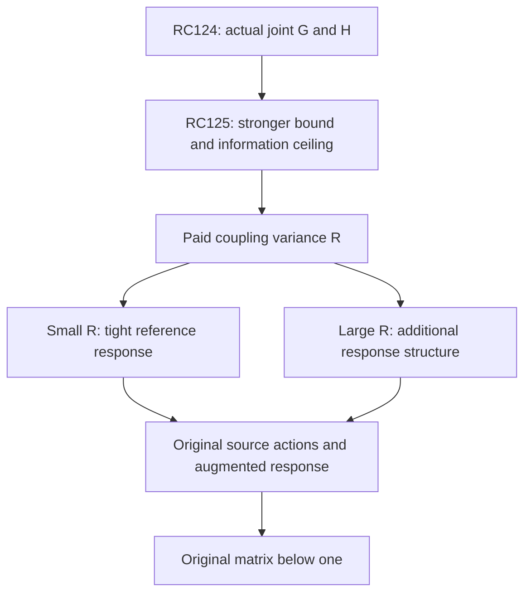

# RPB108 — RC125: sharp first-moment bounds and coupling variance

Date: 2026-10-12 UTC. Aperture: a=11/10. Branch: research/rpb108-route-consolidation. Starting checkpoint: RC124, commit 3798b7d56ede73a8750a23734c5b05e2c21d4d5b.

## Result and research decision

RC125 extracts a substantially stronger correlated variational lower from RC124's actual joint endpoint matrices, without computing another native direction or another endpoint moment. It also proves the sharp information limit of first-moment response estimates and identifies the next minimal matrix: the coupling variance R=H_2-HG^-1H.

| Coordinate / parity | RC124 lower response fraction | RC125 lower fraction | Upper fraction retained |
|---|---:|---:|---:|
| Physical P_0 / even | 0.729820704912 | 0.925311467405 | 0.959641772410 |
| Leading analytic tail / even | 0.545914167381 | 0.551344914616 | 0.744521083956 |
| Physical P_1 / odd | 0.716667836026 | 0.882356582797 | 0.933336574509 |
| Leading analytic tail / odd | 0.535253350257 | 0.539574278546 | 0.778327426073 |

Each fraction normalizes the reference response by that coordinate's actual D-energy; lower and upper Gram endpoints are paid in the appropriate directions. These diagonal displays summarize full two-by-two Loewner sandwiches, which retain the mixed finite–tail correlations. The certificate verifies that the new full lower dominates RC124's full lower, not merely its two diagonal entries.

Even with exact first moments, the sharp method-class interval has a width at least 0.034327384728 times the exact joint Gram in even parity and 0.040345227453 times it in odd parity. This is an information ceiling for first-moment-only certification, not an actual reference error or an ambiguity of the fixed arithmetic endpoint operator. Finer evaluation of the same first moment cannot meet high-accuracy stopping budgets by itself.

The next decisive experiment is a paid matrix variance estimate. If it is small, a Schur response theorem below can replace a long higher-moment calculation. If it is large, the family needs stronger response information or a different enlargement. Small variance is not presumed; RC123 already implies that its leading-tail component is strictly nonzero.

No actual H_2 or variance matrix has been evaluated. The original count below 0.01 remains 10–639. No original Weil positivity, Global/F4 or RH conclusion is made.

## Actual metric and response

Use C=D^-1h, a positive contraction in the actual D energy, and P=D+h as before. For RC124's joint family V=[P_p,psi_0], define

\[
 G=V^*DV,\qquad H=V^*hV=V^*DCV,\qquad
 \Sigma=V^*D(I+C)^{-1}V.
\tag{1}
\]

G is positive definite and exactly diagonal by coefficient support. H includes the actual mixed endpoint pairings. This response is for the positive principal reference; C is the endpoint form action. None is the original Weil operator A_Q, its effective head F, or the original augmentation Hhat.

The generalized spectral bounds below concern the finite endpoint compression M=G^-1/2HG^-1/2. They are not eigenvalue bounds on the original Weil operator or on its effective head.

## Sharp theorem with exact first moments

**Theorem.** For every positive contraction C in D energy and specified full-rank family V,

\[
 \boxed{G(G+H)^{-1}G\preceq\Sigma\preceq G-H/2.}
\tag{2}
\]

Both endpoints are attainable among positive contractions with these exact G and H. Consequently no uniformly better first-moment-only Loewner interval exists over that class.

Proof of lower. For any coefficient matrix Y, the inverse-response variational identity with approximate response VY gives

\[
 \Sigma\succeq GY+Y^*G-Y^*(G+H)Y.
\tag{3}
\]

This is a quadratic lower with its signed cross terms retained. Choosing Y=(G+H)^-1G yields the lower in (2). Equivalently, inverse compression is above the inverse of the compression. The equality case is the invariant model whose D-normalized action is M=G^-1/2HG^-1/2 on the family span.

Proof of upper. For 0<=t<=1, 1/(1+t)<=1-t/2; the difference is t(1-t)/[2(1+t)]. Functional calculus gives (I+C)^-1<=I-C/2, hence (2).

Sharpness of upper. For any normalized first moment 0<=M<=I, the doubled-space operator

\[
 \mathcal C=\begin{pmatrix}
 M&[M(I-M)]^{1/2}\\[M(I-M)]^{1/2}&I-M
 \end{pmatrix}
\]

is a positive orthogonal projection. Compressing it to the first component gives M, and (I+mathcal C)^-1=I-mathcal C/2 attains the upper. This construction proves a limit of the moment information, not a claim that the actual endpoint action is a projection. It remains valid for noncommuting G,H; normalization uses their actual Gram.

## Paid variational acceptance on RC124 intervals

Using exact first-moment formulas with interval endpoints naively would lose correlations or reverse inverse monotonicity. RC125 instead fixes a rational trial and pays its entire quadratic form.

Let G_lower<=G<=G_upper and H_lower<=H<=H_upper be RC124's actual Loewner enclosures. In these tested families G is structurally diagonal. Choose a diagonal rational Y with

\[
 y_j=G_{lower,jj}/(G_{lower,jj}+H_{upper,jj}),\qquad0<y_j<1.
\]

Then the first two terms of (3) are exactly diagonal coefficients (2y_j-y_j^2)G_jj, all with positive weights. Therefore

\[
 \boxed{L_Y=\operatorname{diag}[(2y_j-y_j^2)G_{lower,jj}]
              -Y^*H_{upper}Y\preceq\Sigma,}
\tag{4}
\]

and U=G_upper-H_lower/2 remains an upper. The off-diagonal endpoint terms in Y*H_upperY are retained. The diagonal trial is an implementation choice for reliable interval acceptance; it is not asserted to be the optimal interval trial or an exact inverse response.

For a general joint family without diagonal G, a valid alternative lower from the same fixed-trial identity is

\[
 G_{lower}-(I-Y)^*G_{upper}(I-Y)-Y^*H_{upper}Y.
\]

RC125 uses the sharper structural diagonal case only because actual coefficient supports prove it for this family. It does not generalize that diagonal Gram to a same-parity full source family.

All matrix acceptance is exact rational. The validator checks L_Y>=0, U-L_Y>=0 and L_Y-L_RC124>=0, with an independent two-by-two determinant criterion alongside exact PSD factorization. Thus the displayed improvement holds for every source combination, including mixed finite–infinite ones. No original arithmetic operator action is performed.

## Quantified first-moment information ceiling

The sharp exact interval in (2), normalized by G, has gap

\[
 f(M)=I-M/2-(I+M)^{-1}
 =\tfrac12M(I-M)(I+M)^{-1}.
\tag{5}
\]

RC124's paid matrices certify ell G<=H<=u G by verifying H_lower-ell G_upper>=0 and u G_lower-H_upper>=0. The resulting actual compression intervals are

| Parity | ell | u |
|---|---:|---:|
| Even | 0.08071 | 0.80151 |
| Odd | 0.13332 | 0.82103 |

These are generalized metric bounds, not entrywise ratios or Euclidean eigenvalues. The validator finds and accepts grid endpoints by exact PSD checks.

The scalar gap g(t)=t(1-t)/[2(1+t)] has a single interior maximum on [0,1], since its derivative has numerator 1-2t-t^2. Its minimum on [ell,u] is therefore min(g(ell),g(u)). Functional calculus applied to (5) proves

\[
 (G-H/2)-G(G+H)^{-1}G\succeq\delta G,
 \quad\delta=\min\{g(\ell),g(u)\}>0.
\tag{6}
\]

The exact rational certificate rounds delta downward to 0.034327384728 even and 0.040345227453 odd. This lower concerns the width between the two sharp first-moment **method-class** endpoints. It does not lower-bound the distance of the actual response from either endpoint. The fixed endpoint kernel contains further information; the theorem says that G,H and contraction alone have not used it.

This is a rigorous stopping result for the current estimate architecture: do not attempt to obtain 10^-6 to 10^-24 response widths merely by refining first-moment quadrature. A new signed operator correlation is necessary.

## Coupling variance and a smaller Schur obligation

Define the second endpoint moment and variance

\[
 H_2=V^*DC^2V=(CV)^*D(CV),
 \qquad\boxed{R=H_2-HG^{-1}H\succeq0.}
\tag{7}
\]

R is the Gram of the part of CV orthogonal, in the actual D metric, to the family span. It is a full coupled-response covariance, not a scalar norm obtained by separately maximizing source and leakage directions. The projection uses the exact G. Interval computation of (7) must pay the Gram inverse and source/moment errors; R is not numerically evaluated at this checkpoint.

Normalize the family to an isometry U=VG^-1/2 and split the D-energy space into its range and its orthogonal complement. The endpoint contraction has blocks

\[
 C=\begin{pmatrix}M&K^*\\K&N\end{pmatrix},
 \quad0\preceq N\preceq I,
 \quad K^*K=G^{-1/2}RG^{-1/2}.
\]

The exact reference inverse on that family is determined by

\[
 U^*(I+C)^{-1}U=[I+M-K^*(I+N)^{-1}K]^{-1}.
\tag{8}
\]

Because the **reference** complement satisfies I<=I+N<=2I, its elimination covariance E has R/2<=E<=R in raw Gram coordinates. Inverse order yields the sufficient response sandwich

\[
 \boxed{G(G+H-R/2)^{-1}G
 \preceq\Sigma\preceq
 G(G+H-R)^{-1}G.}
\tag{9}
\]

The denominators are positive: C^2<=C implies H_2<=H, hence R<=H-HG^-1H and G+H-R>=G+HG^-1H>=G. This uses the full signed covariance and the positive complement, without assuming the chosen family invariant.

The new upper in (9) need not dominate the secant upper in (2) when R is large. Both are valid and should be retained; the theorem is not a claim that any second-moment bound automatically improves every direction. A small certified R is the decisive hypothesis.

In particular if R<=epsilon G, the inverse identity and positivity of the reference Schur denominator give

\[
 0\preceq\Sigma-G(G+H)^{-1}G\preceq\epsilon G.
\tag{10}
\]

Thus a single sufficiently small matrix variance estimate can close a prescribed response gap without evaluating an 81-degree positive moment sequence. R=0 means the family is invariant under C, and the Jensen lower is exact. For the present family, RC123 proves C psi_0 leaves every fixed existing finite tail span plus polynomials. Therefore R_psi,psi is strictly positive for the actual operator; exact zero variance cannot be assumed. No quantitative lower or useful upper for that actual variance is provided here.

Computing H_2 is equivalent to computing the next positive moment Gamma_2=G-2H+H_2. The next minimal endpoint datum can therefore be posed as either a full second-moment enclosure or directly the projected covariance in (7). If it is not small, a larger reducing family, more moments or a different reference response construction is needed. This is a testable fork in strategy, not a guarantee that the second moment finishes the calculation.

## Relation to the original Weil obligation

The variance theorem here applies to the endpoint contraction C and the positive reference complement. It does not establish an original Weil complementary floor on a smaller exceptional space. The original finite-dimensional coverage remains RC112's W_639 with count 10–639 below 0.01. Its canonical complement floor and effective-head strong compression are not changed or interchanged.

For a genuine original trial family W, a matrix covariance of its original canonical residuals, together with an actual positive complementary compression, would similarly pay the original Schur coupling. That requires original source actions and a floor valid for that original decomposition. R in (7) is not that covariance and cannot be inserted into the original Weil certificate.

The unchanged original completion condition is the rational augmentation Hhat=A_Q+T_Weil^*T_Weil>=eta I and T_Weil Hhat^-1T_Weil^*<=theta I, theta<1. The present Sigma is not this response, and neither its metric nor its spectral compression replaces the effective head F. The 1,250-feature head is still an auxiliary proof cutoff; this checkpoint does not require its dense evaluation.

| Obligation | Standing after RC125 | Minimal next estimate |
|---|---|---|
| Original strong floor / exhaustive controlled outside space | RC112 inherited W_639 floor | Original exceptional completion or smaller original exclusion |
| Joint endpoint first moment | Two RC124 actual families, improved response lower | First-moment-only architecture cannot meet high accuracy |
| Endpoint coupling variance | Exact conditional theorem, actual leading component nonzero | Paid H_2 or projected R matrix |
| Reference inverse response | Stronger actual first-moment sandwich | Small variance or further signed response information |
| Complete analytic-tail family | Not certified | Full relevant joint correlations, not just more independent columns |
| Regular and original actions | Not evaluated for required family | Paid source actions and original inverse responses |
| Original positivity | Not established | Signed original auxiliary matrix below one or replacement theorem |



Local aperture positivity, Global/F4's separate original first-contact problem and RH remain distinct and are not claimed.

## Reproduction and evidence classification

Inputs: RC124 and RC123, in that order. Hash linkage is checked. All response trial coefficients, Loewner sandwiches and spectral grid endpoints are accepted by exact rational arithmetic. Two-by-two PSD checks are independently verified by determinant and diagonal conditions. Replay reproduces the full certificate.

A separate noncommuting rational contraction with a nonidentity D metric and a nonorthogonal source family verifies the first-moment bounds, two equivalent variational identities, projected covariance positivity and the variance Schur response sandwich. A rational orthogonal projection attains the secant upper; an invariant model attains the Jensen lower. These controls are explicitly abstract, not actual endpoint second moments or original Weil responses.

```bash
python scripts/validate_rpb108_rc125_sharp_first_moment_variance.py \
 --output certificates/rpb108_rc125_sharp_first_moment_variance.json \
 certificates/rpb108_rc124_actual_joint_endpoint_moment.json \
 certificates/rpb108_rc123_endpoint_closure_obstruction.json
```

Repeat with --replay. The inherited helper scripts must be alongside the validator. Infinite-dimensional sharpness and variance reduction are proved above; the finite controls verify their exact algebra and the actual interval acceptance.

**Certified facts:** stronger actual correlated variational lowers, sharp first-moment theorem and quantified method-class width floor, exact variance reduction theorem, actual leading-tail variance nonzero by inherited nonclosure. **Conditional:** tight response from a small paid R; original positivity from its separate source/coupling certificate. **Exploratory:** whether the actual variance is small and the cost of evaluating it. **Not performed:** H_2, R, full tail-family response, regular source or original/augmented actions. **Unsupported:** treating the sharp interval gap as actual error, assuming zero/small variance, or transferring endpoint covariance to original Weil coupling. Only additive RC files are committed; Lean and unrelated branches are untouched.
