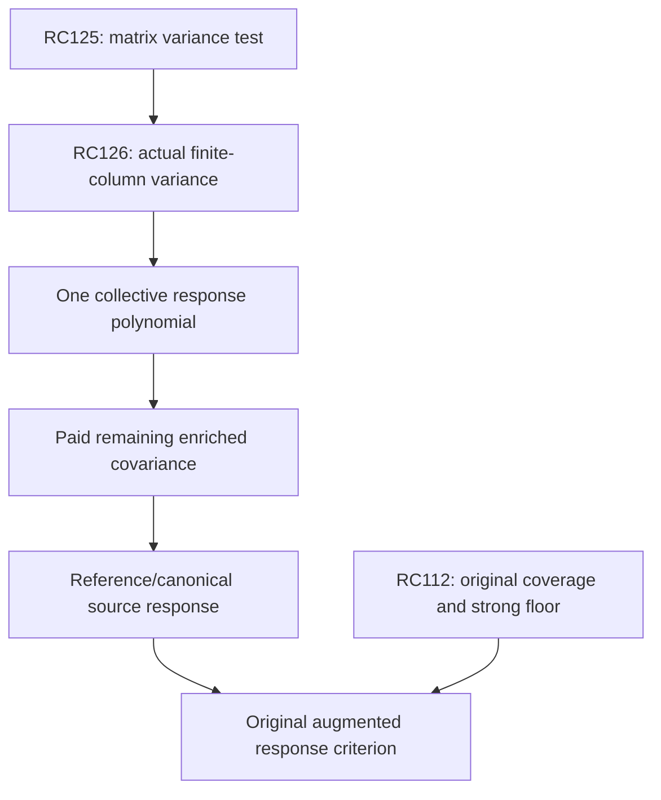

# RPB108 — RC126: actual finite-column variance and response enrichment

Date: 2026-10-12 UTC. Aperture: a=11/10. Branch: research/rpb108-route-consolidation. Starting checkpoint: RC125, commit c7d4bb66910dfad81f1da7b97e4afb2c10255179.

## Result and boundary

RC126 quantifies an actual coordinate of the coupling variance for the RC124 joint family V=[P_p,psi_0]. It proves that the current whole-family small-variance condition cannot meet high accuracy: its finite-column variance is at least 0.008542663843 of source D-energy in even parity and 0.010333778349 in odd parity. This is an actual endpoint covariance, not a pessimistic enclosure margin or a negative original Weil direction.

It then identifies that covariance's structure. One explicit response polynomial captures its entire finite part, rather than adding all constituent native degrees as separate directions. The leading analytic tail completes the even response exactly at the symbolic level. A three-column geometric correction handles the odd tail to a 10^-24 single-action norm target, with polynomial rounding and actual constant errors paid.

| Actual finite-column quantity, outward display | Even | Odd |
|---|---:|---:|
| Variance absolute lower | 0.071446685194269 | 0.036387002696838 |
| Variance absolute upper | 0.071446685194271 | 0.036387002696840 |
| Variance/source D-energy lower | 0.008542663843 | 0.010333778349 |
| Response polynomial degree | 988 | 1563 |
| Nonzero proposal coefficients | 494 | 781 |
| Rounded response polynomial squared D-error, upper | 6.050e-64 | 2.718e-64 |

The certificate stores every rational Legendre trial coefficient with its interval radius, a reproducible generator and a hash. No dense original Weil or canonical metric matrix is evaluated.

This closes only the finite source column's one-action covariance after enrichment. It does not compute the whole variance matrix, the analytic-tail column response, or a reference inverse response. Even a zero covariance row does not establish the full inverse response: internal coupling to other family vectors can subsequently reach their unresolved complement responses. All 39 tail columns and the original source family remain outside this small test certificate.

The original spectral count remains 10–639 below 0.01. No new positive native direction, original Weil positivity, Global/F4 or RH result is claimed.

## Actual operators and finite response split

Use the actual diagonal energy D=J+sI, where JP_n=H_nP_n and s=c_R+log2+789/125, with the inherited actual constant enclosure. The endpoint action C=D^-1h is a positive contraction in D energy. These are canonical-metric/reference objects; they are not A_Q, its effective head F, or its augmented inverse operator Hhat.

For p=0 even or p=1 odd, the exact endpoint coefficients give

\[
 CP_p=a_pP_p+f_p+\psi_0+\eta_p,
 \qquad a_p=d_p/(H_p+s),
\tag{1}
\]

where d_0=1-log2 and d_1=4/3-log2. Here the finite response polynomial is

\[
 f_p=\sum_{\substack{p<n\le M\\n\equiv p\ (2)}}
 \frac{2n+1}{(H_n+s)[n(n+1)-p(p+1)]}P_n,
\tag{2}
\]

and the remaining analytic tail has coefficients

\[
 (\eta_p)_n=(\psi_0)_n
 \frac{p(p+1)}{n(n+1)-p(p+1)}
 \quad(n>M\text{ in parity}).
\tag{3}
\]

Other coefficients vanish. For even parity eta_0=0. For odd parity eta_1 is positive and much smaller than psi_0. Equations (1)–(3) follow directly from the exact endpoint matrix; no inverse response or additional source identity is presumed.

The supports in D coordinates are disjoint: P_p, the modes of f_p, and all analytic tails are mutually D-orthogonal except for correlations among the tails themselves. This is a coefficient-support fact in the actual D metric. It is not an invariant spectral decomposition of C or of the original Weil operator.

## Actual projected variance

For the original two-vector family V=[P_p,psi_0], keep RC125's definitions

\[
 G=V^*DV,\quad H=V^*DCV,\quad
 R=(CV)^*D(CV)-HG^{-1}H.
\]

R is the Gram of the D-orthogonal residual outside that family. The projection of CP_p onto P_p removes a_pP_p. Its projection onto psi_0 removes the leading tail and the component of eta_p parallel to it. Thus

\[
 \boxed{R_{00}=\|f_p\|_D^2
 +\|\eta_p-\operatorname{proj}_{\psi_0}\eta_p\|_D^2.}
\tag{4}
\]

In even parity this is the exact finite identity

\[
 R_{00}=2B\sum_{\substack{2\le n\le M\\n\ even}}
 \frac{2n+1}{(H_n+s)[n(n+1)]^2}.
\tag{5}
\]

The mixed identity <P_0,h psi_0>=||psi_0||_D^2 from RC124 pays its full projected tail; no infinite second-moment summation is necessary for this entry.

In odd parity, let n_first be the first matching-parity index above M and rho=p(p+1)/[n_first(n_first+1)]. Since rho<1,

\[
 \|f_p\|_D^2\le R_{00}\le
 \|f_p\|_D^2+\left[\frac\rho{1-\rho}\right]^2G_{\psi,upper}.
\tag{6}
\]

The upper chooses a trial tail projection coefficient rather than claiming it optimal; orthogonal projection can only reduce that tail norm. The lower and upper finite sum use the actual s upper and lower. Harmonic sums are exact rationals, and each accepted summand is rounded outward. The odd correction is below 2.5e-20 in absolute squared energy; it is paid despite being invisible in the displayed decimal.

Normalizing the lower in (4) by the source G_00 upper yields the actual variance fractions in the first table. Consequently R<=epsilon G is impossible for this whole two-vector family whenever epsilon is below the stated coordinate lower. This rejects the small-variance hypothesis at high accuracy on the present family. It does not prove that its reference response is inaccurate by that fraction, nor that an enlarged family has the same variance.

A coordinate lower R_00>=r is not a full Loewner inequality R>=diag(r,0): unresolved mixed covariance prevents that inference. The certificate explicitly retains this distinction. R_01 and R_11 are not evaluated.

## One response polynomial instead of many native directions

The exact f_p in (2) is one vector containing all 494 even or 781 odd response coefficients. Enlarging the reference family by this vector captures the finite residual collectively; it does not require proving each constituent original native direction positive.

For even parity, the exact symbolic family span{P_0,psi_0,f_0} contains CP_0. The corresponding exact projected covariance has zero P_0 row and column. C psi_0 still leaves every fixed polynomial-plus-existing-tail span by RC123; the whole family is not invariant. Thus this closes one response column, not the full inverse-response obligation.

The numerical trial is a rational polynomial f_hat. The script encloses each coefficient of f_p using

\[
 \frac{2n+1}{(H_n+s_{upper})(z_n-z_p)}
 \le(f_p)_n\le
 \frac{2n+1}{(H_n+s_{lower})(z_n-z_p)},
\]

takes a 10^-50 rounded center, and pays its radius. Physical Legendre orthogonality gives

\[
 \|f_p-f_{hat}\|_D^2\le
 \sum_n\frac{2B}{2n+1}(H_n+s_{upper})\,radius_n^2.
\tag{7}
\]

This produces the error bounds in the table. The stored rounded polynomial does not give exact zero variance; its small residual is paid. The exact symbolic response enrichment and the rounded implemented trial are distinct.

These physical response polynomials are auxiliary source-representation vectors. In particular the odd degree 1563 exceeds the degree range one might associate with the old finite native cutoff, and neither trial is asserted to belong to the original canonical Riesz head. No inherited original complementary floor is automatically transferred to a decomposition involving these vectors.

## Odd analytic correction and paid enrichment budgets

Keep the RC122 tail columns psi_k, with lambda=N(N+1), N=781 in odd parity (and N=494 even). Equation (3) has the geometric expansion

\[
 \eta_p=\sum_{k=1}^{\infty}
 \left[\frac{p(p+1)}\lambda\right]^k\psi_k.
\tag{8}
\]

This converges in D energy. After K retained correction columns,

\[
 \left\|\eta_p-\sum_{k=1}^K
       [p(p+1)/\lambda]^k\psi_k\right\|_D^2
 \le\frac{\rho^{2(K+1)}}{(1-\rho)^2}G_{\psi,upper}.
\tag{9}
\]

Because the coefficient-rounding residual in f_hat has finite support and the analytic remainder has tail support, their D energies add without a triangle cross term. Let the enriched span contain P_p, psi_0, f_hat and psi_1 through psi_K. Its projected finite-column variance is at most the sum of (7) and (9). Projection may further reduce it; no projection inverse or analytic-tail Gram conditioning is required for this sufficient upper.

| Relative one-action D-norm target | Additional even tail columns | Additional odd tail columns |
|---|---:|---:|
| 10^-6 | 0 | 0 |
| 10^-12 | 0 | 1 |
| 10^-24 | 0 | 3 |

These are sufficient ranks for the derived residual enclosure, not optimal enrichment dimensions. The source P_p D-energy lower is used when normalizing. At the 10^-24 target the certificate's relative squared covariance upper is 10^-63 even and 2.074338e-57 odd, including the finite polynomial/constant uncertainty. The broad upward rounding in the even display is deliberate.

The analytic correction columns are exact energy vectors with the inherited actual constant; their numerical pairings and full joint Gram still need certification before a complete response calculation. This table is a finite-column residual/variance certificate, not a 10^-24 inverse response, a whole operator action bound, or a completed enriched-source solver.

## Decision and next minimum estimate

The proposed high-accuracy small-variance test fails for the current whole joint family for an actual structural reason: CP_p has a nonzero collective finite response. That obstruction is removable by the single polynomial f_p, rather than hundreds of separately certified directions. The even symbolic column then closes, and the odd column has an inexpensive geometric tail correction.

What remains is the analytic-tail response and the covariance/coupling of the new family vectors. In the ideal even family the P_0 covariance row is zero, but unresolved complement covariance in other rows can still influence the P_0 inverse response through internal family coupling. It is invalid to use a zero/small one-column residual as a complete Schur matrix certificate.

The next minimal new operator estimate is the actual joint response/covariance for psi_0 and the response polynomial, including their mixed pairings; in odd parity the chosen additional tail columns must be included. Alternatively, a signed second-moment/resolvent inequality controlling that residual family would suffice. More rounding precision on R_00 will not settle those missing rows.

| Obligation | Standing after RC126 | Next datum |
|---|---|---|
| Original coverage and strong floor | RC112 inherited W_639 floor; count 10–639 | Original exceptional completion or smaller original exclusion |
| Canonical metric conditioning | RC121 global diagonal equivalence | None for conditioning itself |
| Actual finite-column covariance | Quantified, not tiny on old family | Collective response polynomial supplied |
| Enriched finite-column residual | Exact symbolic even closure; paid rounded/odd tail bound | Full enriched correlations |
| Analytic-tail variance and responses | Still open | C psi_0, C f_hat or equivalent joint moments |
| High-accuracy reference inverse | Not completed | Full matrix variance/response certificate |
| Regular and original source actions | Not evaluated for required family | Paid arithmetic actions and augmented responses |
| Original positivity | Not established | Original auxiliary response below one or replacement theorem |

The original completion condition remains Hhat=A_Q+T_Weil^*T_Weil>=eta I and T_Weil Hhat^-1T_Weil^*<=theta I with theta<1. The D-energy endpoint covariance here cannot substitute for original Weil source leakage, an original exceptional matrix, or the effective head F. The 1,250-feature head remains an auxiliary original proof cutoff rather than a mandatory dense canonical metric evaluation.



Local positivity at a=1.10, Global/F4's separate original first-contact exclusion and RH remain distinct obligations.

## Reproduction and evidence classification

Inputs in order: RC125, RC124, RC122, RC56. Hash linkage is checked. The validator stores every response polynomial Legendre coefficient interval and its SHA-256, accepts exact finite harmonic variance sums with outward rounding, pays the odd projected-tail upper, and computes enrichment budgets with the exact geometric ratio. No numerical eigenvalue or sampled quadrature acceptance is used.

```bash
python scripts/validate_rpb108_rc126_finite_response_variance.py \
 --output certificates/rpb108_rc126_finite_response_variance.json \
 certificates/rpb108_rc125_sharp_first_moment_variance.json \
 certificates/rpb108_rc124_actual_joint_endpoint_moment.json \
 certificates/rpb108_rc122_signed_endpoint_tail_compression.json \
 certificates/rpb108_rc56_precision_attached_head.json
```

Repeat with --replay. Replay independently rebuilds the harmonic table and sums the finite coefficient-energy budgets in reverse order, comparing the complete coefficient-rich certificate. The inherited helper scripts must be alongside the validator.

**Certified facts:** actual finite-column covariance lower/upper, failure of a high-accuracy whole-family small-variance target on the old span, response polynomial construction, paid finite-column enrichment error. **Conditional:** full reference completion after remaining covariance; original positivity after its independent response criterion. **Exploratory:** whether the unresolved response family has a small or compressible covariance. **Not performed:** full R, analytic-tail action, enriched inverse response, regular or original augmented actions. **Unsupported:** replacing full matrix covariance with a coordinate bound, identifying response polynomials as original spectral modes, or concluding inverse accuracy from a single-action residual. Only additive RC files are committed; Lean and unrelated branches remain untouched.
